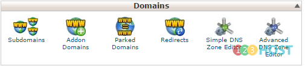
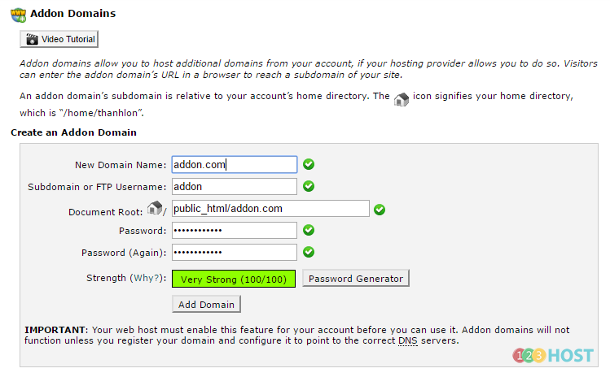

cPanel cho phép chúng ta có thể tạo các tên miền phụ cũng như các các domain chạy song song hoặc độc lập với domain chính của hosting. Bài viết dưới đây sẽ hướng dẫn các bạn tạo các domain như trên.

\_ Đăng nhập cPanel

\_ Mục Domains

\+ Addon Domains: Tên miền khác chạy độc lập với domain chính của hosting, tức là một hosting có thể có hai, ba… website chạy chung với nhau tùy thuộc vào gói hosting bạn lựa chọn.

Ta điền vào tên miền trong New Domain Name, Password, còn lại tự động cPanel sẽ điền (còn nếu muốn theo ý mình, bạn có thể thay đổi) -\> Add Domain.

Sau đó bạn chỉ việc trỏ domain về IP hosting, upload source code là có thể chạy được
