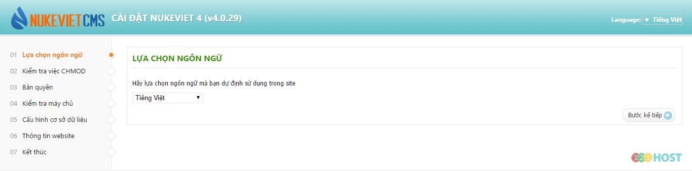
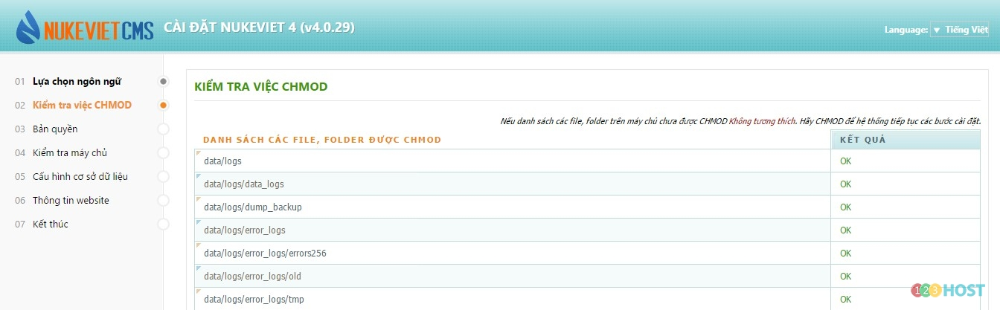
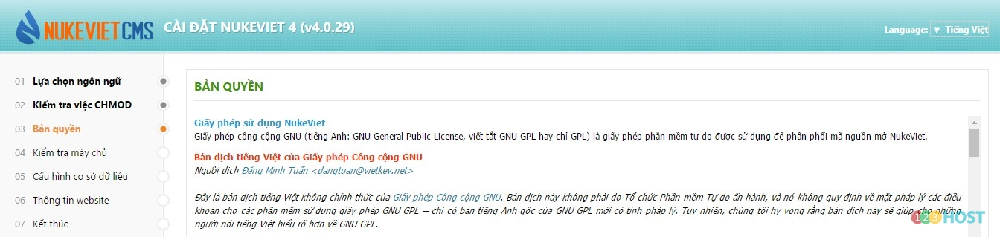
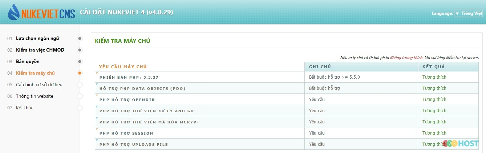
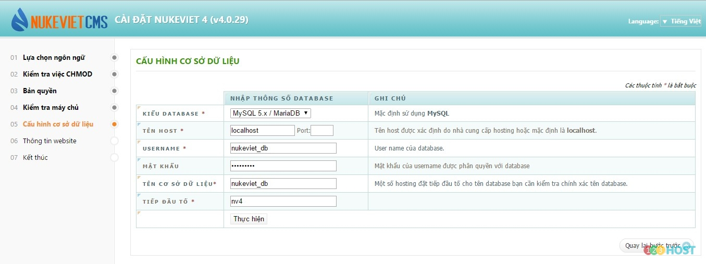
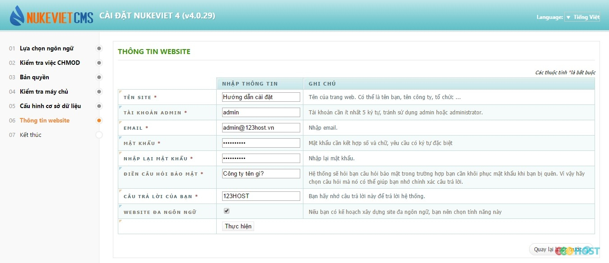
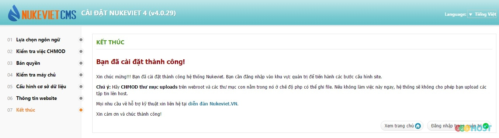

Chào các Bạn,

Kỹ thuật xin hướng dẫn cài đặt NuKeViet 4.x

CHMOD cho các thư mục, tập tin cần thiết

Trên hosting linux, bạn cần phải CHMOD 777 cho các thư mục, tập tin được yêu cầu. Bạn có thể bỏ qua bước này, song đến bước 3 (bên dưới) bạn phải cấu hình FTP để hệ thống tự động CHMOD. Danh sách các file, thư mục cần CHMOD:

/assets /data (và các thư mục bên trong) /uploads (và các thư mục bên trong) /.htaccess Tiến hành cài đặt

Bước 1: Truy cập domain trong lần đầu, hệ thống sẽ tự động chuyển đến trang cài đặt. Bước 2: Chọn ngôn ngữ giao diện cài đặt. Nhấn “Bước kế tiếp” để sang bước tiếp theo.

Bước 3: Hệ thống thực hiện việc kiểm tra chmod cho các thư mục, file cần thiết. Nếu báo lỗi ở thư mục, file nào, bạn cần kiểm tra lại. Chon“Bước kết tiếp” để sang trang tiếp theo.

Bước 4: Thông tin về bản quyền. Bạn có thể đọc kỹ để hiểu rõ hơn về bản quyền NukeViet, tránh các rắc rối về pháp lý về sau. Click “Bước kế tiếp” để tiếp tục.

Bước 5: Kiểm tra mức độ tương thích giữa máy chủ với NukeViet. Nếu gặp lỗi cảnh báo nào, vui lòng liên hệ với nhà cung cấp để giải quyết.

Bước 6: Kết nối CSDL. Khai báo các thông số kết nối với CSDL rỗng đã tạo ra ở các bước thực hiện với hosting. Click “Thực hiện” để tiếp tục.

Bước 7: Điền thông tin website. Nhấn “Thực hiện” để hoàn tất quá trình cài đặt.

Và đây là kết quả, bạn có thể đi đến trang quản trị hoặc trang chủ CMS NukeViet

