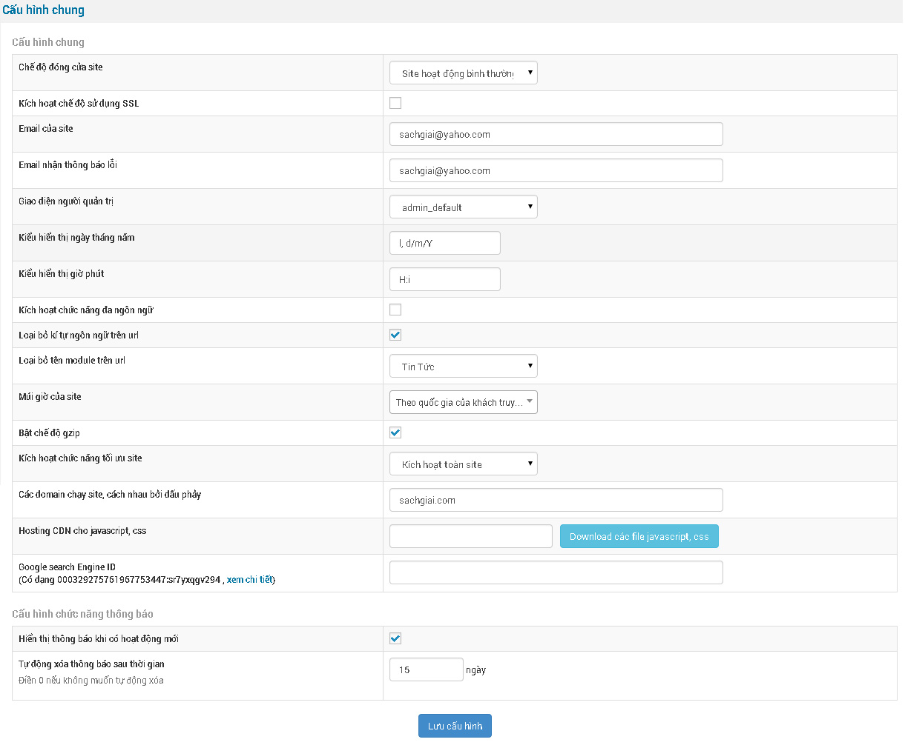
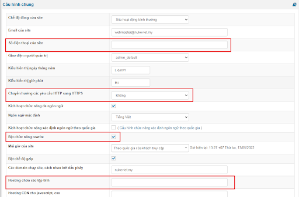
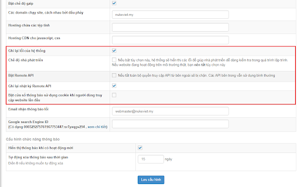
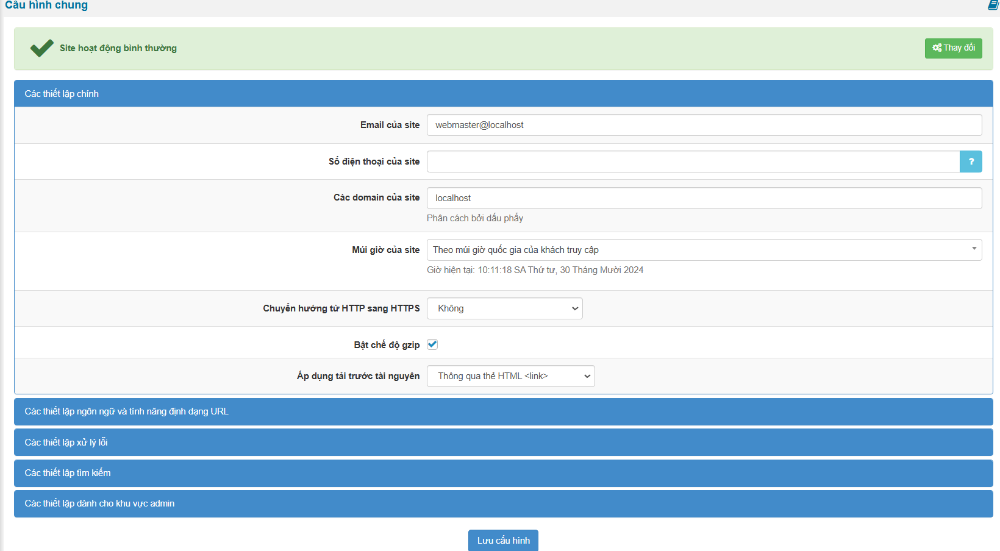

Cấu hình chung cho trang web của bạn, chi tiết các phần như sau:

1\. Chế độ đóng cửa site: có 4 chế độ để bạn lựa chọn

\- Site hoạt động bình thường

\- Đóng cửa site chỉ có Quản trị tối cao truy cập

\- Đóng cửa site Người điều hành chung truy cập

\- Đóng cửa site Tất cả admin truy cập

2\. Kích hoạt chế độ sử dụng SSL: Nếu trang web của bạn có sử dụng SSL (https) thì đánh dấu vào lựa chọn này.

3\. Email của site: Địa chỉ thư trên trang web của bạn

4\. Email nhận thông báo lỗi: Địa chỉ thư nhận thông báo lỗi (hệ thống gửi thư cho bạn khi có lỗi)

5\. Giao diện người quản trị: Lựa chọn giao diện trang quản trị mà bạn thích

6\. Kiểu hiển thị ngày tháng năm : d/m/y (ngày/tháng/năm)

7\. Kiểu hiển thị giờ phút: H:i (giờ/phút)

8\. Kích hoạt chức năng đa ngôn ngữ : Nếu trang web có hai ngôn ngữ trở lên thì đánh dấu vào lựa chọn này

9\. Loại bỏ kí tự ngôn ngữ trên url : Bỏ tên ngôn ngữ trên liên kết. Nếu bạn đánh dấu vào mục này thì sẽ hiện tiếp theo mục 9.1

9.1. Loại bỏ tên module trên url : Chọn module mà bạn muốn loại bỏ tên ngôn ngữ trên liên kết

11\. Múi giờ của site: Chọn múi giờ bạn muốn

12\. Bật chế độ gzip : Bật chế độ nén cho trang web của bạn

13\. Kích hoạt chức năng tối ưu site : có 4 mục lựa chọn:

\- Không kích hoạt

\- Kích hoạt cho toàn site

\- Kích hoạt khu vực ngoài site

\- Kích hoạt khu vực admin

*Lưu ý: Nếu bạn đặt quảng cáo Google Adsense thì chọn: Không kích hoạt*

14\. Các domain chạy site, cách nhau bởi dấu phảy : Bạn có nhiều tên miền chạy cùng một trang web thì hãy nhập các tên miền đó vào đây, phân cách nhau bởi dấu phẩy (,)

15\. Hosting CDN cho javascript, css: Các file javascript, css cho hosting CDN

16\. Google search Engine ID: Nếu bạn có ID google cusmtom search thì điền nó vào đây

17\. Hiển thị thông báo khi có hoạt động mới: Nếu bạn muốn hiển thị thông báo thì bấm vào đây

18\. Tự động xóa thông báo sau thời gian: chọn số ngày tự động xoá thông báo

**Phiên bản NukeViet 4.5.01:**

- Không còn tùy chọn “Kích hoạt chế độ sử dụng SSL”, “Kích hoạt chức năng tối ưu site”.

- Có thêm nội dung:

- Số điện thoại của site

- Chuyển hướng các yêu cầu HTTP sang HTTPS

- Bật chức năng rewrite

- Hosting chứa các tệp tĩnh

- Ghi lại lỗi của hệ thống

- Chế độ nhà phát triển: nếu bật tùy chọn này, hệ thống sẽ hiển thị các lỗi để giúp nhà phát triển dễ dàng kiểm tra trong quá trình lập trình.

- Bật Remote API: nếu tắt, toàn bộ quyền truy cập API từ bên ngoài sẽ bị chặn, các API bên trong vẫn sử dụng bình thường

- Ghi lại nhật ký Remote API

- Bật cửa sổ thông báo sử dụng cookie khi người dùng truy cập website lần đầu

**Phiên bản NukeViet 4.6.0**

- Giao diện thay đổi thành Panel

