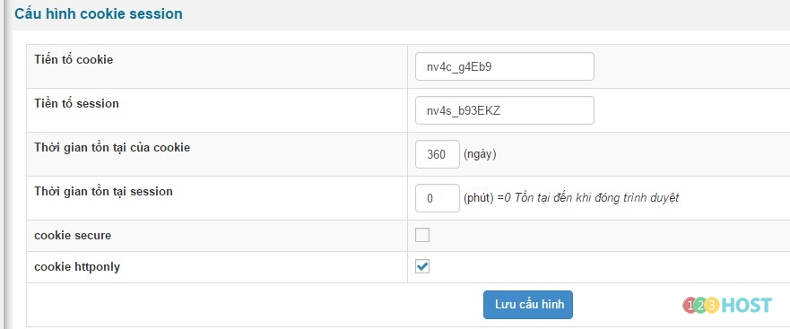
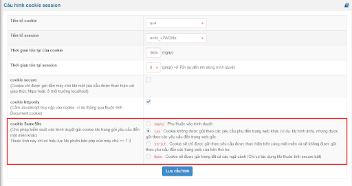
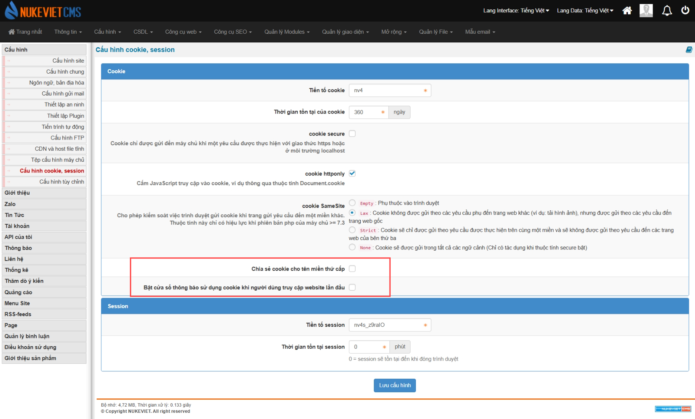

Đăng nhập khu vực quản trị với quyền quản trị tối cao (ACP) / Cấu hình / Cấu hình cookie session

Giúp quy định thời gian lưu cookie cải thiện tình trạng load site, nên áp dụng với site ít cập nhật về dữ liệu(không liên tục)

Phiên bản 4.5.01 có thêm **cookie Samesite**: Cho phép kiểm soát việc trình duyệt gửi cookie khi trang gửi yêu cầu đến một miền khác. Thuộc tính này chỉ có hiệu lực khi phiên bản PHP của máy chủ \>= 7.3

- Giao diện thay đổi
- Có thêm nút *‘Chia sẻ cookie cho tên miền thứ cấp’* và *‘Bật cửa sổ thông báo sử dụng cookie khi người dùng truy cập website lần đầu’*

