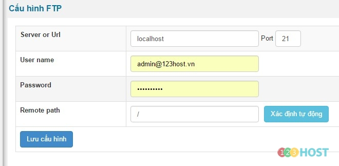

Đăng nhập khu vực quản trị với quyền quản trị tối cao **(ACP) / Cấu hình / Cấu hình FTP**

Sever or URL: domain hoặc IP máy chủ

Port: Cổng giao tiếp, mặc định 21

Username: Tên truy cập FTP

Password: Mật khẩu truy cập FTP

Remote path: Đường dẫn đến thư mục gốc chứa site (nhấn xác định tự động để hệ thống kết nối)

Lưu file.
