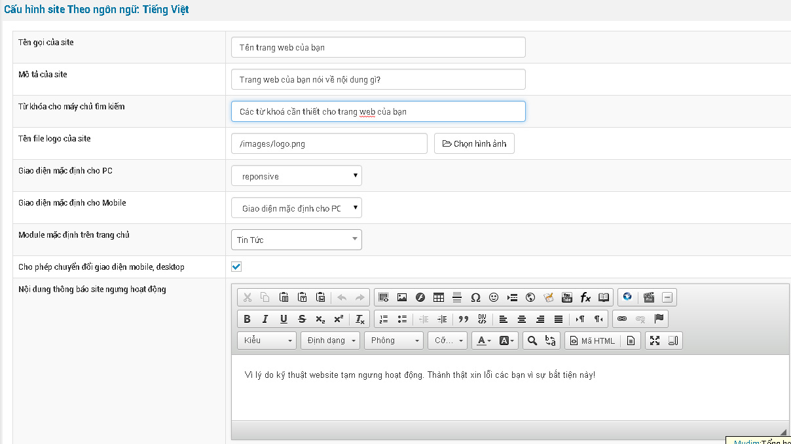
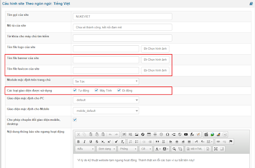
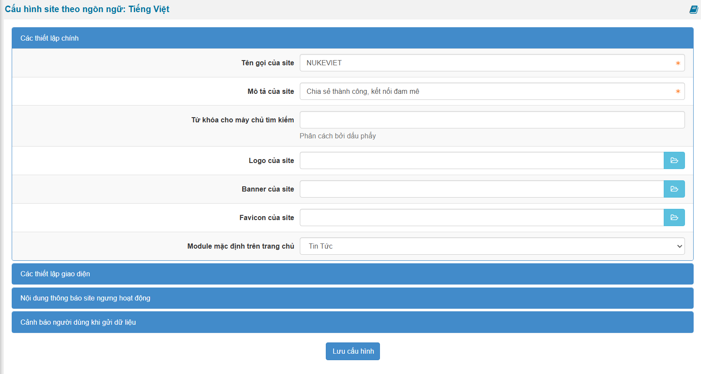

**Tên gọi của site:** Tên trang web của bạn

**Mô tả của site:** Trang web của bạn nói về nội dung gì?

**Từ khóa cho máy chủ tìm kiếm:** Các từ khoá cần thiết cho trang web của bạn, gõ càng nhiều càng tốt và mỗi từ khoá cách nhau bởi dấu phẩy.

**Tên file logo của site:** Là tên file hình đại diện cho trang web của bạn.

**Giao diện mặc định site:** Chọn giao diện bạn muốn hiển thị mặt định khi khách truy cập

**Module mặc định trên trang chủ:** Là module hiển thị đầu tiên khi trang web của bạn được mở.

**Nội dung thông báo site ngưng hoạt động:** Bạn muốn hiển thị nội dung thông báo như thế nào khi tạm ngừng hoạt động của trang web thì ghi vào đây.

**Phiên bản NukeViet 4.5.01:**

- Có thêm tùy chọn file banner và file favicon của site: tên file ảnh bìa và URL liên kết tới 1 trang web cụ thể.

- Cho biết “Các loại giao diện được sử dụng”: bao gồm giao diện tự động, giao diện máy tính và giao diện di động → cho phép người dùng linh hoạt thay đổi giao diện trên nhiều thiết bị.

**Phiên bản NukeViet 4.6.0**

- Giao diện thay đổi thành Panel

