**Bước 1:** Truy cập trang quản trị của NukeViet.

**Bước 2:** Truy cập vào mục Cấu hình trên thanh Menu.

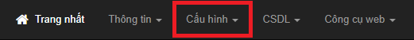

**Bước 3:** Trong mục Cấu hình, chọn Cấu hình gửi mail.

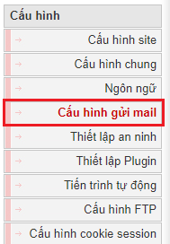

**Bước 4:** Trong mục Cấu hình gửi mail, chọn SMTP trong mục Lựa chọn phương thức.

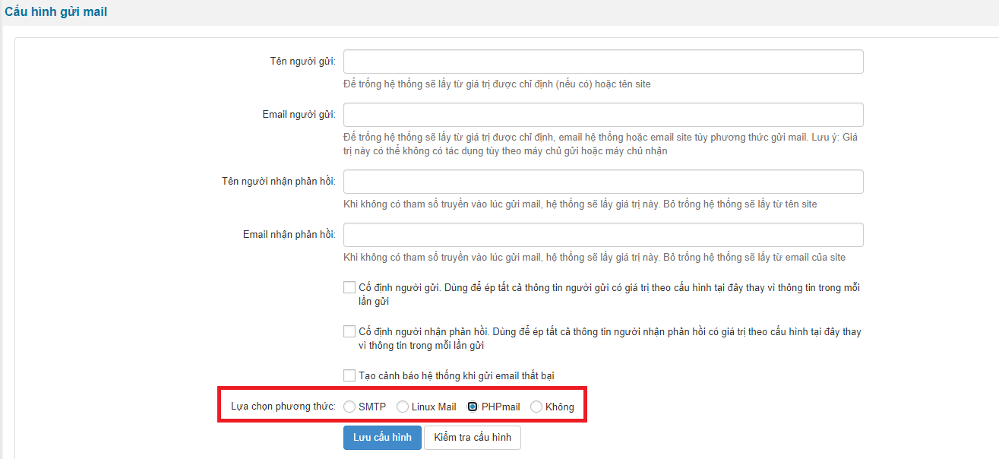

Sau khi chọn SMTP thì sẽ hiện ra một menu để người dùng tiến hành cấu hình.

- Máy chủ (SMTP) Thư Gửi đi: mặc định là smtp.gmail.com bạn để nguyên
- Cổng gửi mail: sử dụng cổng 465
- Sử dụng Xác thực: sử dụng SSL
- SSL verify peer và SSL verify name peer: xác thực SSL: chọn Không
- Tên Tài khoản: là tài khoản mail mà bạn vừa sử dụng đăng nhập tạo xác thực 2 lớp và mật khẩu ứng dụng ở trên.
- Mật khẩu: là mật khẩu ứng dụng bạn tạo ra ở trên.

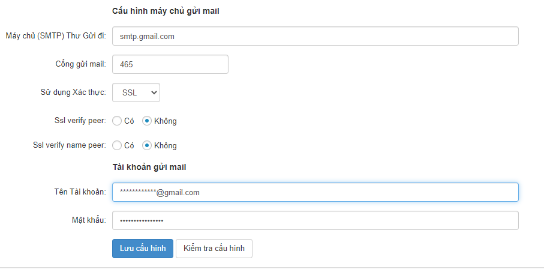

**Bước 5:** Sau khi hoàn thành cấu hình thì tiến hành bấm lưu cấu hình. Chọn trên menu trái mục Tài khoản.

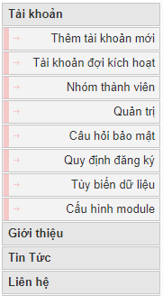

Sửa địa chỉ email của tài khoản quản trị tối cao sang địa chỉ email ở trên để hoàn tất việc cấu hình SMTP.

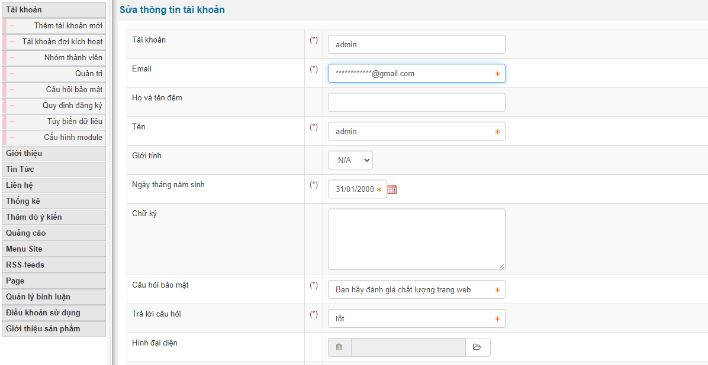

Sau khi hoàn tất, tiến hành truy cập từ menu bên trái mục Liên hệ -\> Gửi phản hồi. Tiến hành nhập tiêu đề, email nhận(nên là email của người cài đặt để kiểm tra tính năng) và nội dung, sau đó bấm gửi phản hồi để kiểm tra hoạt động của SMTP.

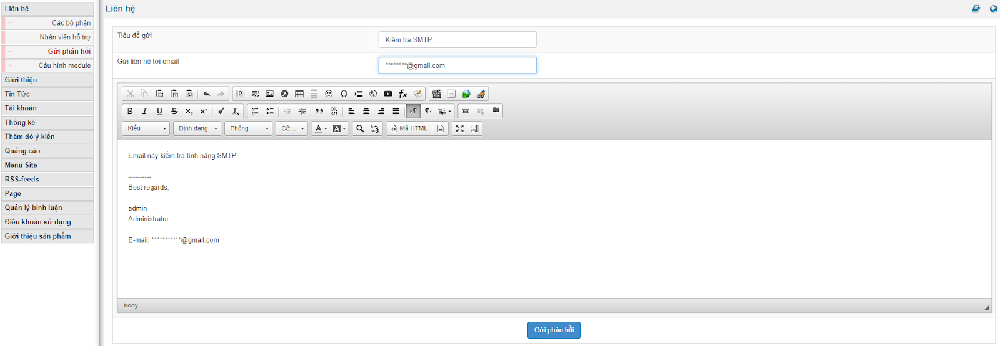

Sau đó kiểm tra email. Khi xuất hiện email như dưới thì đã hoàn thành cấu hình SMTP cho NukeViet.

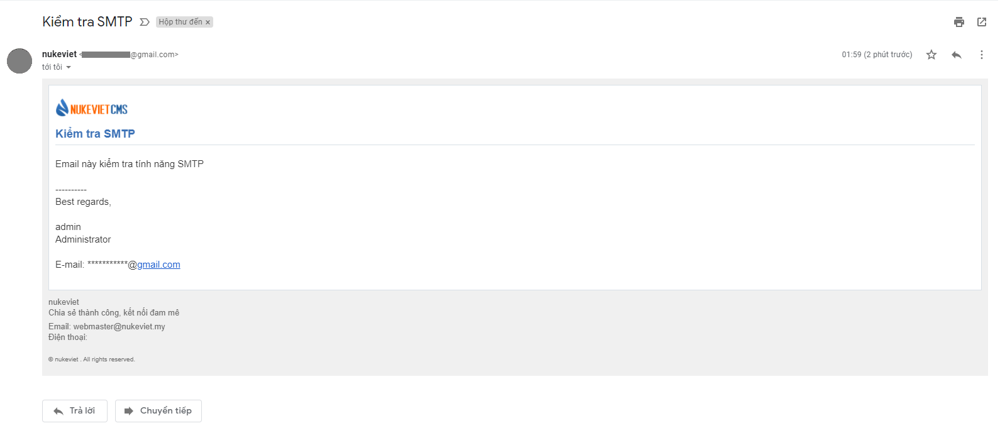

Phiên bản NukeViet 4.5.01 - 4.5.06 có thêm lựa chọn “Gửi kèm chữ ký số DKIM (nếu có) khi dùng phương thức” và “Gửi kèm chữ ký số DKIM (nếu có) khi dùng phương thức”

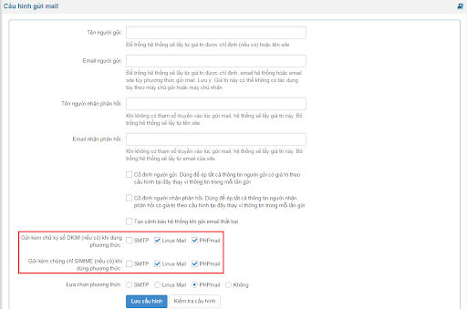

**Phiên bản NukeViet 4.5.06**

- Giao diện “ Chữ ký số của miền gửi thư DKIM” và “Chứng chỉ chữ ký email S/MIME” đã được thay đổi thành panel

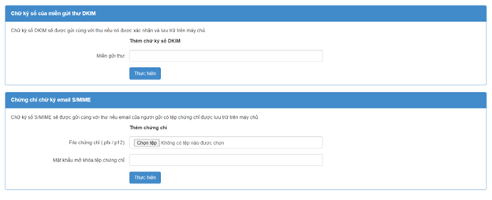

\- Chữ ký số DKIM sẽ được gửi cùng với thư nếu nó được xác nhận và lưu trữ trên máy chủ. Tại trường “Miền gửi thư” thêm chữ ký số DKIM rồi ấn thực hiện. - Chữ ký số S/MIME sẽ được gửi cùng với thư nếu email của người gửi có tệp chứng chỉ được lưu trữ trên máy chủ. Tại trường File chứng chỉ (.pfx /.p12), thêm chứng chỉ có đuôi .pfx hoặc .p12 rồi điền mật khẩu mở khóa chứng chỉ và ấn thực hiện.

\*\* Phiên bản NukeViet 4.6.0\*\*

- Việc xác thực bảo mật đổi tên từ *‘sử dụng xác thực’* sang *‘loại bảo mật’* và chuyển từ kiểu dropbox đổi thành checkbox

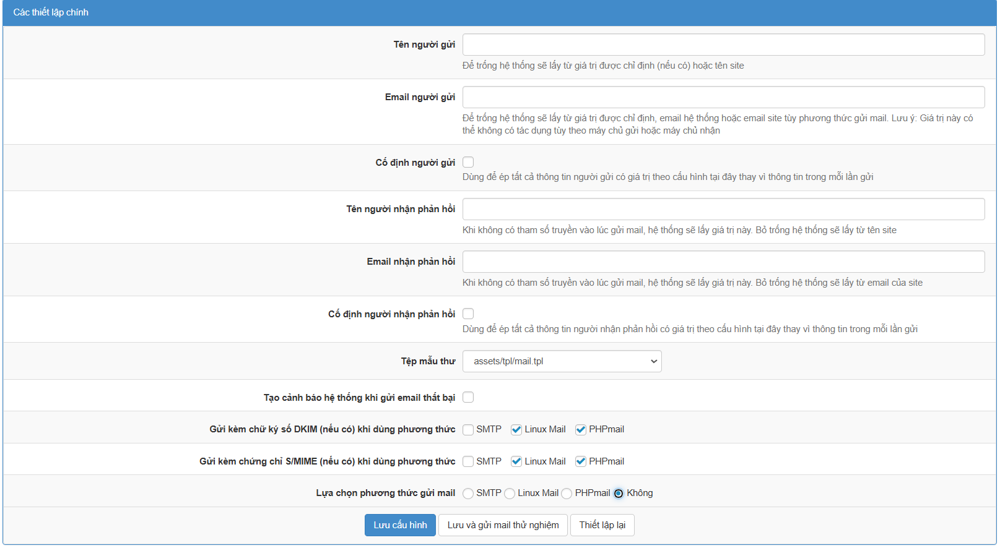

- Lựa chọn phương thức gửi mail là SMTP sẽ xuất hiện giao diện sau

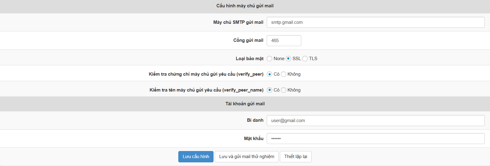
