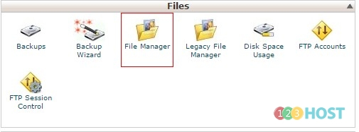
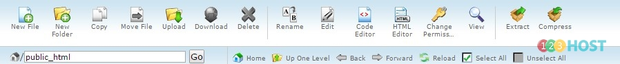

Chào các Bạn,

Mình xin giới thiệu chức năng File Manager của Cpanel.

Bước 1: Đăng nhập Cpanel --\> Mục Files --\> Chọn Công cụ File Manager

Bước 2: Tại đây các bạn có thể thực hiện các thao tác:

1\. Tạo file mới

2\. Tạo thư mục mới

3\. Copy file

4\. Di chuyển file - thư mục đến vị trí khac

5\. Up code lên host để sử dụng

6\. Tải file chọn về máy

7\. Xóa file chọn

8\. Đổi tên file - thư mục chọn

9\. Chỉnh sửa file đã chọn

10\. Chỉnh sửa hoặc xem file theo dạng hiển thị dễ nhìn hơn với code editor

11\. Hoặc xem chỉnh file dạng HTML editor

12\. Thay đổi quyền cho file - thư mục (chmod)

13\. Xem file

14\. Nén hoặc giải nén file - thư mục chọn

