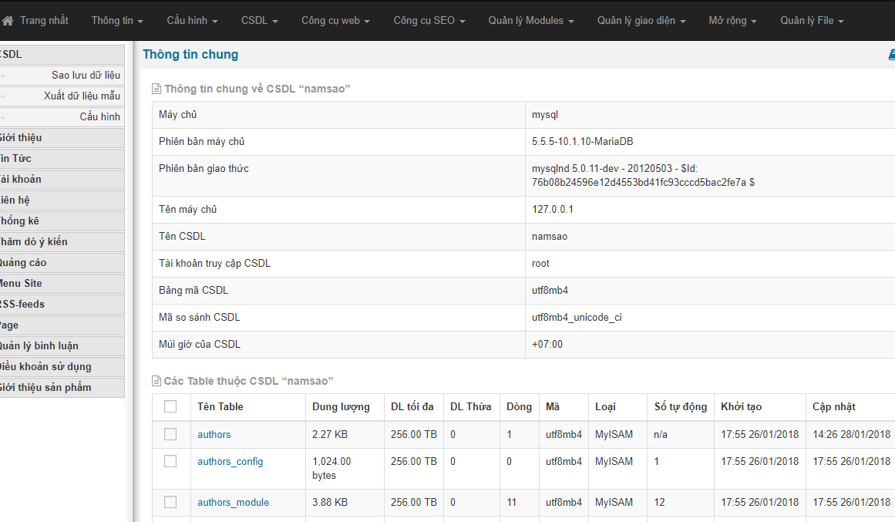
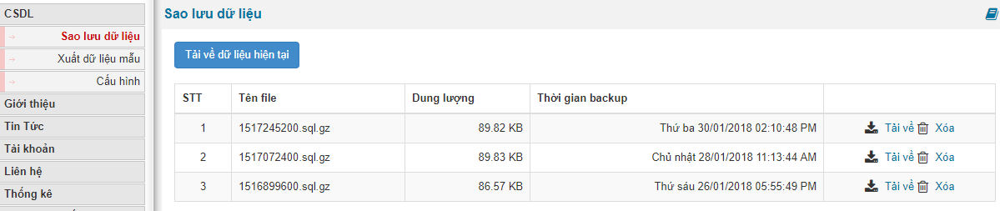
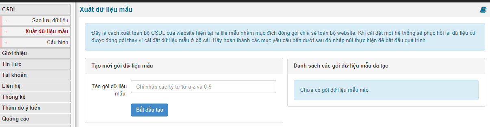
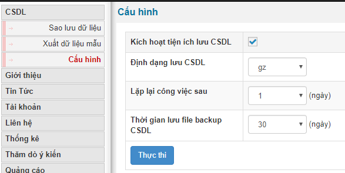

Quản trị csdl là một phần khá quan trọng trong quán trình quản lý 1 website

Quản trị csdl dùng vào các mục đích sau

- Tạo bản sao lưu csdl để tránh bị mất mát lỗi khi vận hành website
- Bản sao lưu có thể quay về các thời điểm mà bạn muốn
- Có thể khô phục lại csdl cũ khi website bị tấn công
- Nhân bản nội dung website để cài đặt cho một website mới

Khi bạn truy cập CSDL thì bạn sẽ có ngay danh sách các bản trong database và tùy chọ tải về csdl ngay cuối danh sách

Ở phần Sao lưu csdl bạn sẽ có các file csdl cho phép bạn tải về, những file này sẽ được tạo tự động từ hệ thống

Xuất dữ liệu mẫu: xuất dữ liệu mẫu cho phép bạn tạo ra file csdl dùng trong việc cài đặt một site mới chỉ lấy nội dung mà không lấy các thông số của site cũ

Cấu hình csdl: việc cấu hình csdl giúp chúng ta có thể tạo ra các bản backup csdl theo thời gian thực giúp bạn có được csdl của từng thời điểm khi website đăng bài

