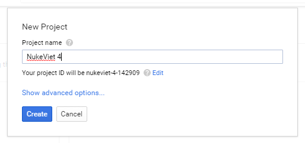
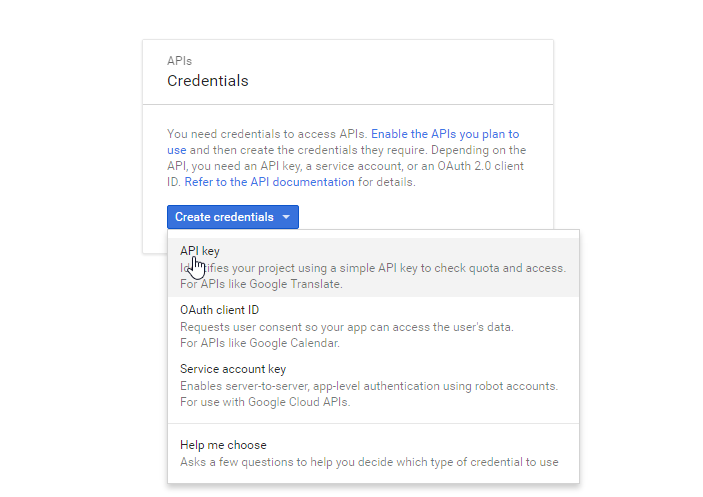
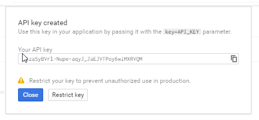

Để sử dụng google map API, google bắt buộc người dùng phải cung cấp giá trị API Key, bài viết này hướng dẫn tạo một Google Project để lấy API key.

Truy cập [https://console.developers.google.com](https://console.developers.google.com) sau đó nhấp nút **Creat project**, tại hộp thoại **New Project** điền vào tên project tùy ý sau đó nhấp nút Creat.

# Kích hoạt Google Map Javascript API

Sau khi Project được tạo thành công, nhấp chọn Tab Library, nhập tìm kiếm từ khóa **Google Maps JavaScript API** hoặc tại danh sách **Popular APIs** trong nhóm **Google Maps APIs** tìm thấy **Google Maps JavaScript API**.

Nhấp chọn **Google Maps JavaScript API** và ấn **ENABLE**

# Lấy API key

Nhấp chọn menu **Credentials** sau đó nhấp Create credentials và chọn API key:

Tại hộp thoại hiện ra giá trị API Key chính là giá trị cần lấy để đưa vào cấu hình block.

