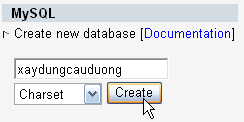
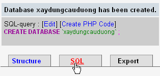
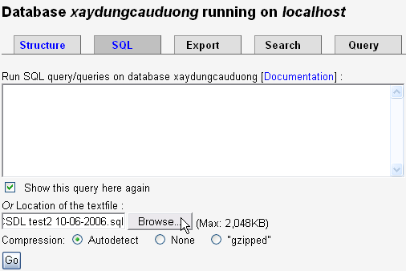
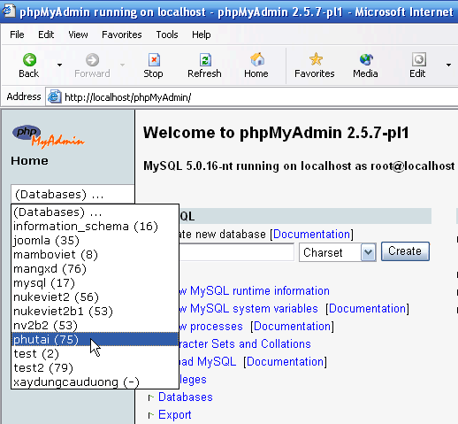
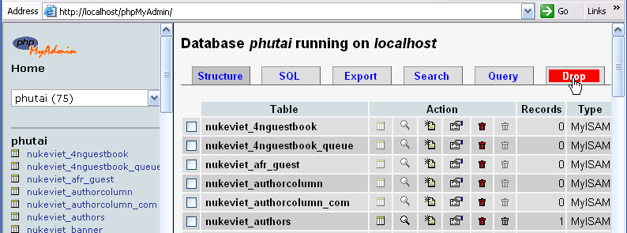
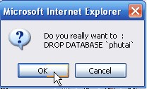
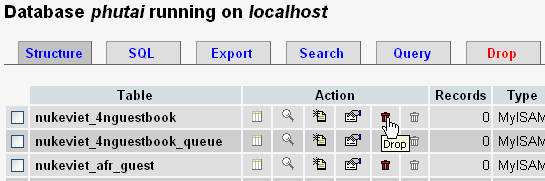
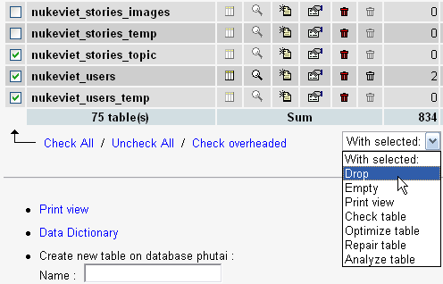
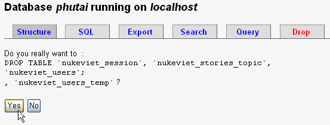

Thông thường, hosting sẽ có sẵn các dịch vụ Backup và Restore, bạn có thể sử dụng chúng. Mục này sẽ thiên về khía cạnh sử dụng PHP Admin trên cơ sở Localhost.

## Backup CSDL

Đầu tiên, để tạo file Backup, bạn đăng nhập vào Admin Control Panel: [http://localhost/home/admin/admin.php](http://localhost/home/admin/admin.php) , nhấp vào mục Lưu dữ liệu. Trong giây lát, trình duyệt sẽ đề nghị bạn tải file “Sao luu CSDL tencsdl ngay-thang-nam.sql” về, bạn lưu file này vào ổ cứng để sau này nếu site gặp sự cố, giả sử bị hacker xóa hết dữ liệu thì có thể phục hồi lại nhờ file này. (chi tiết xem thêm hướng dẫn 1.1 Lưu dữ liệu có trong Phần 4, Mục V)

**Chú ý:** file dữ liệu (SQL) không bao gồm hình ảnh, việc sao lưu file SQL luôn phải đi kèm với việc sao lưu các dữ liệu tĩnh trên host (ảnh, file …) nhờ công cụ Backup của Hosting. Biện pháp tốt nhất là sao lưu CSDL mỗi tuần (trên host) và mỗi tháng một lần, tiến hành tải CSDL cùng các dữ liệu khác từ máy chủ về máy tính cá nhân

## Restore CSDL

Giả sử bạn cần phục hồi CSDL, hãy tiến hành các bước sau:

Bước 1: Vào PHPMyAdmin theo địa chỉ: [http://localhost/phpMyAdmin/](http://localhost/phpMyAdmin/)

Bước 2: Tạo CSDL rỗng với tên của CSDL cũ, ví dụ xaydungcauduong (xem hình 1).

Bước 3: Nhấp vào link SQL của CSDL vừa tạo (xem hình 2)

- Tại cửa sổ Import CSDL (xem hình 3), bạn có 2 cách để nhập vào CSDL.

- Cách thứ nhất: Đưa thẳng nội dung SQL vào bảng nhập liệu.

- Cách thứ hai: Import bằng file SQL.

- Nếu dùng cách thứ 2, bạn hãy nhấp nút Browse để dẫn đến file SQL vừa Backup. Nhấp Go để bắt đầu quá trình. Trong thời gian ngắn, dữ liệu sẽ được phục hồi.

- Bây giờ hãy truy cập vào Web của bạn. Thật kỳ diệu, dữ liệu được phục hồi nguyên vẹn (cho đến thời điểm bạn sao lưu).

## Drop (hủy) CSDL

Để hủy toàn bộ CSDL trên localhost hoặc một phần (hủy một số table – bảng) bạn thực hiện theo các bước sau:

- Truy cập vào PHPMy Admin theo địa chỉ: [http://localhost/phpMyAdmin/](http://localhost/phpMyAdmin/), chọn CSDL cần xử lý (xem hình 4)

- Nhấn nút Drop nếu muốn hủy toàn bộ CSDL (xem hình 5)

- Nhấn OK để đồng ý (xem hình 6).

- Nếu mốn hủy 1 table trong CSDL thì nhấn biểu tượng thùng rác cùng hàng với table đó (xem hình 7) .

- Nếu muốn hủy nhiều table trong CSDL thì chọn table đó rồi chọn tùy chọn “With selected” là “Drop” (xem hình 8).

- Nhấn YES để đồng ý (xem hình 9).

## Xử lý lỗi khi Restore

- Nếu xảy ra lỗi Font, nguyên nhân là do bảng mã (Charset) của CSDL mới không đúng với bảng mã của CSDL cũ. Khi đó bạn cần khai báo bảng mã của CSDL mới tạo cho phù hợp.

- Nếu quá trình Import SQL báo lỗi dạng:

Code:

MySQL said:

\#1064 - You have an error in your SQL syntax; check the manual that corresponds to your MySQL server version for the right syntax to use near '#»¿CREATE TABLE nukeviet_4nguestbook (

id int(9) NOT NULL au

Nguyên nhân là do trong file SQL có chứa 3 ký tự BOM đầu file, hãy dùng EmEditor để loại bỏ nó. Sau đó thực hiện Import lại là hết lỗi.
