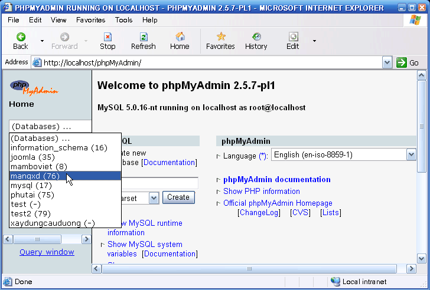
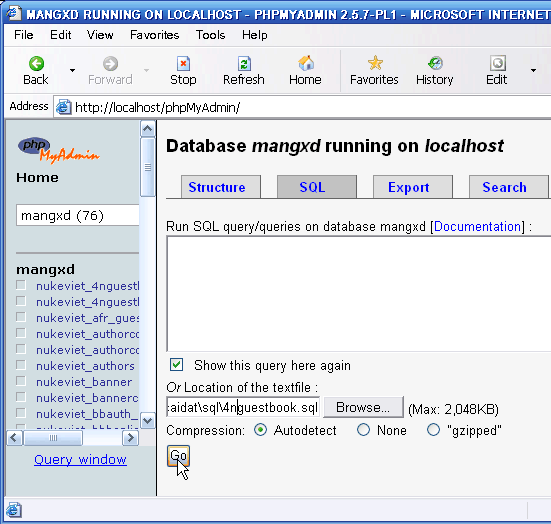

Trong quá trình cài đặt, đôi khi chạy file setup không thành công. Khi đó chúng ta có thể khắc phục bằng cách nhập (import) nội dung file SQL vào CSDL (được cung cấp kèm trong bộ cài mỗi Module, Block). Các bước thực hiện như sau:

Bước 1: Từ của sổ trình duyệt, truy cập đến địa chỉ: [http://localhost/phpMyAdmin/](http://localhost/phpMyAdmin/).

Bước 2: Chọn CSDL mà bạn cần import nội dung file SQL vào (xem hình 1).

Bước 3: Nhấp vào link SQL trên cửa sổ trình bày CSDL, bạn sẽ được đưa tới trang chèn dữ liệu. Nhấp Browse để chỉ đến file SQL cần nhập vào CSDL. Nhấp Go để tiến hành nhập nội dung file SQL vào CSDL (xem hình 2).

Chờ trong giây lát, nếu quá nhập file vào CSDL thành công bạn sẽ nhận được thông báo: “Your SQL-query has been executed successfully”. Như vậy bạn đã import xong file SQL vào CSDL
