Chào các Bạn,

Mình xin hướng dẫn cách Backup và Restore bằng MysqlDumper.

**I. Cài đặt**

Bước1: Cần cài đặt MysqlDumper

Link Download: [http://sourceforge.net/projects/mysqldumper](http://sourceforge.net/projects/mysqldumper)

Sau khi tải về các bạn giải nén ra sau đó đổi tên cho dễ nhớ và nén lại thành file .zip (trong ví dụ này mình đổi thành mysqldum.zip)

Bước 2: Up file nén vào trong thư mục /public_html/ , sau khi up giải nén ra được thư mục mysqldum thuộc đường dẫn: /public_html/mysqldum

Bước3: di chuyển vào trong thư mục msqldum, chmod 777 cho file config.php.

Bước4: Tạo thêm thư mục

Work

work/backup

work/log

work/config

Lưu ý: đường dẫn như sau:

/public_html/mysql/work

/public_html/mysql/work /backup

/public_html/mysql/work/log

/public_html/mysql/work/config

Bước 5: chmod 777 cho các thư mục đó:

Work

work/backup

work/log

work/config

Bước5: Sau khi xong tiến hành cái đặt với link sau:

[http://domain.com/mysqldum/install.php](http://domain.com/mysqldum/install.php) (thay tên miền + đường dẫn thư mục như bạn đã tạo)

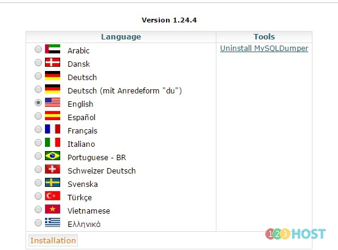

Bước 6: Điền thông tin kết nối đến database

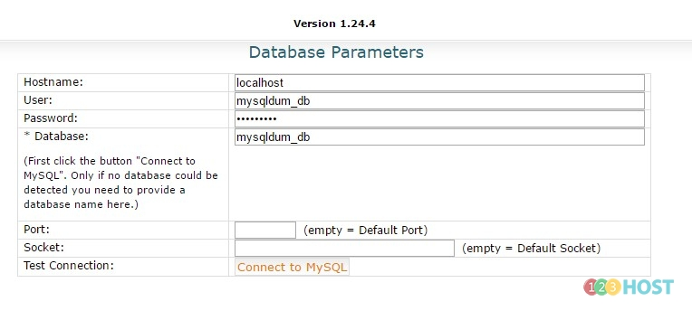

Bước 7: Sua khi thành công sẽ có giao diện như sau:

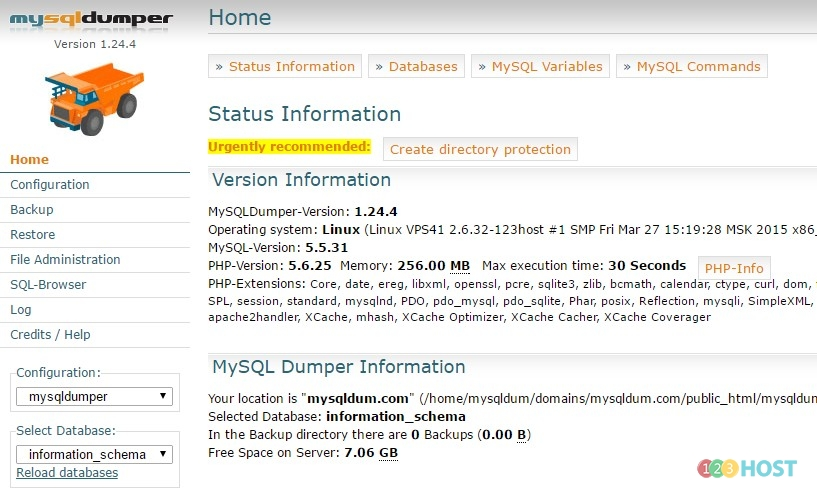

**II. Backup**

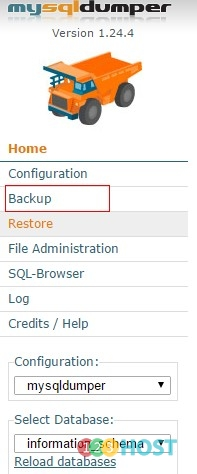

Lưu ý: Chọn data cần backup ở mục: select Database

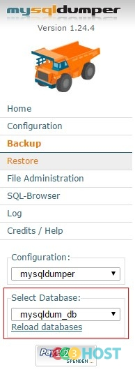

Chọn start New Backup

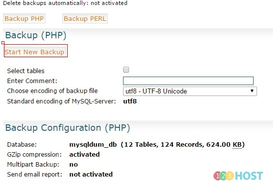 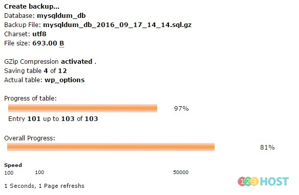

Chọn Continue

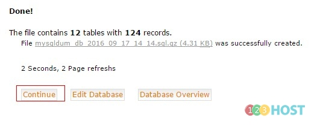

Backup thành công.

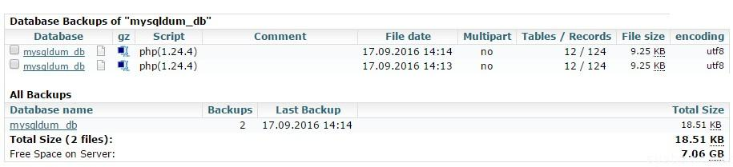

**III. Restore**

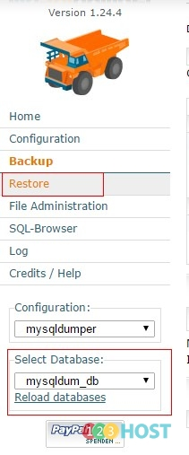

Chọn Restore hoặc restore theo bảng

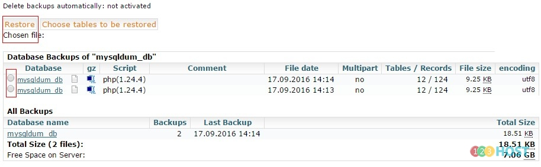

Chọn tất cả bảng và restore

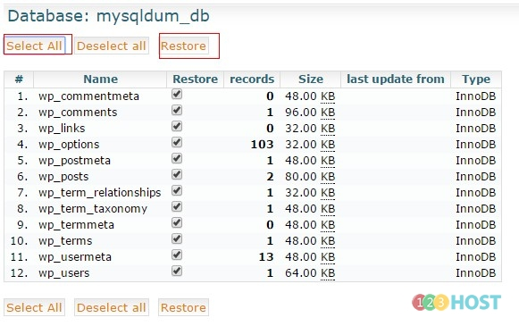

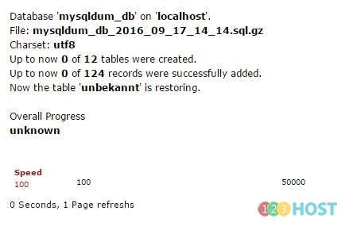
