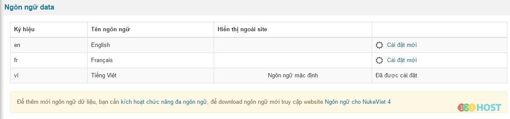
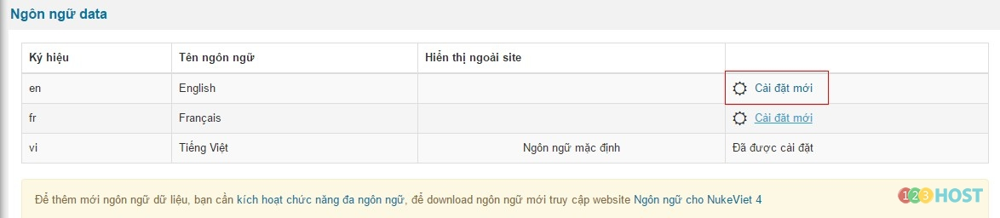
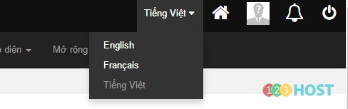
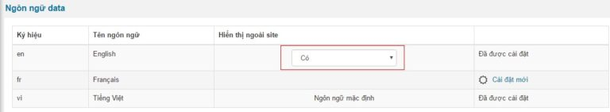

Đăng nhập khu vực quản trị với quyền quản trị tối cao **(ACP)/Cấu hình/Ngôn ngữ/Ngôn ngữ data**

Lưu ý: Để thêm một ngôn ngữ mới trước hết phải cho phép hệ thống sử dụng đa ngôn ngữ. Nếu việc này chưa được thực hiện, hệ thống sẽ thông báo. Truy cập **Cấu hình/Cấu hình chung** để Kích hoạt chức năng đa ngôn ngữ. Sau khi kích họat, bạn hãy quay trở lại khu vực này để tiếp tục việc thêm một ngôn ngữ mới.

NukeViet 4 tích hợp sẵn ba ngôn ngữ là Việt, Anh và Pháp, bạn có thể thấy danh sách này sau khi cài đặt NukeViet 4, tùy vào ngôn ngữ bạn sử dụng khi cài đặt NukeViet 4, ngôn ngữ dữ liệu sẽ được cài đặt mặc định tương ứng. Ví dụ trong trường hợp mình chọn Tiếng việt trong qúa trình cài đặt, thì tiếng việt cũng sẽ là ngôn ngữ được kích họat mặc định.

 Bước 1: Trên danh sách Ngôn ngữ data, click Cài đặt mới với tên ngôn ngữ tương ứng.

Bước 2: Sau khi click, bạn sẽ được chuyển đến trang quản lý của ngôn ngữ vừa cài đặt. Lúc này, bạn hãy tiến hành cấu hình lại cho ngôn ngữ này, việc cấu hình cho ngôn ngữ này sẽ độc lập với ngôn ngữ trước đó, nên công việc này được xem như bạn đang thiết lập cho một website mới. Bạn có thể chuyển đổi giữa hai ngôn ngữ qua hộp chọn này.

Bước 3: Ngay sau khi cấu hình thành công, bạn đã có thể truy cập ngôn ngữ mới bằng cách thêm ký hiệu ngôn ngữ sau domain. htttp://domain.com/en/. Một vấn đề khác, sau khi cấu hình xong ngôn ngữ thì chắc hẳn bạn phải nghĩ đến việc hiển thị danh sách ngôn ngữ ra bên ngoài để người dùng chọn lấy ngôn ngữ họ muốn xem. Tại danh sách ngôn ngữ dữ liệu, chọn Hiển thị ngoài site là Có 
