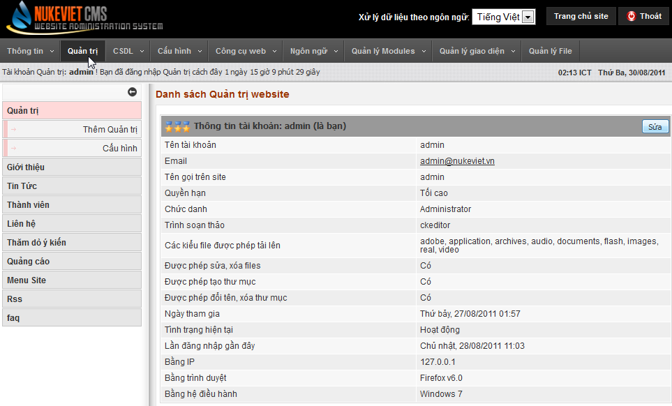
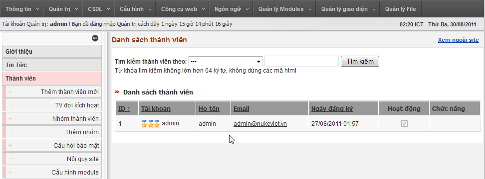
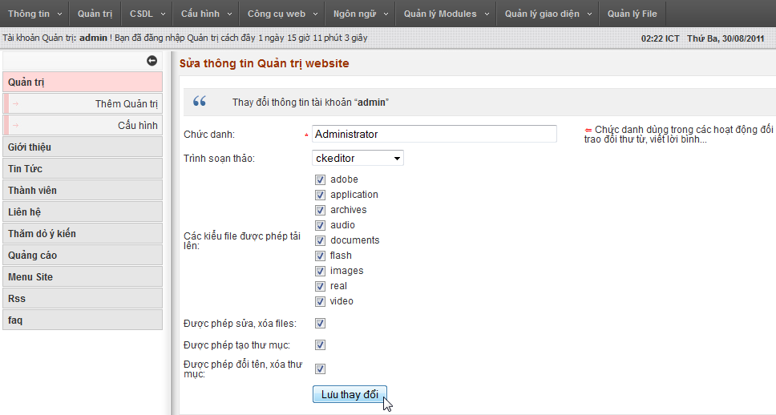
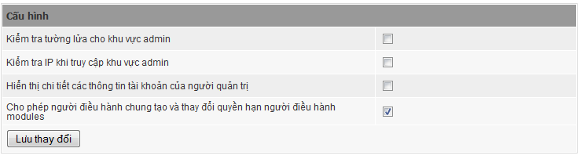
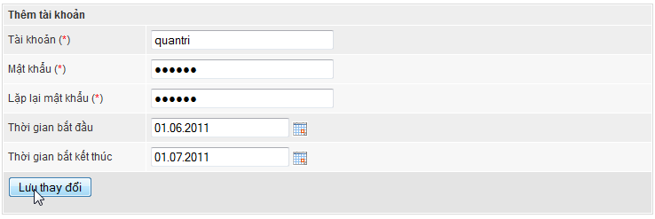

## Giới thiệu về hệ thống quản trị của nukeviet

NukeViet cho phép phân quyền đa chức năng với nhiều cấp. Ở mức độ người quản trị, hệ thống cho phép phân thành các quyền:

- Quyền tối cao (chỉ dành cho người đầu tiên cài đặt website).
- Quyền điều hành chung (Được quản lý toàn bộ site nhưng không được can thiệp vào các chức năng có khả năng hủy hoại hoàn toàn site.
- Quyền điều hành module: Chỉ được quản lý trong phạm vi module.

### Thêm/Sửa Quản trị website

- Chọn link Thêm quản trị để thêm một quản trị vào site. Hệ thống đòi hỏi phải chọn từ một thành viên trong hệ thống do đó nó sẽ chuyển sang trang danh sách thành viên để bạn chọn người quản trị từ đây.

- Chúng ta cũng có thể sửa thông tin của người quản trị bằng nút “Sửa”. Nó cho phép thiết lập lại các quyền hạn của người quản trị.

### Cấu hình phần quản trị

- Phần này giúp bạn thiết lập phần quản trị, kể cả an ninh, bảo mật trong phần quản trị. Các nội dung thiết lập như ảnh sau:

- Chúng ta cũng có thể thêm tài khoản tường lửa nhằm bảo vệ khu vực quản trị:
- Nếu bạn thường xuyên đăng nhập Admin Control Panel từ một địa chỉ IP hoặc một dải IP nhất định, hãy bật thiết lập này để đảm bảo chỉ có những người sử dụng IP đó mới có quyền truy cập Admin Control Panel.

