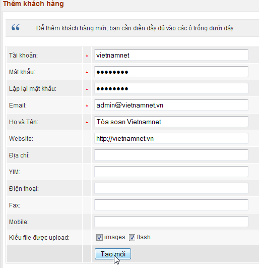
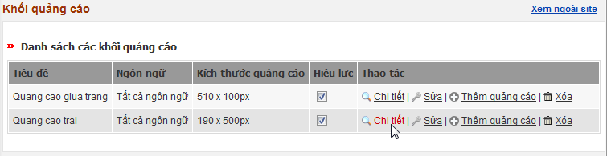
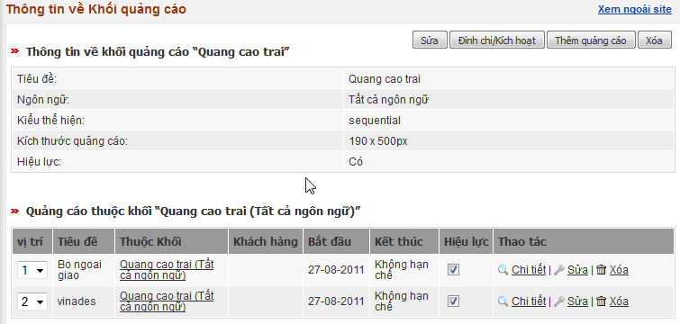
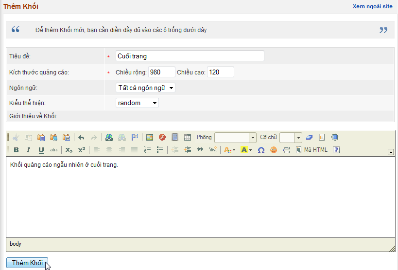
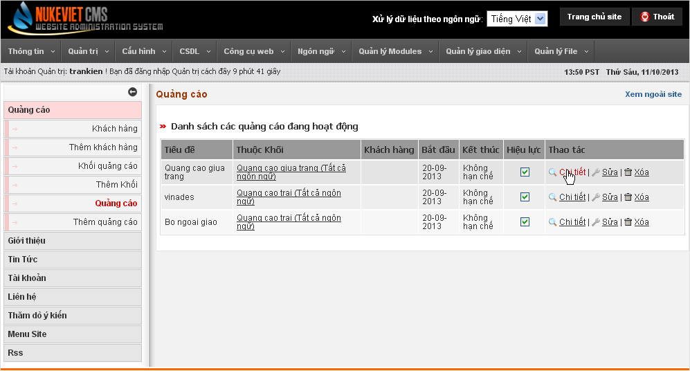
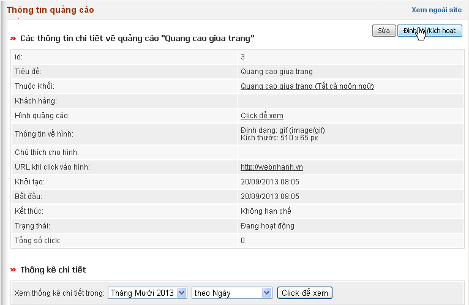
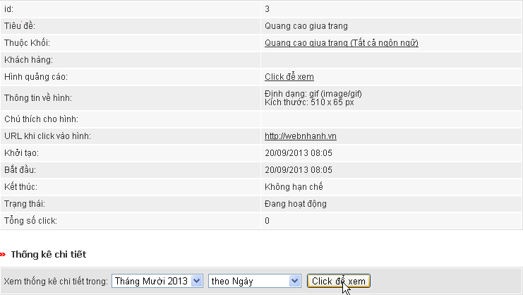
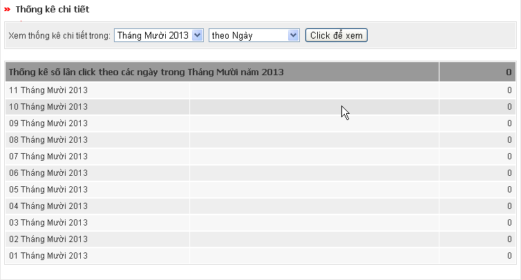
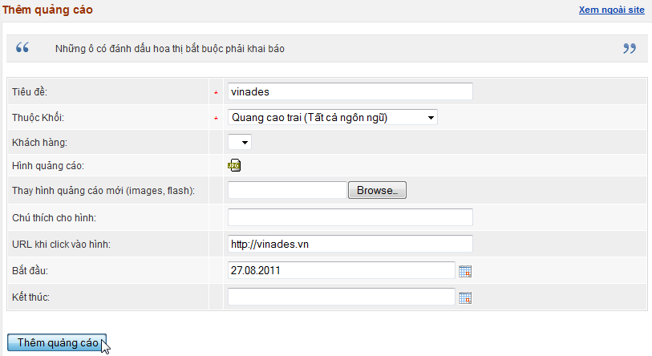

### Khách hàng

Chức năng này cho phép quản lý khách hàng đăng hàng quảng cáo trên site. Với module này, khách hàng không nhất thiết phải là thành viên của site mà họ được cấp tài khoản riêng để theo dõi các quảng cáo của mình.

### Thêm khách hàng

### Khối quảng cáo

Chức năng này dùng để định dạng các khối quảng cáo, cho phép ta xem chi tiết, sửa lại khối quảng cáo  

### Thêm Khối

### Quảng Cáo

Chức năng này dung để quản lý các quảng cáo, cho ta xem chi tiết và sửa lại các quảng cáo đã đăng lên  Ta còn có thể ngưng hoạt động quảng cáo  Xem thống kê chi tiết số lượng người click vào quảng cáo trong 1 ngày  

### Thêm quảng cáo

### Đưa quảng cáo lên website

Để đưa quảng cáo hiển thị lên website, bạn cần định nghĩa các khu vực quảng cáo thông qua các block. Bằng cách thêm block quảng cáo vào vị trí thích hợp, quảng cáo sẽ tự động hiển thị tại vị trí quy định. Xem [Cách thêm block](/nukeviet/admin/themes/blocks) để biết chi tiết cách thêm.
