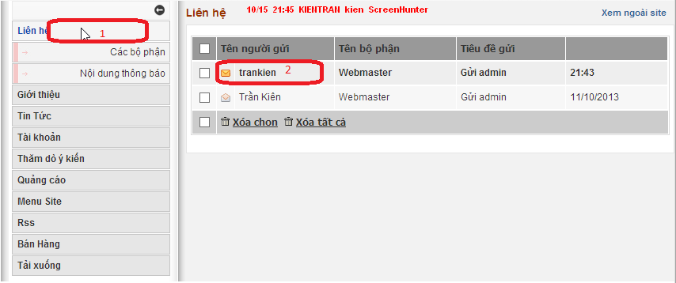
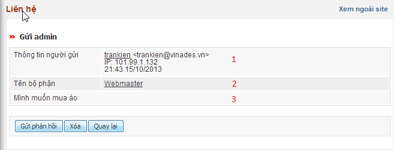
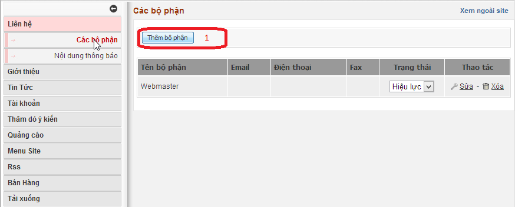
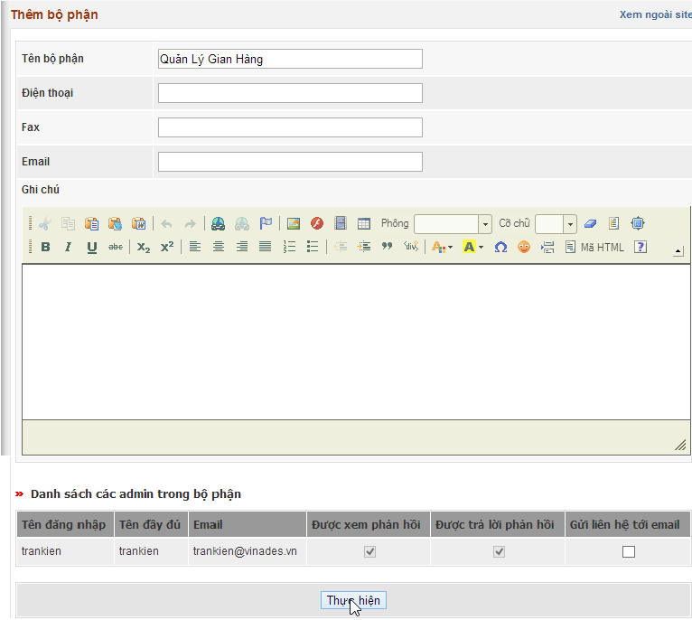
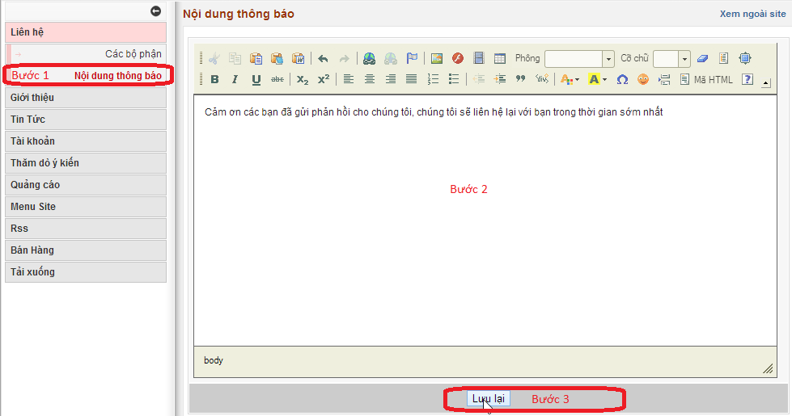

### Quản lý các liên hệ gửi tới

Đây là chức năng giúp ta có thể nhận thư phản hồi của người dùng

Xem liên hệ gửi tới:

Bước 1: Click vào module Liên hệ

Bước 2: Click vào thư chưa đọc ( Những thư sáng là những thư chưa đọc)

Ở hàng ngang số 1: Là chi tiết về thông tin mà người dùng gửi

Ở hàng ngang số 2: Là tên những bộ phận mà người dùng liên hệ

Ở hàng ngang số 3: Là nội dung người dùng liên hệ

Ở dưới ta cũng có 3 tùy chọn là: Gửi phản hồi, xóa , quay lại

### Quản lý các bộ phận

Chức năng này giúp ta thêm, sửa, xóa các bộ phận nhận phản hồi ý kiến của người dùng. Giúp cho việc phân quyền quản lý tiếp nhận thông tin được thuận tiện hơn.

Truy cập: Admin Control Panel =\> Liên hệ =\> Quản lý các bộ phận

Các chức năng có tại đây:

1.  Thêm bộ phận mới.
2.  Sửa, xóa, ngưng hiệu lực bộ phận cũ.

#### Thêm bộ phận mới

Tại trang quản lý bộ phận phụ trách liên hệ, nhấp link "Thêm bộ phận mới", form thêm bộ phận liên hệ mới hiện ra như hình dưới đây:

Bạn điền đầy đủ các thông tin sau đó phân quyền cho người được quản lý bằng cách đánh dấu cấp quyền tương ứng. Cuối cùng nhấp nút "Thực hiện" để thêm.

### Nội dung thông báo trên trang liên hệ

Nội dung thông báo sẽ hiện ra khi người dùng liên hệ với chúng ta. Để soạn nội dung thông báo, ta làm theo các bước sau:

Bước 1: Click vào chức năng Nội dung thông báo

Bước 2: Soạn nội dung thông báo

Bước 3: Lưu lại
