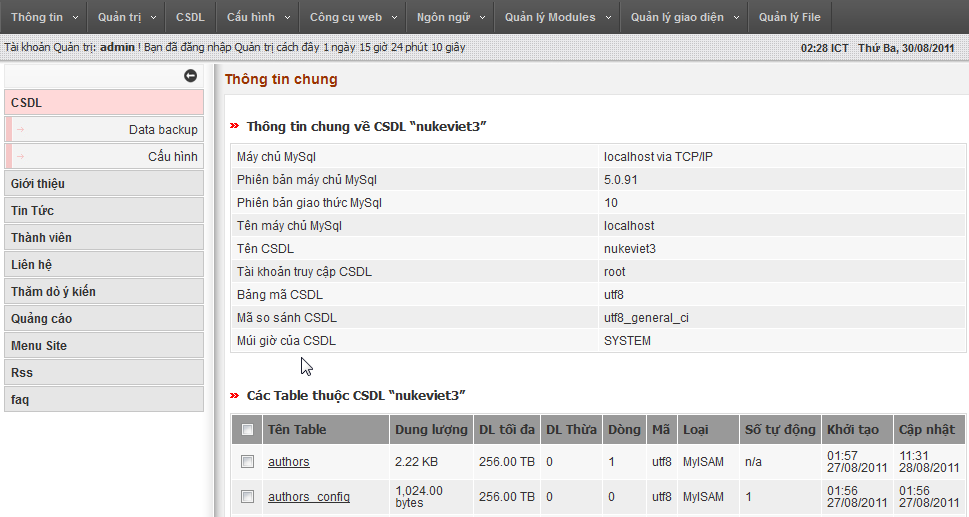
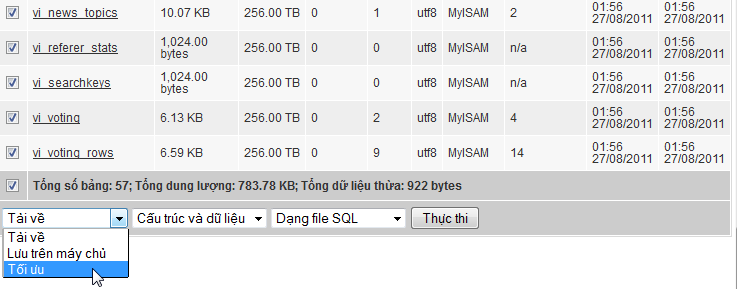
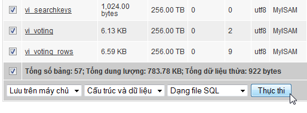
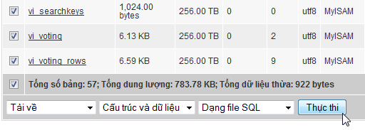
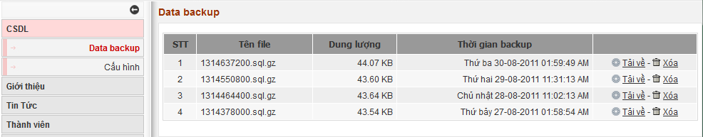
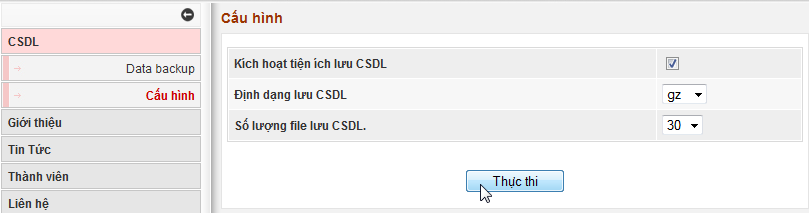

## Giới thiệu chung về quản trị cơ sở dữ liệu

Phần này giúp bạn quản lý cơ sở dữ liệu của site mà chủ yếu là chức năng sao lưu cơ sở dữ liệu sẽ hay được sử dụng. 

## Hướng dẫn tối ưu hóa cơ sở dữ liệu

## Hướng dẫn lưu cơ sở dữ liệu

## Hướng dẫn tải về

## Data backup

Chúng ta có thể tải về hoặc xóa các cơ sở dữ liệu đã backup từ đây. 

## Cấu hình

