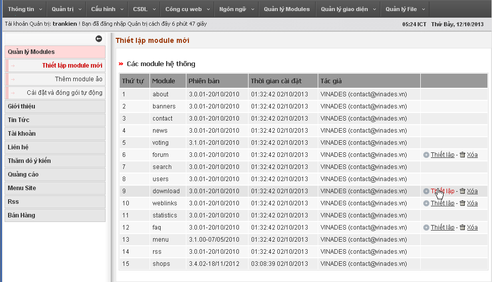
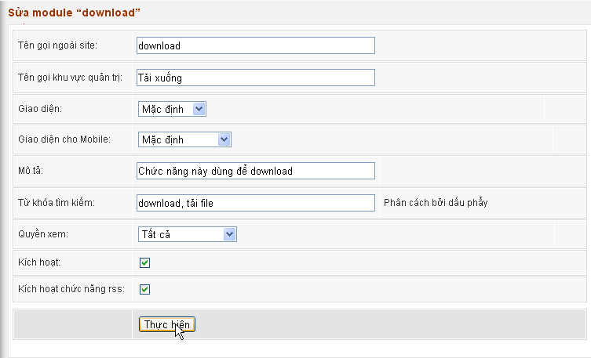
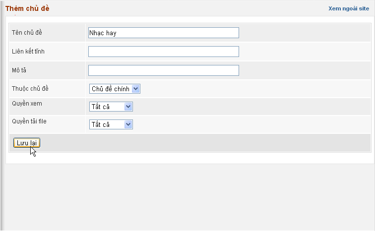
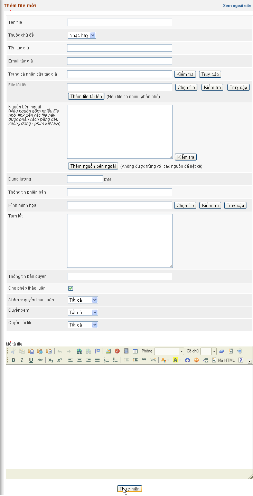
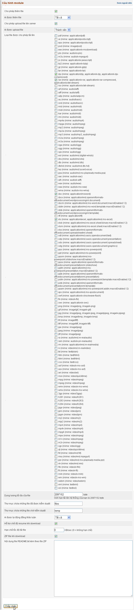

Module download không được thiết lập sẵn ngay sau cài, do đó nếu muốn sử dụng bạn phải thiết lập nó trước. Vào Admin Control Panel/Modules/Thiết lập module.

Nhấp nút Thiết lập để hệ thống chuyển qua trang thiết lập.

### Quản lý chủ đề

Module sẽ yêu cầu bạn thêm chủ đề trước khi làm bất cứ thao tác nào khác.

### Thêm file mới

### File chờ kiểm duyệt

Cho phép quản lý các file thành viên gửi tới.

### Báo cáo lỗi

Cho phép theo dõi các báo lỗi gửi tới.

### Quản lý comment

Cho phép quản lý các bình luận thành viên gửi tới.

### Cấu hình module

