Cho tới phiên bản NukeViet 3.4, NukeViet hỗ trợ hầu hết các loại ngôn ngữ trừ tiếng Trung (chưa hỗ trợ rewrite). Với các loại ngôn ngữ sử dụng chế độ căn lề phải (ví dụ như tiếng Ả Rập) có thể đpá ứng bằng cách sử dụng giao diện phù hợp.

Hệ thống ngôn ngữ của NukeViet phân biệt thành 2 loại là [ngôn ngữ giao diện và ngôn ngữ cơ sở dữ liệu (ngôn ngữ data)](/nukeviet/concepts/language). Để có thể cài ngôn ngữ data thì hệ thống cần có sẵn ngôn ngữ giao diện (bạn cũng có thể tạo ngôn ngữ giao diện nếu nó chưa có sẵn).

## Ngôn ngữ data

Để cài ngôn ngữ cơ sở dữ liệu bạn truy cập Admin Control Panel =\> Ngôn ngữ. Tại đây bạn sẽ thấy hiện trang sử dụng các ngôn ngữ của website và các ngôn ngữ có thể cài đặt thêm.

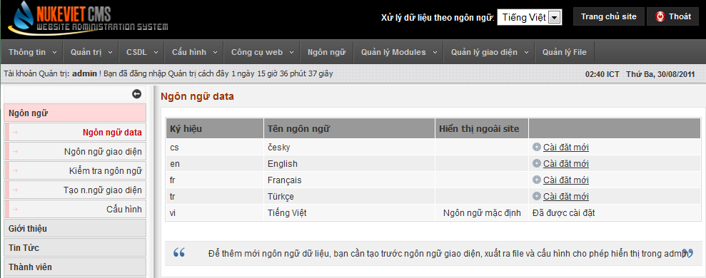

### Cài đặt ngôn ngữ mới

Để cài đặt một ngôn ngữ mới, bạn làm các bước sau:

#### Bước 1

Nhấp vào link "Cài đặt mới" cho ngôn ngữ bạn muốn cài đặt. Ví dụ ở đây là cài đặt thêm trang Tiếng Anh.

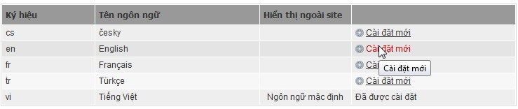

Sau khi cài đặt xong, hệ thống sẽ thông báo như sau:

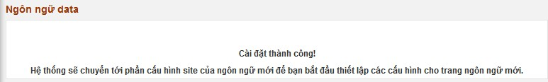

Hệ thống sẽ tự động chuyển sang trang cấu hình để bạn tiếp tục thực hiện cấu hình cho trang tiếng Anh như hình dưới đây:

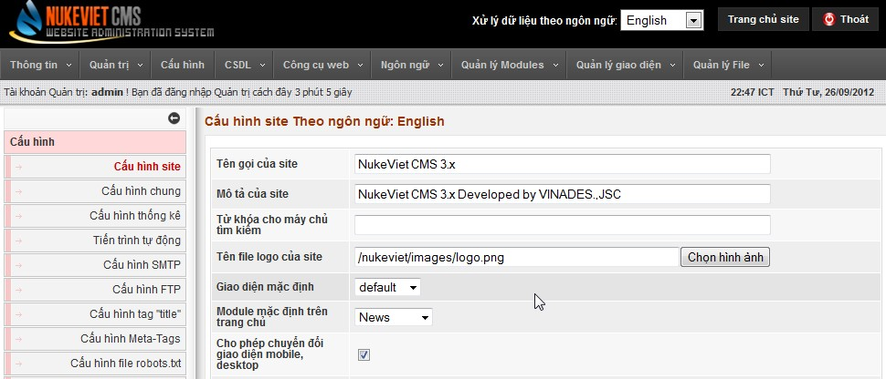

<u>Chú ý</u>: Nếu ngôn ngữ bạn muốn cài thêm không có trong danh sách này thì có nghĩa là bạn cần bổ sung ngôn ngữ giao diện cho nó. Xin xem phần "[Ngôn ngữ giao diện](/nukeviet/admin/language)" ở bên dưới để có thể tự biên tập thêm các gói ngôn ngữ giao diện hoặc tìm các gói ngôn ngữ phù hợp từ NukeViet Store hoặc NukeViet Translate System để cài đặt thêm.

#### Bước 2

Cấu hình và Cập nhật dữ liệu cho trang tiếng Anh.

<u>Một số lưu ý</u>:

- Sau khi cài xong, trang tiếng Anh sẽ được thiết lập với dữ liệu demo và cấu hình mặc định, bạn có thể thay đổi dữ liệu demo và cấu hình mặ định cho phù hợp với nhu cầu của mình.
- Ngay khi cài đặt xong, chỉ có người quản tị tối cao (là bạn) mới có quyền truy cập trang tiếng Anh này, người sử dụng vẫn chưa thể truy cập trang này. Để có thể kích hoạt trang này, bạn thực hiện bước 3 dưới đây.

#### Bước 3

Kích hoạt hiển thị ngôn ngữ ngoài site

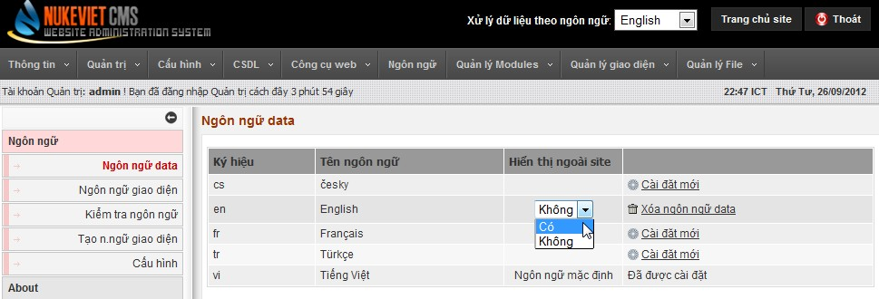

Lúc này, bạn ra ngoài trang chủ sẽ thấy có thêm ngôn ngữ mới.

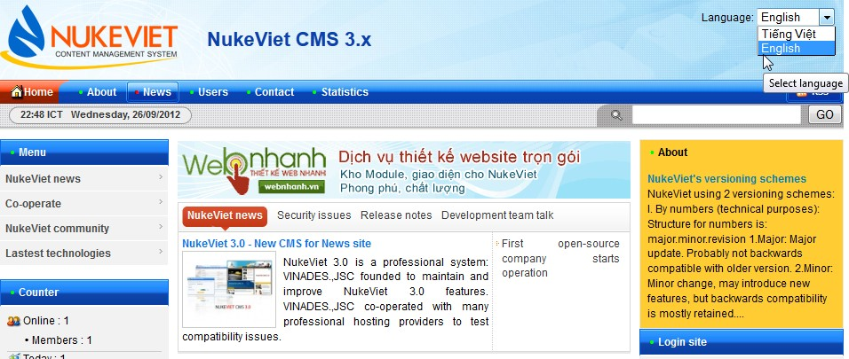

<u>Lưu ý</u>:

- Với website sử dụng nhiều ngôn ngữ, người quản trị phải luôn chú ý ngôn ngữ cơ sở dữ liệu đang được xử lý trong Admin Control Panel (xem góc trên, bên phải Admin Control Panel): Ngôn ngữ giao diện ngoài site luôn được đồng bộ với ngôn ngữ của cơ sở dữ liệu nhưng ngôn ngữ giao diện ở trang quản trị và ngôn ngữ cơ sở dữ liệu có thể sử dụng lẫn lộn do đó cần hết sức lưu ý việc này.
- Với website sử dụng từ 2 ngôn ngữ trở lên, phần cấu hình chung của website sẽ xuất hiện thêm 2 tùy chọn:
  - Ngôn ngữ mặc định
  - Kích hoạt chức năng xác định ngôn ngữ theo quốc gia.

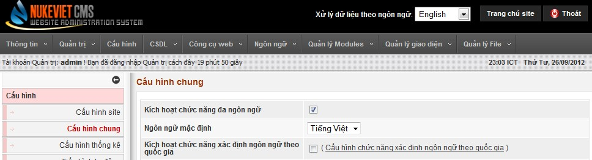

### Xác định ngôn ngữ theo quốc gia

Chức năng này chỉ xuất hiện khi có ít nhất 2 ngôn ngữ được hiển thị ngoài site và tự động ẩn khi chỉ có 1 ngôn ngữ được sử dụng.

Để sử dụng chức năng này hãy làm theo các bước sau:

#### Bước 1

Truy cập Admin Control Panel =\> Cấu hình =\> Cấu hình chung. Đánh dấu vào ô "Kích hoạt chức năng xác định ngôn ngữ theo quốc gia".

#### Bước 2

Truy cập Admin Control Panel =\> Ngôn ngữ =\> Ngôn ngữ theo quốc gia. Lựa chọn ngôn ngữ cho từng quốc gia và ấn nút "Thực hiện".

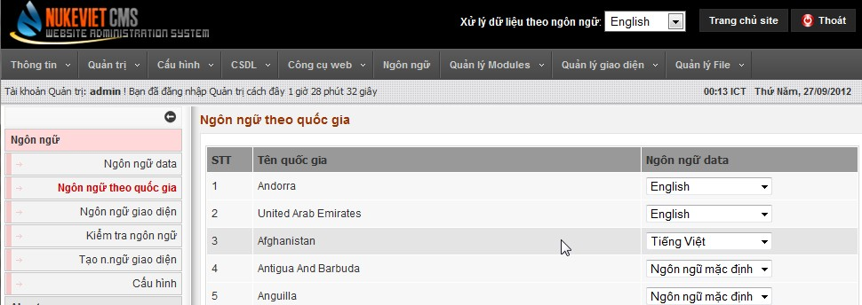

## Ngôn ngữ giao diện

Chức năng này giúp bạn biên tập các ngôn ngữ mới hoặc sửa các ngôn ngữ giao diện đã có, muốn sửa nó đầu tiên bạn cần đọc nó từ các tệp tin trên site. Lần đầu tiên sử dụng chức năng này hệ thống sẽ thông báo chưa có cơ sở dữ liệu được đọc và nó sẽ tự động đọc cơ sở dữ liệu của ngôn ngữ bạn đang sử dụng. 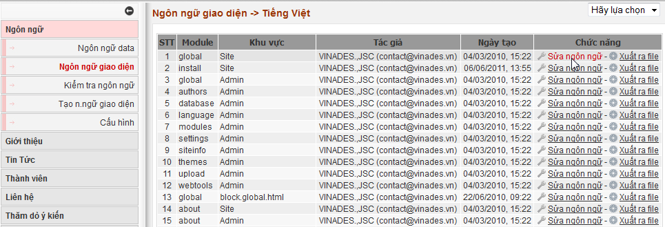 Bạn nhấp link “sửa ngôn ngữ” để sửa file ngôn ngữ: 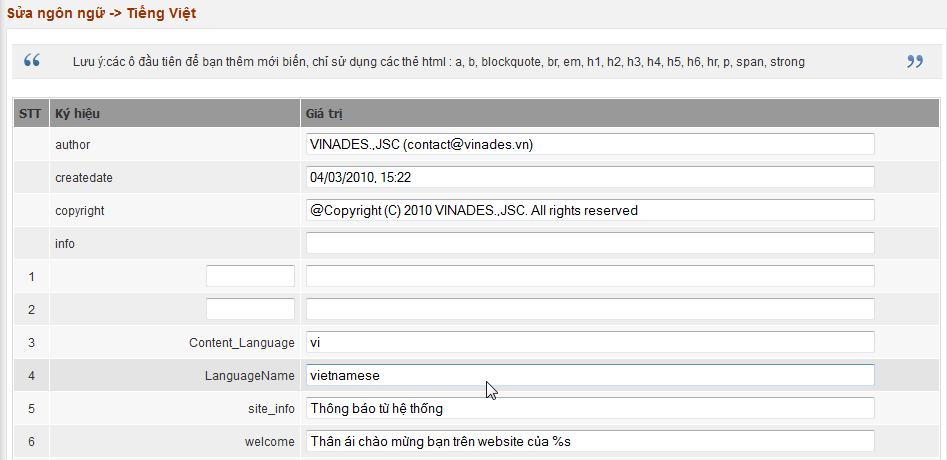 Sau khi xửa xong, bạn nhớ lưu lại file, cuối cùng, xuất ra file để hệ thống ghi lại nội dung bạn vừa sửa ra file của hệ thống để các sửa đổi này có hiệu lực. 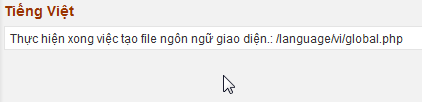

## Cấu hình

Với chức năng này bạn có thể quản lý được ngôn ngữ nào sẽ hiển thị ngoài site, ngôn ngữ nào hiển thị trong Admin Control Panel. Có thể đọc các gói ngôn ngữ giao diện vào cơ sở dữ liệu hoặc xuất ngược các ngôn ngữ đã đọc ra file, có thể download cả gói ngôn ngữ về. 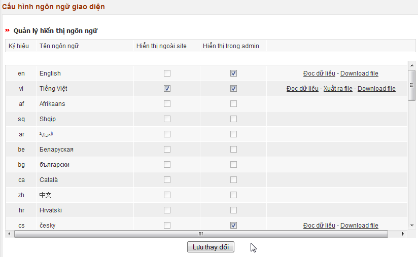 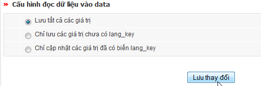 Đây là kết quả báo cáo sau khi thực hiện việc đọc dữ liệu gói tiếng Anh: 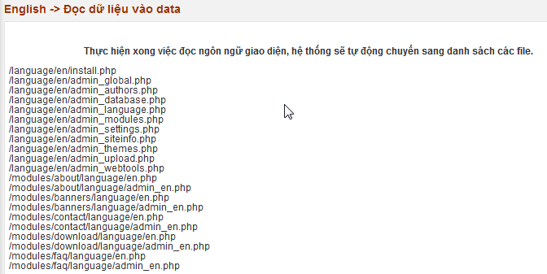

## Kiểm tra ngôn ngữ giao diện

Chức năng này giúp đối chiếu việc dịch 2 ngôn ngữ giao diện với nhau để có thể chỉnh sửa cho đúng hoặc dịch tiếp phần dang dở. Để sử dụng chức năng này, bạn phải có ít nhất 2 ngôn ngữ giao diện đã được đọc vào cơ sở dữ liệu. Bạn có thể đọc các ngôn ngữ vào cơ sở dữ liệu từ mục “Cấu hình”. 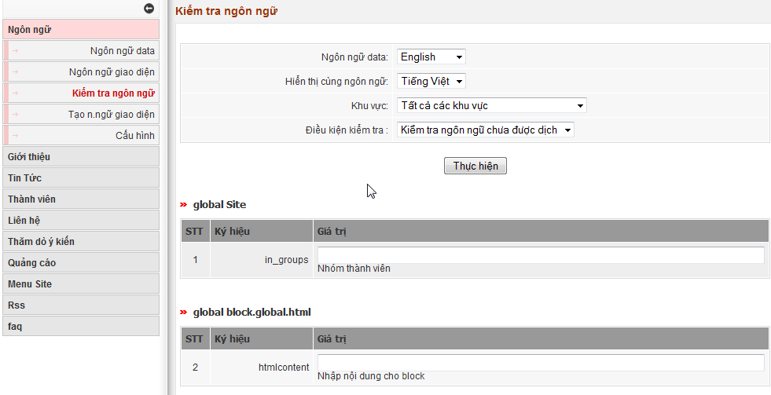

## Tạo ngôn ngữ giao diện

Chức năng này giúp bạn tạo gói ngôn ngữ giao diện chưa có từ 1 trong 2 gói ngôn ngữ là tiếng Việt và tiếng Anh, sau đó bạn có thể bắt đầu thực hiện việc dịch thuật thông qua chức năng “Ngôn ngữ giao diện”. 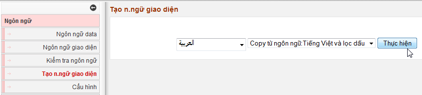
