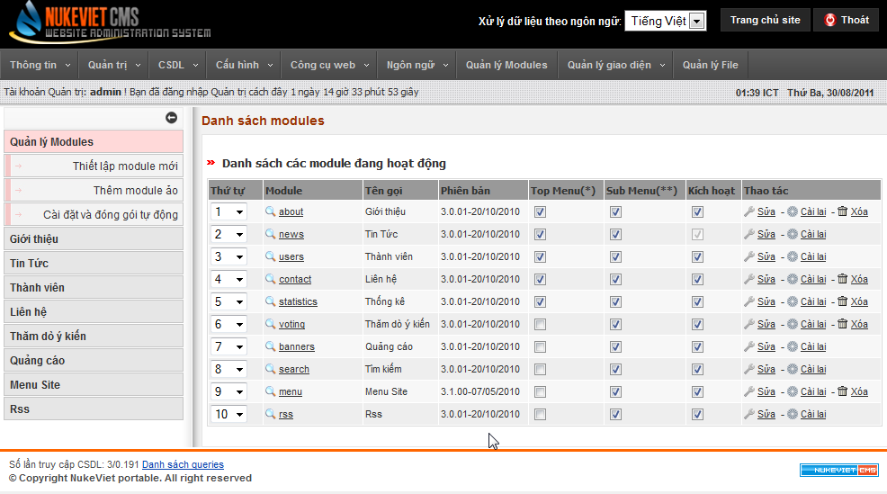
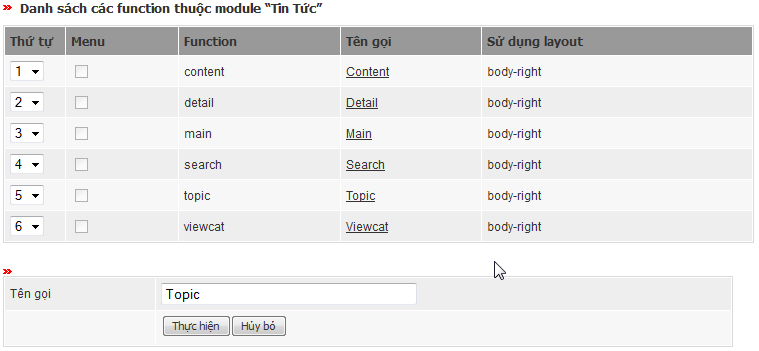
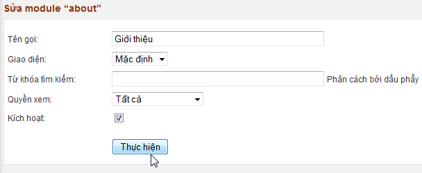

- Bạn thay đổi thứ tự module tại cột thứ tự. Thứ tự này sẽ ảnh hưởng đến vị trí module trong menu bên ngoài site (nếu sử dụng menu tự động) và menu quản trị các module (cột menu bên trái Admin Control Panel).

- Tùy chọn hiển thị ở topmenu hoặc sub menu hay không.

- Tùy chọn kích hoạt module. Nếu module không được kích hoạt, chỉ có admin mới có quyền truy cập nó bên ngoài site. Bạn không thể ngưng kích hoạt module hiện hành (vì nếu ngưng kích hoạt nó thì site không thể truy cập). Nếu muốn ngưng kích hoạt module hiện hành thì bạn phải thay đổi module hiện hành thành module khác tại Cấu hình/Cấu hình site.

- Chức năng cài lại module sẽ xóa sạch dữ liệu hiện tại và đưa module về trạng thái ban đầu.

- Chức năng xóa sẽ xóa hoàn toàn cơ sở dữ liệu của module, module sẽ được chuyển về trang thái chưa cài đặt, nếu muốn sử dụng bạn phải sử dụng chức năng “Thiết lập module mới”.

- Click vào tên module để xem danh sách các hàm, click vào tên 1 hàm để đổi tên hàm đó:

- Click vào “Sửa” module để thay đổi thông tin và thực hiện phân quyền truy cập cho module:

