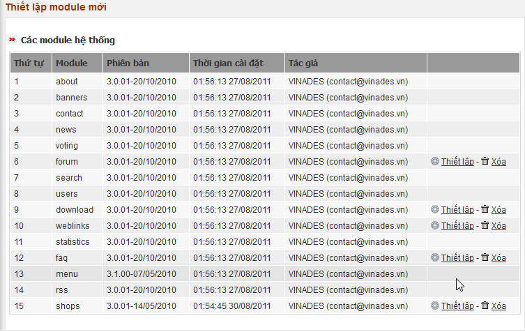
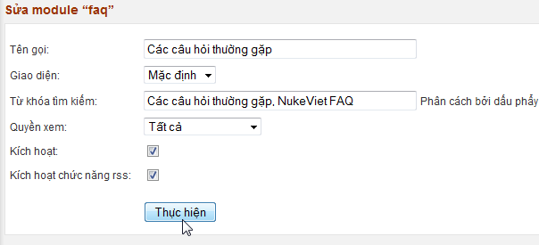

Chức năng này sẽ giúp bạn thiết lập các module đang có trên hệ thống nhưng chưa được cài đặt.  Để xóa hoàn toàn module khỏi hệ thống, bạn nhấp link Xóa. Để thiết lập module muốn sử dụng, bạn nhấp nút “Thiết lập”. Hệ thống sẽ ngay lập tức kích hoạt và chuyển bạn sang trang sửa thông tin module này.

