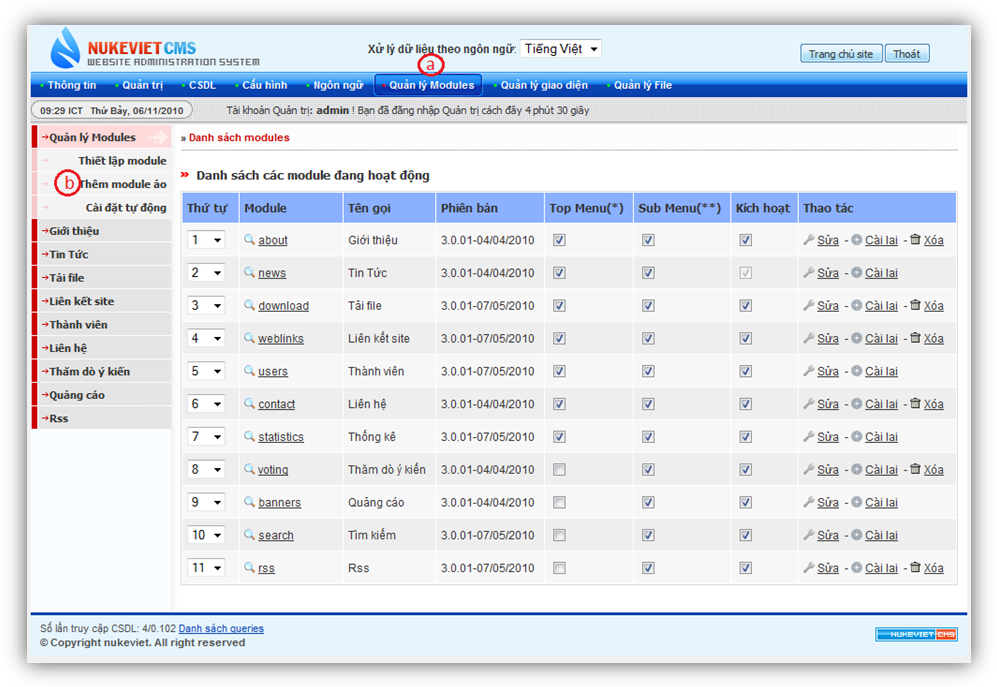
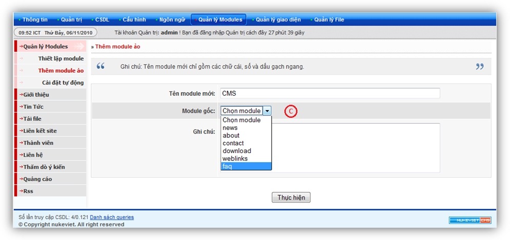
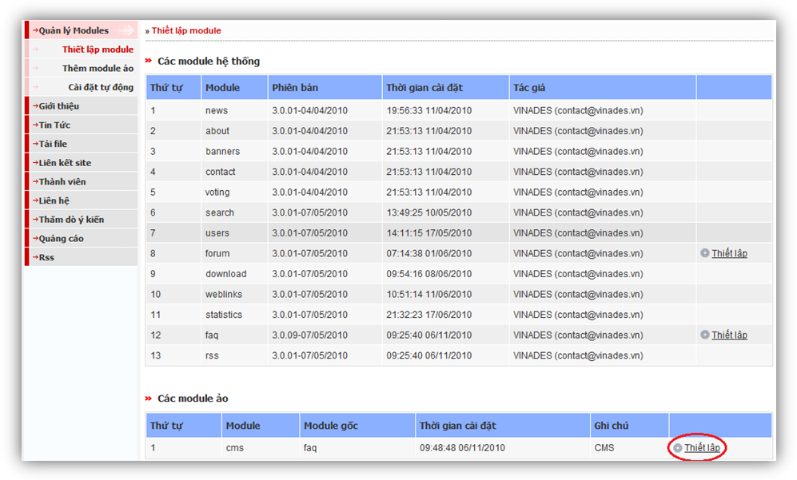
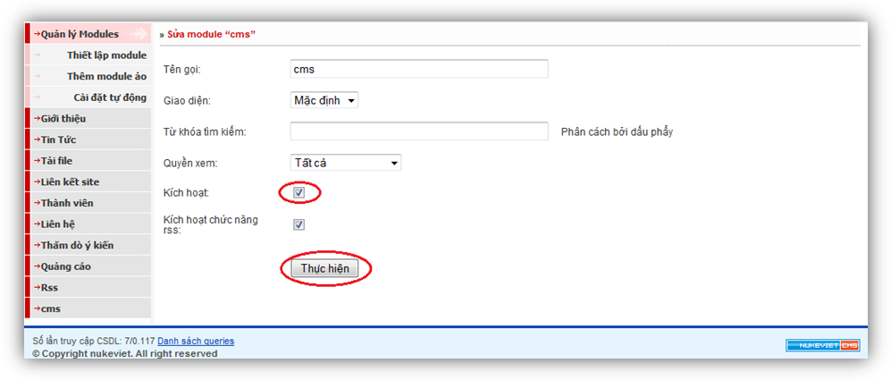

NukeViet 3.0 trở đi có một tính năng mới cho phép hỗ trợ đa nhân module. Chúng tôi gọi đó là công nghệ ảo hóa module. Công nghệ này cho phép người sử dụng có thể khởi tạo hàng ngàn module một cách tự động mà không cần động đến một dòng code. Các module được sinh ra từ công nghệ này gọi là module ảo. Module ảo là module được nhân bản từ một module bất kỳ của hệ thống NukeViet nếu module đó cho phép tạo module ảo.

Để tạo một module ảo mới chúng ta cần qua 3 bước:

- Đăng nhập vào quản trị lựa chọn menu quản lý module
- Trong menu quản lý module chọn menu Cài đặt module

- Trong menu Cài đặt module nhập tên module ảo, lựa chọn là module ảo của module nào và ghi chú.

Sau khi hoàn tất 3 thao tác trên thì nhấn vào nút “Thực hiện” để tạo một module ảo mới.

Ở hình trên chúng ta vừa tạo module CMS là module ảo của module menu, để có thể sử dụng cho bên ngoài website chúng ta cần vào nhấn vào “Thiết lập” để cài đặt module CMS.

Để xuất bản hoàn chỉnh module CMS, sau khi nhấn vào nút “Thiết lập” chúng ta cần phải kích hoạt module CMS  Sau khi kích hoạt module ảo thì module này sẽ có chức năng như tất cả các module khác.
