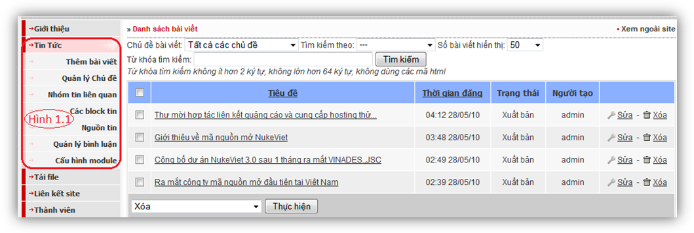

Để có thể xuất bản một bài viết trước tiên chúng ta cần phải tạo: Chủ đề, Chuyên đề và Nguồn tin cho bài viết.

27.1 Chủ đề và quản lý chủ đề tin tức

Chủ đề cho phép ta đưa bản tin vào trong đó tạo thành một chuyên mục tin tức, bao gồm nhiều bài viết liên quan bên trong.

**Để thêm mới một chủ đề tin tức chúng ta cần phải qua 04 bước:**

- Bước 1: Nhập vào tiêu đề.

- Bước 2: Chọn chủ đề (Khi lần đầu tiên thêm mới một chủ đề mặc định nó được chọn là chủ đề chính, ở những lần thêm tiếp theo các bạn có thể chọn chủ đề đó là chủ đề chính hoặc là thành phần con).

- Bước 3: Nhập vào từ khóa cho chủ đề (Nhằm tạo ra phần meta keyword cho chủ đề, như thế các bộ máy tìm kiếm sẽ phân loại và đánh giá chủ đề - có lợi về kết quả tìm kiếm cho website của bạn).(Có thể nhập hoặc không)

- Bước 4: Nhập vào phần miêu tả chủ đề - phần này sẽ được thêm vào phần meta description

Sau khi hoàn thành 04 bước trên chúng ta nhấn vào nút: Lưu thay đổi. Như vậy một chủ đề mới đã được thêm.(Hình 2)

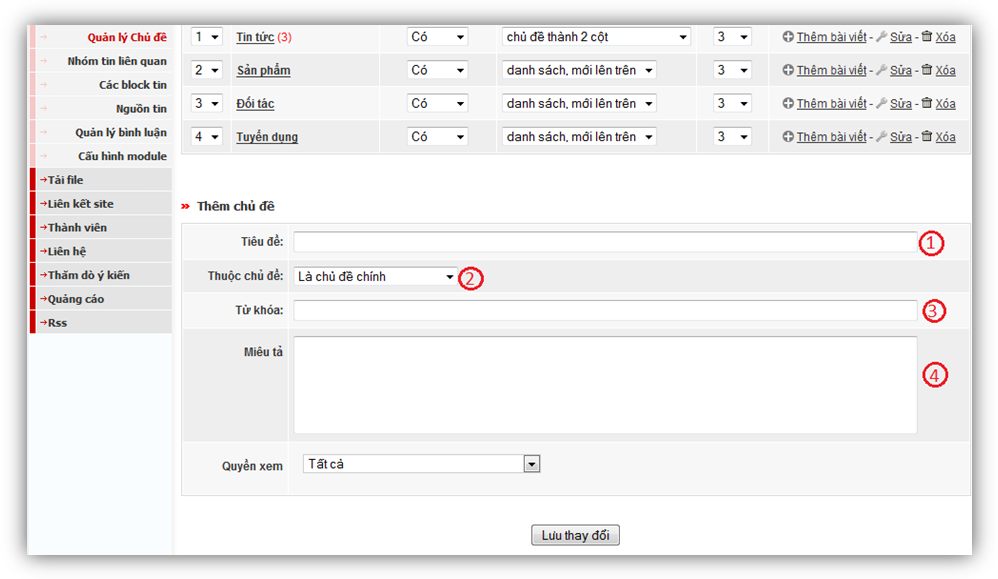

Để sửa một chủ đề chúng ta cần qua 05 bước:

- Bước 1: Nhập lại tiêu đề

- Bước 2: Chọn lại chủ đề

- Bước 3: Nhập liên kết tĩnh cho chủ đề - nhằm mục đích tạo ra đường dẫn thân thiện cho chủ đề và được bộ máy tìm kiếm ưu tiên trong kết quả tìm kiếm. Phần này chỉ xuất hiện khi sửa chủ đề, sau khi bạn thêm mới chủ đề đến khi sửa hệ thống đã lọc từ và đưa ra gợi ý cho bạn.

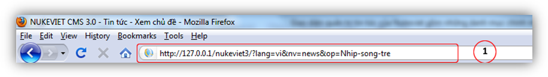

- Bước 4: Nhập lại từ khóa

- Bước 5: Nhập lại phần miêu tả chủ đề.

Sau khi hoàn thành 05 bước bên trên thì nhấp vào nút Lưu thay đổi để cập nhật lại những thay đổi cho chủ đề (Hình 4 ).

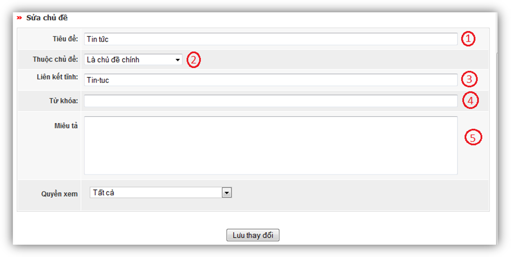

Sau khi thêm chủ đề , thì giao diện phần quản lý chủ đề sẽ có thêm Menu như hình 5 bên dưới:

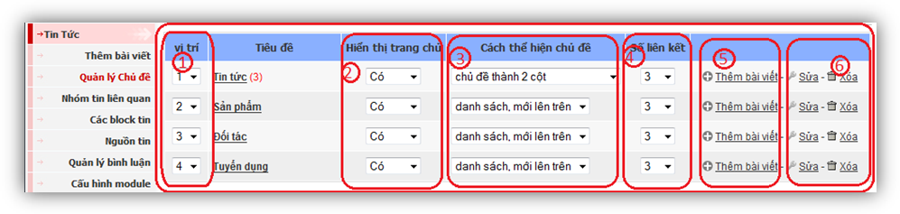

Khu vực 1: Vị trí: Chỉ ra vị trí sắp xếp của chủ đề so với các chủ đề khác. Để thay đổi vị trí của 1 chủ đề các bạn có thể nhấn vào Menu lựa chọn của chủ đề đó (Hình 6) 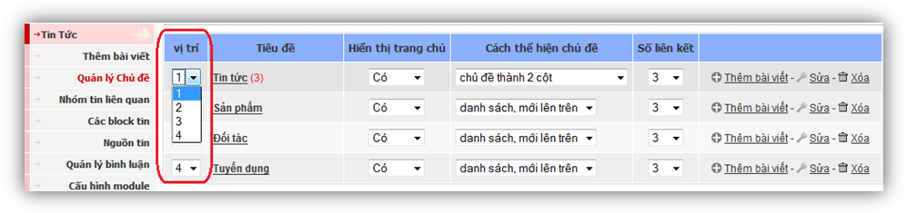

Khu vực 2: Hiển thị trang chủ:Có 02 lựa chọn: Có hoặc Không, Menu này cho phép chủ đề có thể xuất hiện tại trang chủ của site hay không.

Khu vực 3: Cách thể hiện chủ đề: Đối với từng chủ đề sẽ có 06 lựa chọn cách hiển thị tin tức trình bày cho chủ đề đó

- Danh sách, mới lên trên (Hình 7)

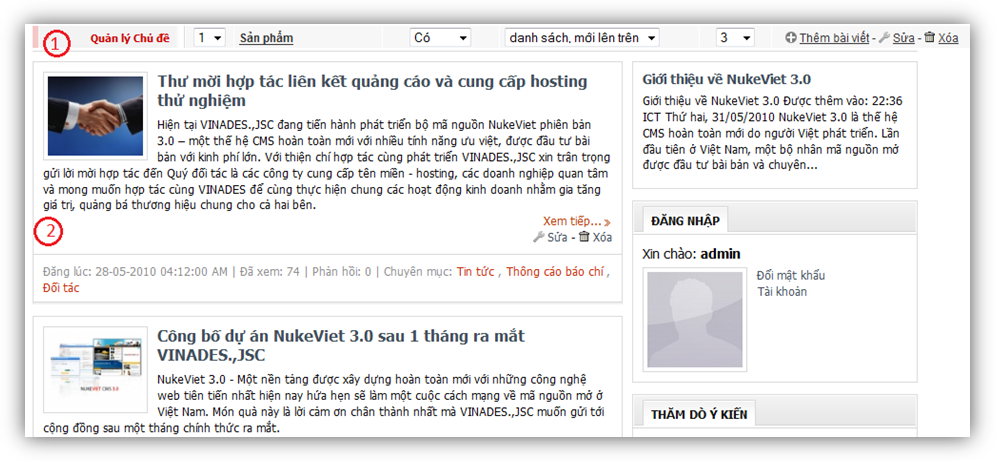

- Danh sách, cũ lên trên (Hình 8)

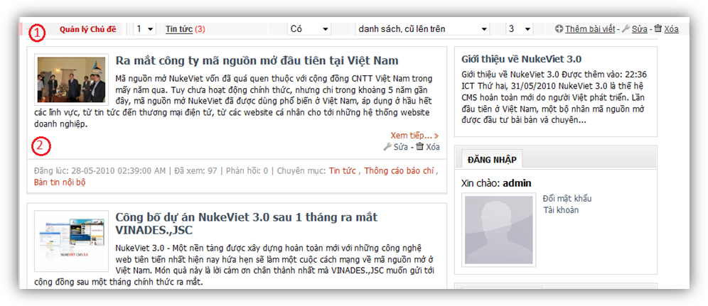

- Chủ đề, tin khác nằm bên trái (Hình 9)

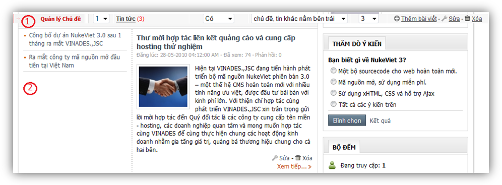

- Chủ đề, tin khác nằm bên phải
- Chủ đề, tin khác nằm bên dưới

- Chia thành 02 cột (Hình 10)

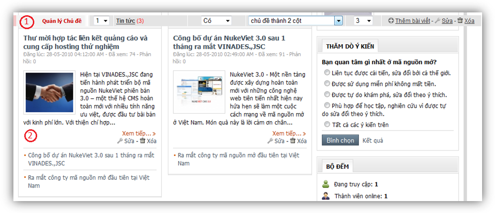

Khu vực 4: Số liên kết: Đối với từng chủ đề cho phép ta chọn số liên kết thuộc chủ đề đó giá trị mặc định sẽ được chọn là 3.

Khu vực 5: Chức năng thêm dành cho phần quản lí chủ đề như : Xóa – sửa chủ đề, thêm bài viết mới vào ngay chủ đề đó.

Khi xóa chủ đề cần lưu ý những điều sau:

- Khi chủ đề chứa các thành phần – chủ đề con trong nó, hệ thống sẽ không cho bạn xóa chủ đề đó. Để có thể xóa được nó bạn cần phải di chuyển các thành phần – chủ đề con trong chuyên mục đó. (Hình 11).

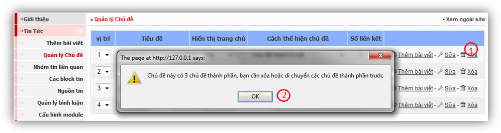

- Trong hình 13 bên trên chúng ta có tiêu đề “Tin tức” có 3 chuyên mục con trong nó là: Thông cáo báo chí, Bản tin nội bộ, tin công nghệ. Để có thể xóa được chuyên mục “Tin tức” chúng ta phải vào bên trong nó – xóa hoặc sửa các chuyên mục: Thông cáo báo chí, Bản tin nội bộ, tin công nghệ.

- Để minh họa cho việc xóa 1 chủ đề: Chúng ta sẽ xóa chủ đề: “Thông cáo báo chí” là chủ đề con của chủ đề “Tin tức” như hình 12

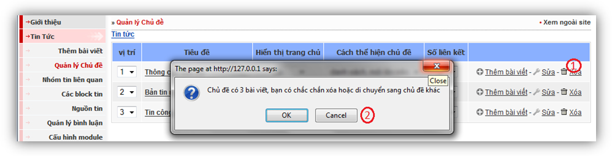

Trên hình 12 sau khi nhấn vào chức năng xóa (1) hệ thống sẽ thông báo cho chúng ta một hộp thoại để khẳng định chắc chắn rằng bạn muốn xóa nó hay không?

Sau khi nhấn OK hệ thống sẽ chuyển bạn sang bước tiếp theo như hình 13

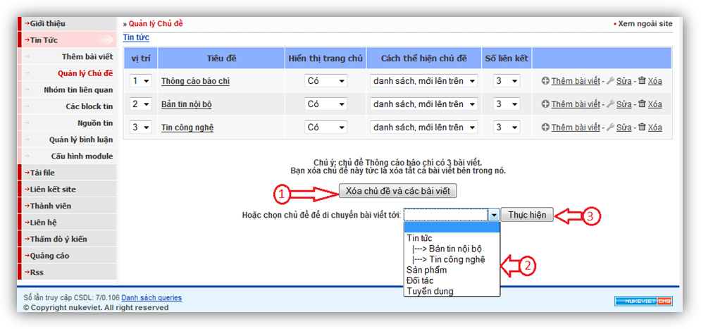

Việc xóa 1 chuyên mục sẽ làm mất toàn bộ các dữ liệu và bài viết trong chuyên mục đó, để đảm bảo việc an toàn dữ liệu cho bạn – hệ thống yêu cầu bạn cần phải xác nhận lại một lần nữa việc “Xóa chủ đề và các bài viết”(Bước 1) Hoặc di chuyển chủ đề bằng cách: Lựa chọn chủ đề tin tức muốn di chuyển tới (Bước 2), khi lựa chọn xong nhấn vào nút “thực hiện” để bắt đầu di chuyển các bài viết bên trong chuyên mục “Tổng hợp” (Bước 3). Sau khi hoàn thành – bạn có thể xóa hoặc sửa các chủ đề tiếp theo: Chi hội, pháp lý. Khi hoàn tất các bước đó chúng ta mới có thể xóa chủ đề “Tin cộng đồng”.

### Nhóm tin liên quan

Cũng giống như chủ đề, nhóm tin liên quan cho phép ta có thể trình bày nhiều bản tin liên quan – nhưng trong một phạm vi nhỏ hơn. nhóm tin liên quan giúp truyền tải cho người đọc khi xem chi tiết một bài viết thành hệ thống những sự kiện chuyên biệt, ví dụ: Chùm sự kiện về bão lụt miền Trung.

Để quản lý các nhóm tin liên quan cũng tương tự như quản lý các chủ đề.

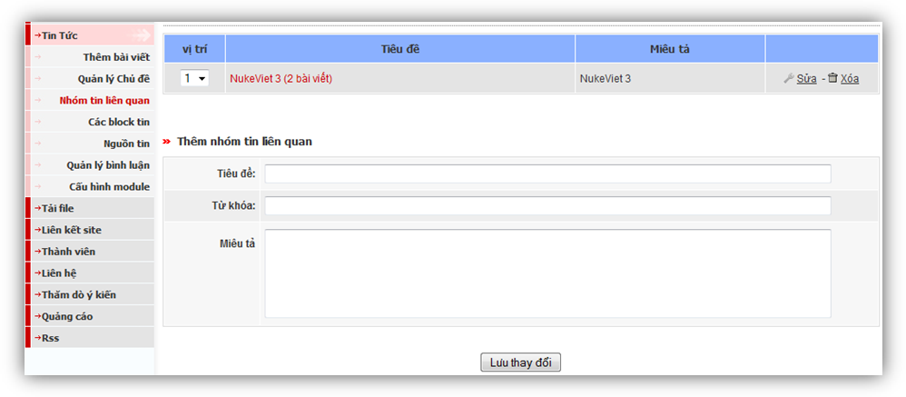

### Nguồn tin

Đây là phần khai báo để đưa vào bài viết được trích dẫn từ nguồn nào bao gồm: Tên nguồn và địa chỉ liên kết tới nguồn tin đó.

Ta có thể thêm nhiều nguồn tin bằng cách nhập đầy đủ thông tin vào phần Thêm nguồn tin như hình 15

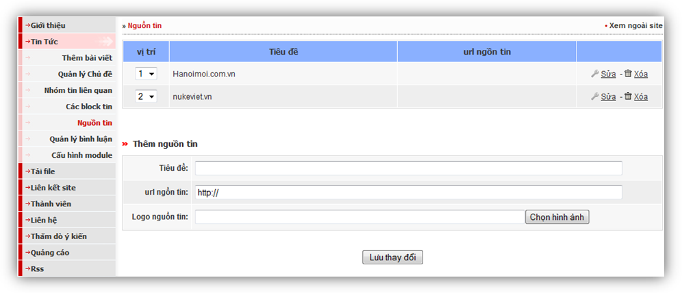

### Các block tin

Phần này giúp cho chúng ta hướng đối tượng người đọc chú ý hơn đến những bài viết được thêm vào nhằm làm nổi bật một hay nhiều bài viết.

Trong phần quản lý bài viết cho chúng ta 02 lựa chọn:

- Block tin nóng

- Block tin chính

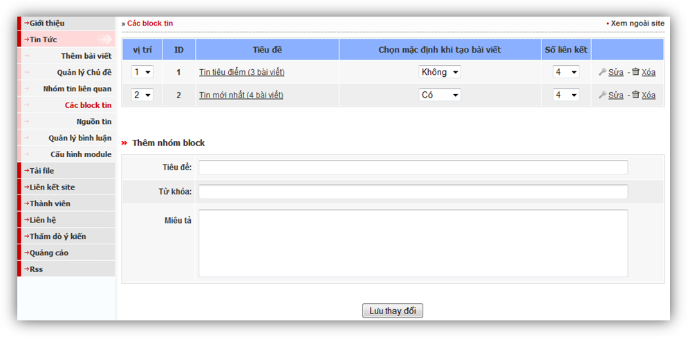

### Cấu hình module

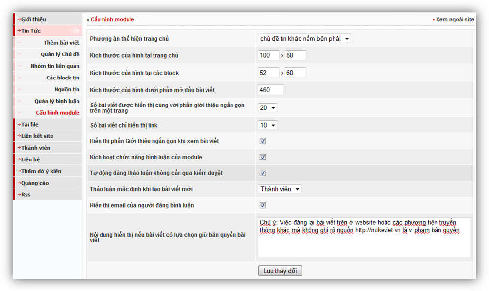

Phần cấu hình module giúp chúng ta tùy chỉnh cách hiển thị bài viết, hình ảnh, số lượng liên kết và một số chức năng khác cho module Tin tức.

Trong phần này chúng ta có các lựa chọn:

- Phương án thể hiện tại trang chủ: Cũng giống như Cách thể hiện chủ đề phần này cho chúng ta 06 lựa chọn như danh sách, mới lên trên,…

- Kích thước của hình tại trang chủ: Là kích thước tối đa về chiều rộng hoặc chiều dài tại hình minh họa của bài viết khi xem tại trang chủ hay vào một chủ đề - một chuyên mục. Đơn vị tính bằng Pixel
- Kích thước hình minh họa tại block: Như ở phần quản lý các block chúng ta cho phép lựa chọn một hay nhiều bài viết vào một trong 02 block tin nóng hoặc tin mới, phần này cho phép chúng ta quy định kích thước của hình minh họa cho bài viết thuộc block đó. Đơn vị tính bằng Pixel.

- Kích thước của hình dưới phần mở đầu của bài viết: Cho phép chúng ta chỉ định kích thước tối đa của hình minh họa cho bài viết khi chức năng này được kích hoạt ở menu Thêm bài viết.

- Số bài viết được hiển thị cùng với phần giới thiệu ngắn gọn trên một trang: Cho phép chúng ta cấu hình trên một trang chuyên mục hay một trang chủ đề có tối đa bao nhiêu bài viết được hiển thị.

- Số bài viết chỉ hiển thị link: Cho phép cấu hình số liên kết đến các bài viết liên quan cùng chuyên mục, cùng chủ đề khi xem chi tiết một bài viết.

- Thảo luận mặc định khi thêm bài viết mới: Cho phép xét thảo luận cho từng đối tượng chung – mặc định cho tất cả bài viết.
- Tự động đăng thảo luận không thông qua kiểm duyệt: Khi chọn chức năng này người đọc sẽ thấy phần thảo luận của mình ngay khi đăng thảo luận. Nếu bỏ chọn chức năng này, để hiển thị bình luận của người đọc – bạn cần phải vào menu Quản lý bình luận để cho phép bình luận của người đọc có thể hiển thị.
- Thông báo bản quyền bài viết: Ghi chú ý cho người muốn đăng lại thông tin bài viết cần phải tuân thủ những gì, chức năng này được kích hoạt trong từng bài viết một. Mặc định trong từng bài viết chức năng này bị tắt.

### Xuất bản và sửa chữa tin tức

Để xuất bản tin tức chúng ta nhấn vào menu Thêm bài viết trong admin quản lý Tin tức, Sau đó cần phải điền thông tin vào 16 bước như hình 20:

1\. Nhập vào tiêu đề bài viết (Bắt buộc).

2\. Chọn chủ đề của bài viết (Bắt buộc): Bài viết có thể chọn 1 hoặc nhiều chủ đề liên quan.

3\. Chọn chuyên đề (Không bắt buộc).

4\. Hình minh họa cho phần giới thiệu (Không bắt buộc)

5\. Chú thích cho hình minh họa (Không bắt buộc).

6\. Hình ảnh tại bài viết: Cung cấp tùy chọn cách hiển thị hình ảnh, có 03 lựa chọn: Không hiển thị, hiển thị mặc định theo cấu hình module và hiển thị bên dưới tiêu đề bài viết. (Không bắt buộc, cấu hình mặc định được lựa chọn: hiển thị theo cấu hình module).

7\. Giới thiệu ngắn gọn (Không bắt buộc – Khuyến cáo không nên bỏ qua bước này.) Có tác dụng miêu tả chung nhất nội dung của bài viết muốn truyền tải đến người đọc. Khi nhập thông tin vào đây sẽ làm cho bài viết được trình bày đẹp hơn.

8\. Nội dung chi tiết: (Bắt buộc) – Toàn bộ nội dung của bài viết sẽ được hiển thị khi bạn điền thông tin vào ô này.

9\. Tác giả bài viết (Không bắt buộc) – Nếu không nhập thông tin vào, hệ thống sẽ tự động lấy theo tên của người đăng bài viết.

10\. Nguồn tin (Không bắt buộc) – Có thể lựa chọn trong danh sách đã tạo ở mục Nguồn tin bên trên hoặc nếu nguồn tin chưa có trong danh sách thì có thể nhập vào ô trống ở bên dưới.

11\. Giữ bản quyền bài viết (Không bắt buộc) – Mặc định chế độ giữ bản quyền bài viết sẽ được tự động chọn, nếu bài viết không phải do các bạn tự biên soạn thì có thể bỏ lựa chọn ở ô này. Khi chế độ này được kích hoạt mỗi khi xem bài viết đó dưới bài viết sẽ có thêm dòng bản quyền như hình 18

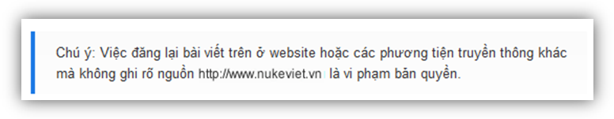

12\. Từ khóa dành cho máy chủ tìm kiếm: Nhằm mục đích tối ưu hóa bài viết với thẻ keyword dành cho bộ máy tìm kiếm. Nếu để trống hệ thống sẽ tự động tạo từ khóa cho bài viết của bạn, bạn cũng có thể sử dụng công cụ được cung cấp sẵn bằng cách copy toàn bộ nội dung bài viết và paste vào ô số 10 – sau đó nhấn vào nút công cụ Vào đây để tạo keyword cho bài viết của bạn. Hoặc bạn cũng có thể tự nhập từ khóa – chú ý mỗi từ khóa phân cách nhau bởi dấu phẩy. (Không bắt buộc – Khuyến khích dùng nếu các bạn chú trọng đến vấn đề tối ưu hóa bài viết cho bộ máy tìm kiếm).

13\. Quyền xem bài viết: Hạn chế 1 hoặc nhiều đối tượng có thể truy cập đến bài viết của bạn, mặc định hệ thống sẽ để tất cả mọi người có thể xem. Bạn có thể cấu hình lại bằng cách lựa chọn một trong những cách được cung cấp:

· Tất cả

· Thành viên

· Khách

· Quản trị

· Hoặc một trong những nhóm trong Menu quản trị Nhóm do bạn tạo ra

(Không bắt buộc).

14\. Thời gian đăng: Hệ thống sẽ tự động đăng bài viết vào thời gian do bạn lựa chọn tình theo Ngày – tháng – năm: Giờ - Phút. (Không bắt buộc)

15\. Thời gian hết hạn: Hệ thống sẽ tự động khóa bài viết không cho người đọc xem vào thời gian mà bạn quy định bài viết hết hiệu lực. (Không bắt buộc).

16\. Tính năng mở rộng: Cung cấp cho bạn các lựa chọn về :

· Hiển thị trên trang chủ (Mặc định giá trị l: Có)

· Cho phép thảo luận (Mặc định giá trị là: Thành viên, bạn cũng có thể lựa chọn các giá trị là Không hoặc là Tất cả mọi người đều có thể tham gia thảo luận).

· Cho phép xếp hạng bài viết: Nhằm giúp người đọc đánh giá bài viết theo các mức yêu thích. Mặc định hệ thống sẽ cho phép người đọc sử dụng chức năng này.

· Cho phép gửi bài viết: Để người đọc có thể gửi bài viết này cho bạn bè qua email, mặc định hệ thống luôn bật chức năng này.

· Cho phép in bài viết: Mặc định hệ thống sẽ cho phép người đọc sử dụng chức năng này. Bạn có thể không cho người đọc sử dụng nó bằng cách bỏ lựa chọn này.

· Cho phép lưu bài viết: Chức năng này phục vụ yêu cầu khi người đọc có nhu cầu lưu trữ bài viết trên máy để có thể đọc lại mà không cần vào website. Mặc định hệ thống sẽ bật tính năng này, bạn có thể tắt nó bằng cách bỏ lựa chọn này.

Khi đã hoàn thành 16 bước trên bạn hãy nhấn vào nút Lưu thay đổi để xuất bản bài viết. Hãy trở lại trang chủ và xem thành quả mà bạn có được.

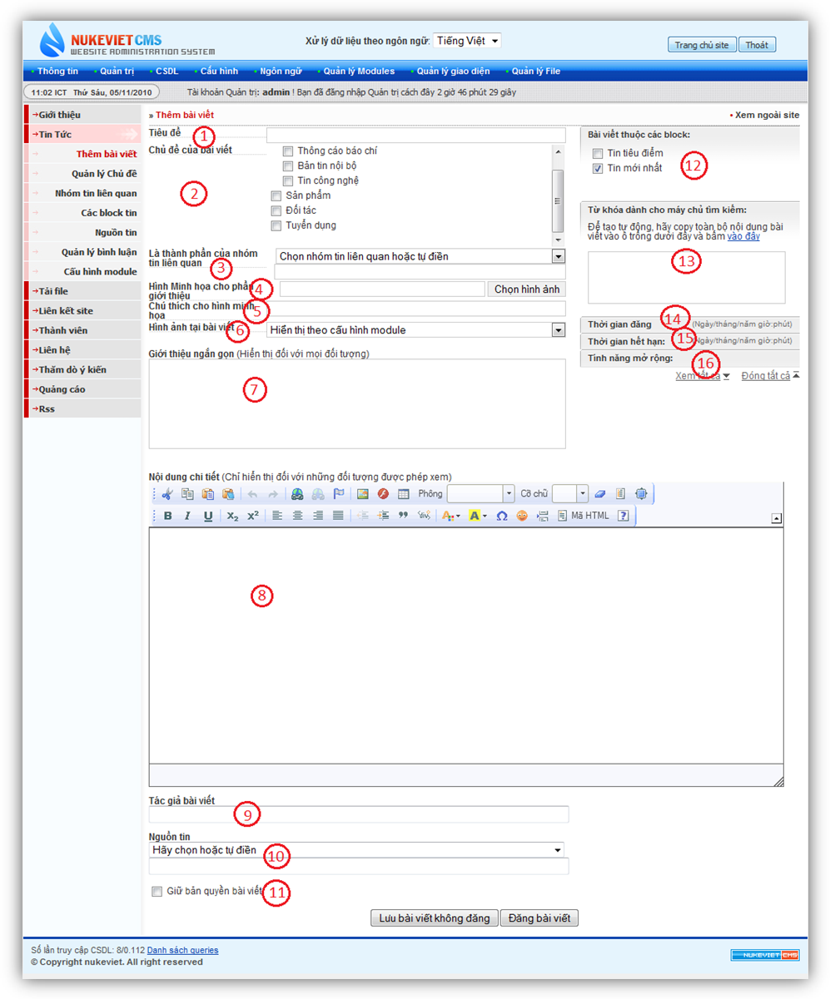

### Sửa chữa – xóa tin tức

Để sử dụng chức năng này bạn nhấn vào menu quản lý Tin tức (1)như hình 20

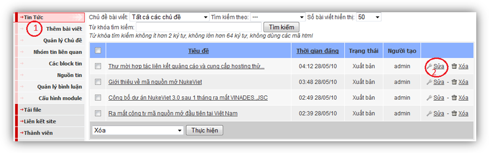

Sau đó nhìn sang phía menu bên phải, tương ứng với mỗi bài viết đều có menu lựa chọn với 02 chức năng đó là: Sửa – Xóa. Để sửa bài viết nào bạn hãy nhấn vào menu Sửa (2) ở bài viết đó.

Khi một bài viết được chọn để sửa sẽ như hình minh họa dưới đây – Hình 23:

Các bước từ 1-16 tương tự như khi thêm bài viết.

### Liên kết tĩnh:

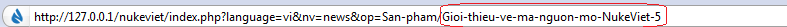

NukeViet sử dụng các liên kết tĩnh giúp tạo liên kết thân thiện cho bộ máy tìm kiếm, giúp bài viết của bạn đạt thứ hạng tìm kiếm cao. Mặc định hệ thống sẽ tự tạo ra liên kết tĩnh cho bạn, nếu muốn thay đổi bạn có thể chỉnh sửa tại mục “liên kết tĩnh” (17)

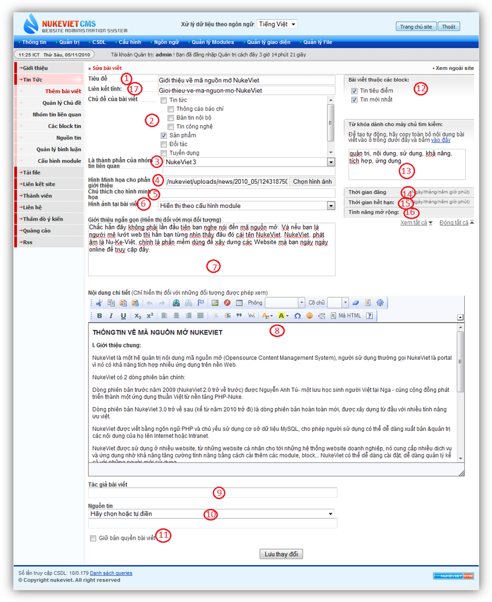
