Với tính năng App ID của Facebook giúp người quản trị quản lý được comment của người bình luận thông qua mạng xã hội facebook, bạn có thể xóa, sửa comment bất kỳ nếu có App ID.

Điều đầu tiên chúng ta cần làm là đăng ký một ứng dụng trên facebook, ứng dụng có ID ở dạng chuổi số, sau đó khai báo chuổi số đó vào website.

Để đăng ký được ứng dụng thì tiên tài khoản facebook của bạn đã được xác minh số điện thoại ([https://www.facebook.com/settings?tab=mobile](https://www.facebook.com/settings?tab=mobile)) Nếu đã xác minh số điện thoại thì bỏ qua bước xác minh này.

## Bước 1. Đăng nhập và đăng ký tài khoản Facebook Developer

Các bạn đăng nhập vào tài khoản FB của mình, và truy cập địa chỉ [https://developers.facebook.com](https://developers.facebook.com). Trên menu phía trên, các bạn rê chuột vào **My Apps**, chọn **Register as a Developer** 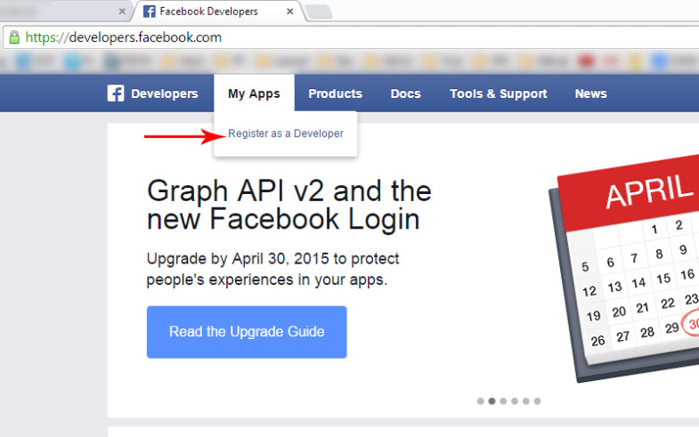

Tiếp theo Facebook sẽ hỏi xác nhận bạn là có chấp nhận với các quy định của họ hay không, các bạn click vào nút như hình bên dưới và tiếp tục. 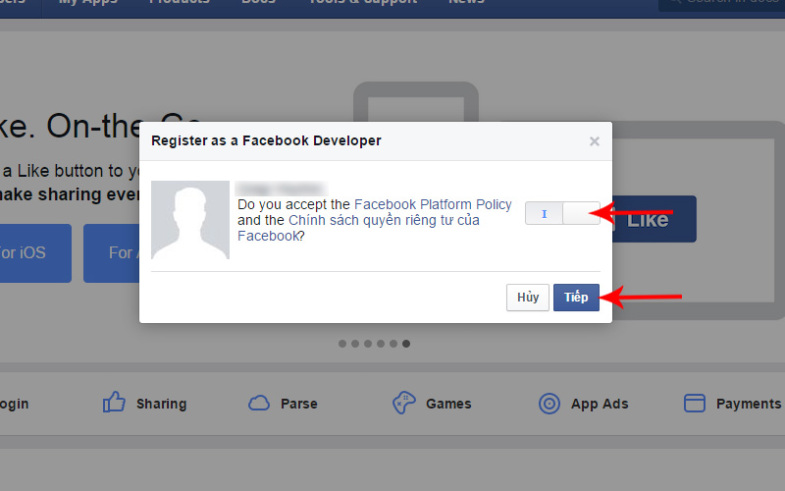

## Bước 2. Xác nhận tài khoản qua số điện thoại di động

***Nếu bạn đã xác minh số điện thoại với facebook sẽ bỏ qua bước này, để chuyển sang bước 3*** Đến bước này FB sẽ cần xác nhận tài khoản của bạn qua điện thoại. Có 2 cách là nhận tin nhắn SMS từ FB hoặc 1 cuộc gọi tự động với voice là giọng đọc dãy số xác nhận. Các bạn nhập số điện thoại của bạn vào. Ở đây mình chọn **Send as Text** để nhận tin nhắn văn bản cho nhanh. 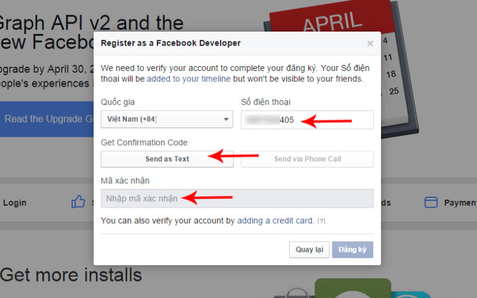 Sau khi nhập số điện thoại vào rồi, các bạn sẽ nhận được tin nhắn từ Facebook, với mẫu như hình bên dưới, các bạn nhập dãy số đó vào ô mã xác nhận rồi click nút ***Đăng ký*** để tiếp tục. 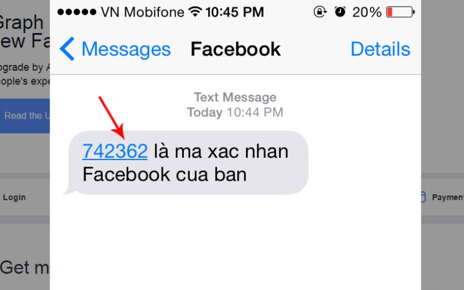 Nếu thành công, bạn sẽ thấy thông báo như thế này: 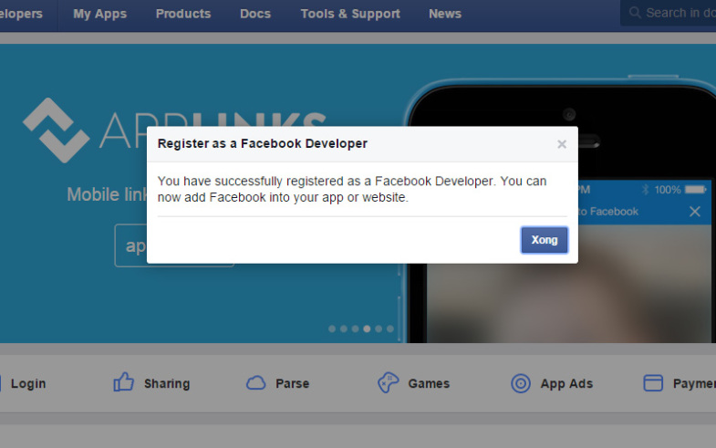

## Bước 3. Tạo App mới

Các bạn tiếp tục rê chuột vào phần menu **My Apps**, rồi chọn **Add a New App** 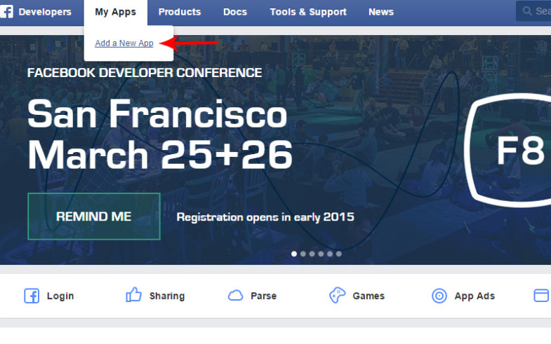 Facebook sẽ hỏi bạn là muốn tạo App cho ứng dụng nào, ở đây mình **chọn loại là Web** (và bạn cũng nên chọn thế nếu dùng App này trên website). 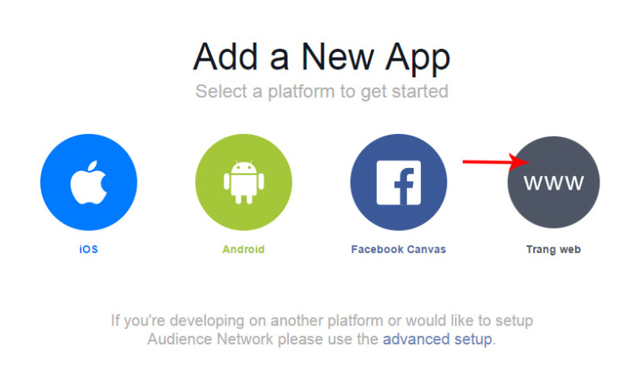

Tiếp theo các bạn hãy nhập tên cho App của bạn, ở đây mình viết là: **NukeVietApp**, xong bấm chọn **Create New Facebook App ID**. 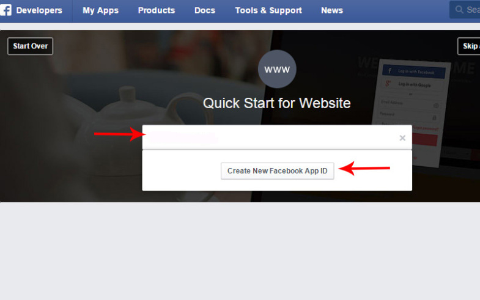 Sau khi bấm nút **Create New Facebook App ID**, bạn bấm chọn **Skip and Create App ID** để qua trang quản lý app chính, bỏ qua bước Quick Start này, vì mục đích bài này là để bạn lấy được **App ID** và **Serect ID** chứ chưa triển khai app vào website 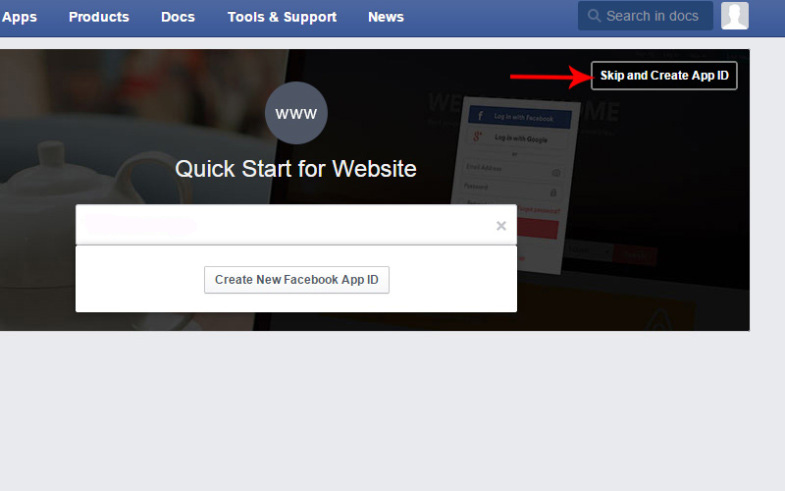

Các bạn sẽ được chuyển đến trang quản lý thông tin và cấu hình app, các bạn sẽ thấy dãy số App ID của bạn trong khung tương ứng và các bạn bấm vào nút **Show** trong khung **App Secrect** để thấy dãi mã này.

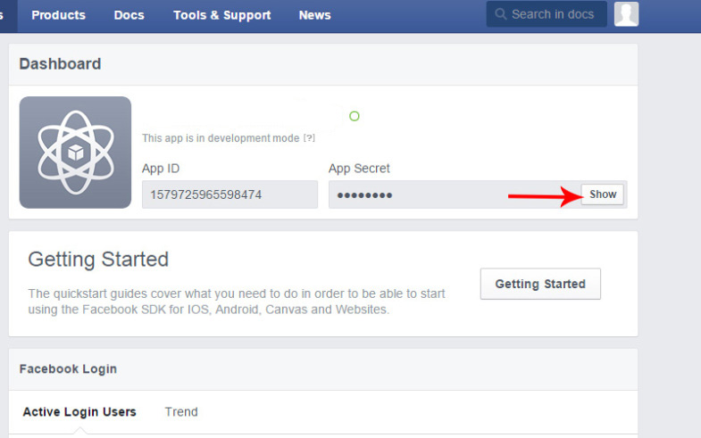

Dãy mã này sẽ dùng để các bạn khai báo vào website của các bạn, nó sẽ trông như thế này (ở đây là mình demo nên show dãy mã ra, các bạn nên giữ dãy mã này và không nên cho ai biết). 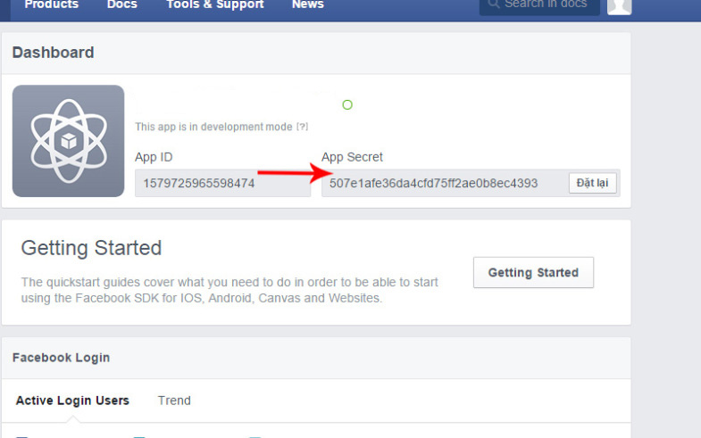 Vậy là bạn đã có **App ID** và **App Secret** để khai báo cho ứng dụng trong website của bạn rồi. Nhưng để bật App lên và sử dụng được, các bạn làm thêm bước này nữa. Bạn bấm vào menu **Setting** bên trái, các bạn sẽ thấy hình sau: 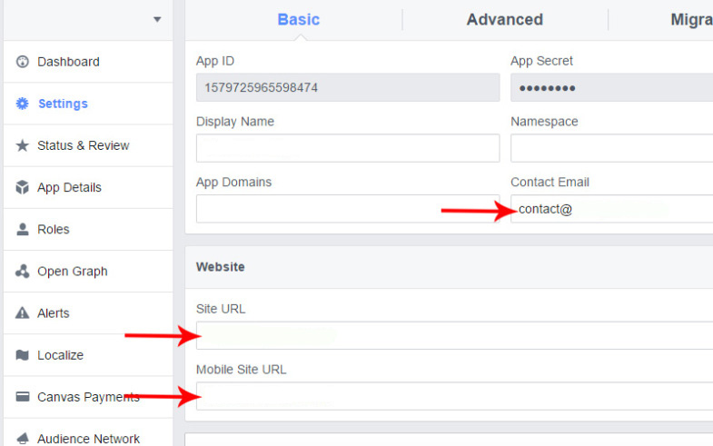

Ở đây các bạn cần phải khai báo **Contact Email** và\*\* Site URL\*\* cũng như **Mobile Site URL** thì mới có thể bật App lên để sử dụng được, sau khi điền các thông tin đó xong, các bạn lưu lại. Tiếp tục bấm vào menu bên trái là: **Status and Review**. Lưu ý thêm là phần **Apps Domain** bạn phải nhập giống ới Site URL theo cấu trúc domain.com, trong ảnh tác giả quên điền.

Các bạn click vào cái nút như trên hình dưới để bật App lên. 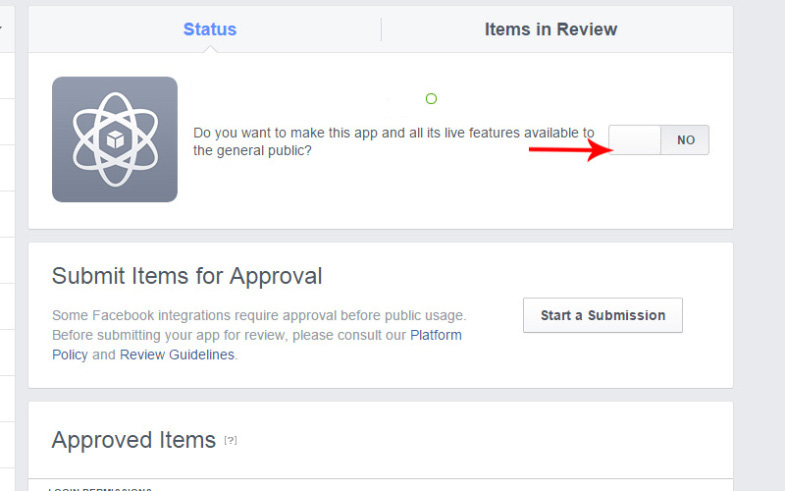 Bật xong các bạn sẽ thấy App của bạn đèn xanh hiện lên 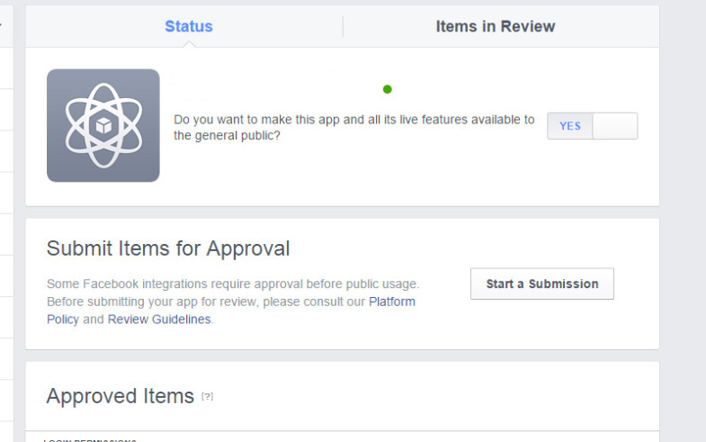

vậy là app của bạn bây giờ đã hoạt động được và bạn có thể copy cái App ID và quay trở về bài viết trên cùng để tiến hành thay thế App ID

## Khai báo ID cho module news và module shop

### Với module news

*Bước 1*: bạn truy cập tên module **“Tin tức”** chọn\*\* “Cấu hình module”\*\* như hình sau: 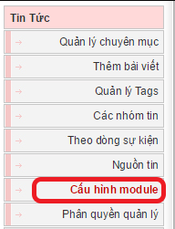 *Bước 2*: Di chuyển xuống phía dưới tới khu vực **“Cấu hình đăng bài”** Chọn ô **“Facebook App ID”** 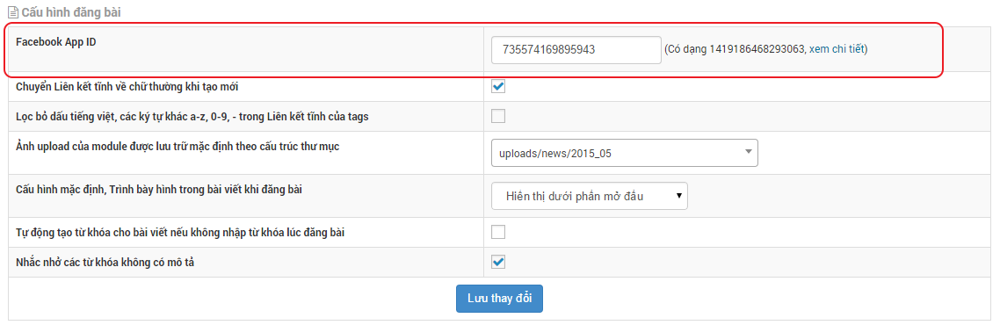 Tại đây bạn điền App ID mới đăng ký thay cho id 735574169895943 như trong hình.,

### Với module shop

Bước 1: Bạn chọn tên module **“Sản phẩm”** , tiếp đến bạn chọn **“Cấu hình module”** 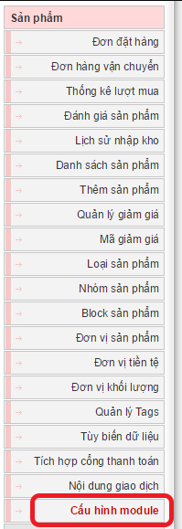 Bước 2: bạn kéo xuống tới khu vực\*\* “Cấu hình module”\*\* tìm tới **“Facebook App ID”** và điền ID mới sau đó lưu lại cấu hình. 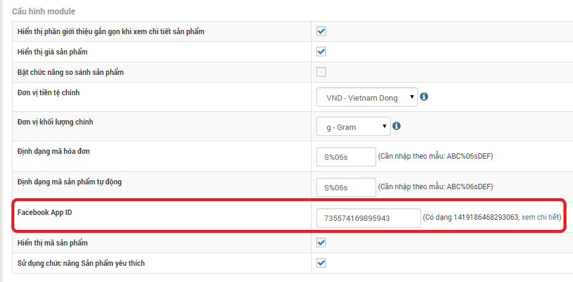

Đối với các module khác chúng ta cũng làm tương tự. Tức là vào phần cấu hình module, điền thông số Facebook App ID nếu có.

## Form comment facebook

Hiện nay From comment facebook (block) đã được cho vào nukeviet mặc định phiên bản 4. Để thiết lập được block bạn chỉ cần làm như sau :

1.  Bật kéo thả block ở ngoài site
2.  Chọn kiểu block: Bình luận
3.  Chọn block: global block_facebook_comment_box
4.  Thiết lập các thông tin cần thiết cho block và lưu lại

Khi thành công, form comment facebook sẽ hiển thị như sau 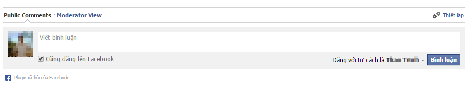 *Giải thích*

- Phần **Public Comments** là hiện lời bình của khách ghé thăm website của bạn. Bạn có thể xóa lời bình, chặn người dùng hay đứa họ vào danh sách đen.

- Phần **Moderator View** sẽ hiển thị danh sách các Comment mới và cần xác minh, chưa được hiển thị trên website của bạn nếu như bạn đã đặt chế độ yêu cầu kiểm duyệt trước khi xuất bản.

Khi có ai đó bình luận trên website của bạn, tất cả người dùng là quản trị viên (Moderator) sẽ nhận được thông báo trên Notification của facebook

## Thiết lập comment facebook

Truy cập vào địa chỉ [https://developers.facebook.com/tools/comments](https://developers.facebook.com/tools/comments) Sau đó chọn ứng dụng -\> setting 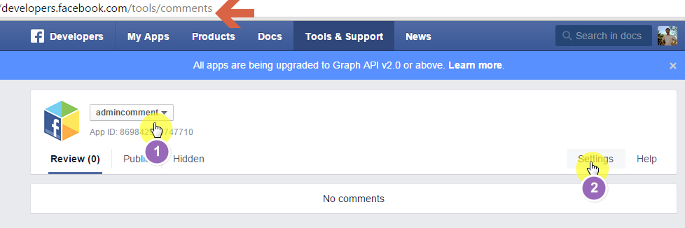 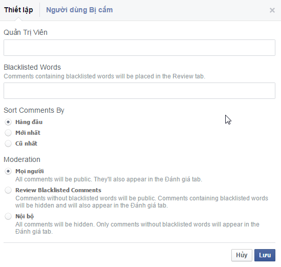

- Quản Trị Viên: thêm các quản trị viên, các quản trị viên phải là bạn với người tạo ứng dụng.
- Blacklisted Words: các từ khóa bị cấm.
- Sort Comments By: Kiểu sắp xếp bình luận
- Moderation: Chế độ kiểm duyệt comment: công khai ngay Không kiểm duyệt, kiểm duyệt, chỉ nội bộ.
