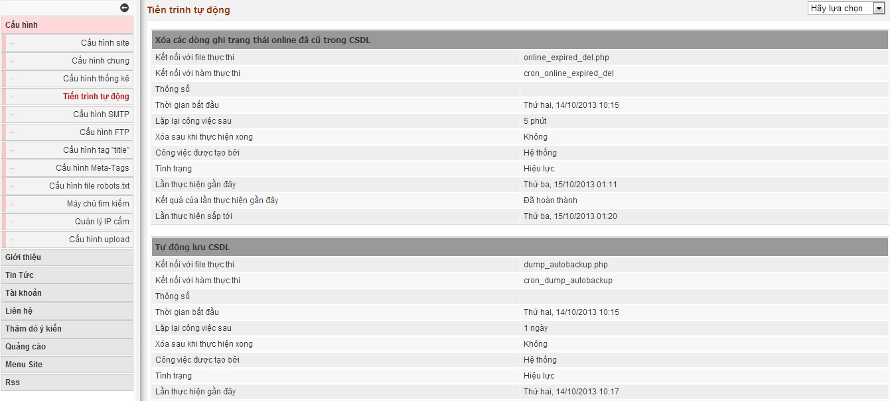

Trong hệ thống NukeViet 3 có các tiến trình tự động, để thực thi các công việc chạy tự động trong site.

Mặc định trong hệ thống có các tiến trình sau

- Xóa các dòng ghi trạng thái online đã cũ trong CSDL

- Tự động lưu CSDL

- Xóa các file tạm trong thư mục tmp

- Xóa IP log files Xóa các file logo truy cập

- Xóa các file error_log quá hạn

- Gửi email các thông báo lỗi cho admin

- Xóa các referer quá hạn

- Cập nhập dánh giá site từ các máy chủ tìm kiếm

- Kiểm tra phiên bản nukeviet

Các tiến trình này cần phải được bật, Nếu một tiến trình bị lỗi trong quá trình thực thi thì tiền trình này sẽ dừng lại không chạy tiếp, bạn cần kiểm tra lại lỗi của mỗi tiến trình và kích hoạt lại tiến trình đó.
