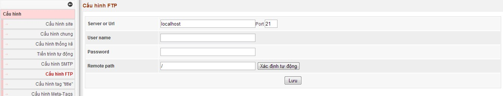

Với các hosting linux bật safe mode, hoặc khi cài đặt hệ thống cần chmode cho các file và cấc thư mục thì bạn nên nhập các thông số FTP để khi hệ thống cần thiết tạo thư mục hoặc chmode có thể thực hiện được.

Các thông số FTP này thường khi mua hosting bạn có các thông số này.

- Server or Url: Thường là địa chỉ IP hoặc tên domain hoặc localhost

- User name: User name của tài khoản FTP

- Remote path: Là giá trị của đường dẫn tới thư mục khi dùng phần mền FTP để truy cập.
