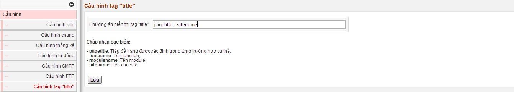

Phần này giúp chúng ta lựa chọn Phương án hiển thị tag "title" Trong đó có các phương án như:

- *pagetitle*: Tiêu đề trang được xác định trong từng trường hợp cụ thể,
- *funcname*: Tên function,
- *modulename*: Tên module,
- *sitename*: Tên của site
