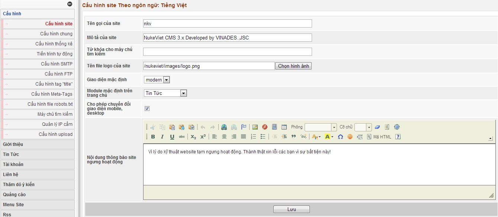

Phần này sẽ áp dụng cho site theo từng ngôn ngữ, nếu site của bạn có nhiều ngôn ngữ khác nhau bạn cần thiết lập các thông số này theo từng ngôn ngữ.  Chú thích:

- Tên gọi của site, Mô tả của site: hiển thị trên thanh tiêu đề của trình duyệt

- Từ khóa cho máy chủ tìm kiếm: Đây là từ khóa chung cho toàn site để các công cụ tìm kiếm có thể đánh dấu site bạn, tại đây bạn chỉ liệt kê các từ khóa chung nhất của site. Các từ khóa cách nhau bởi dấu phẩy.

- Tên file logo của site: Là logo hiển thị ngoài website nếu giao diện đó cho phép cấu hình

- Giao diện mặc định site: Là giao diện được sử dụng mặc định cho các các module nếu khi cấu hình module chọn giao diện mặc định.

- Module mặc định trên trang chủ: Module này sẽ được gọi khi truy cập bằng vào trang chủ của site.

- Nội dung thông báo site ngưng hoạt động: Bình thường mục này không được chọn, nếu chọn mục này thì chỉ có người quản trị mới nhìn thấy thông tin của site, các thành viên khác sẽ được thông báo bằng nội dung của ô: Nội dung thông báo site ngưng hoạt động.
