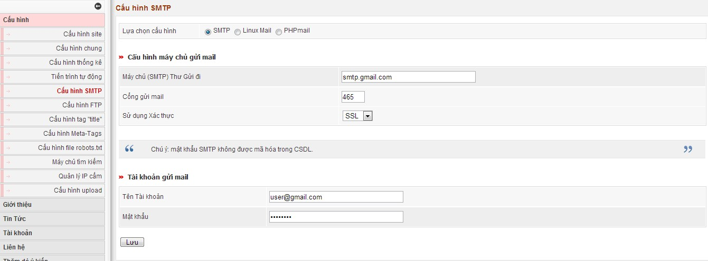
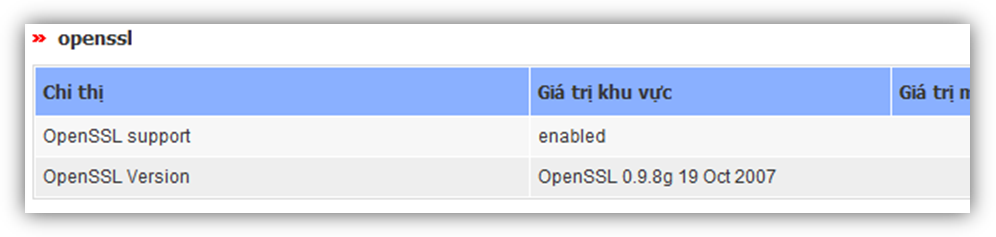

Trong một số trường hợp máy chủ của bạn không có hàm mail hoặc hàm mail bị chặn. Để có thể gửi mail được bạn cần cấu hình gửi mail bằng SMTP 

Ví dụ dùng tài khoản gmail:

- Máy chủ (SMTP) Thư Gửi: smtp.gmail.com

- Cổng gửi mail: 465 hoặc 587

- Sử dụng Xác thực: SSL

- Tên Tài khoản: (tài khoản email của bạn, có cả @gmail.com)

- Mật khẩu: (Mật khẩu đăng nhập gmail)

Nếu dùng SMTP để gửi mail có sử dụng SSL thì máy chủ cẫn hỗ trợ thư viện openssl. Để kiểm tra xem máy chủ của bạn có hỗ trợ hay không xem theo hướng dẫn sau:

Vào menu Thông tin - \> Tiện ích mở rộng tìm xem có đoạn sau không

