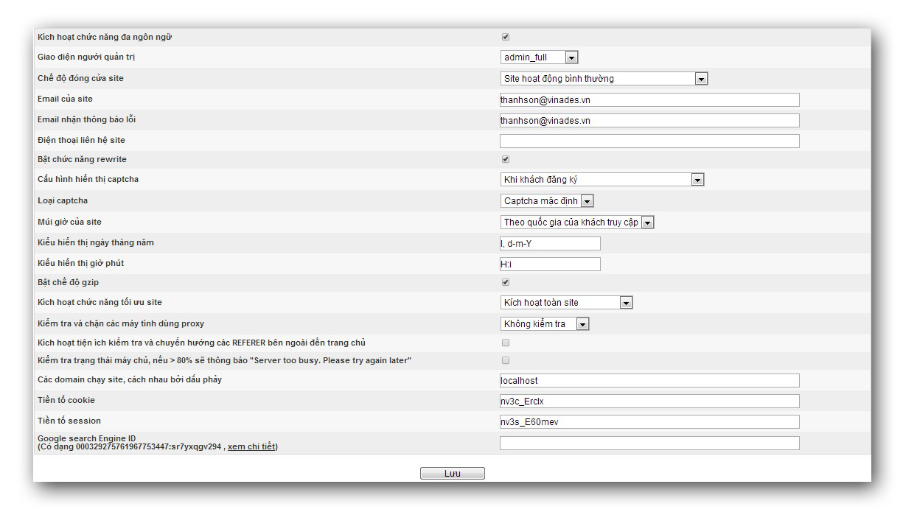

Cấu hình chung sẽ áp dụng cho toàn site, các cấu hình này bạn nên cấu hình ngay sau khi site cài đặt. 

- Kích hoạt chức năng Đa ngôn ngữ: Nếu chức năng này hoạt động bạn có thể xây dựng thêm các ngôn ngữ cho site, Nếu site chỉ xây dựng ngôn ngữ bạn nên tắt chức năng này.

- Giao diện người quản trị: Người quản trị có thể thay đổi giữa 2 loại giao diện admin_full và admin_default để quản lý site

- Chế độ đóng cửa site:

``` text
{{/images/nukeviet/setup/dong_cua_site.png|}} 
* Có 4 lựa chọn cho người sử dụng:
  * Site hoạt động bình thường (mặc định)
  * Đóng cửa site chỉ có Quản trị tối cao truy cập: Ở chế độ này thì site sẽ chỉ hiển thị với người quản trị tối cao, những thành viên hoặc khách sẽ nhận được thông báo trong phần [[/nukeviet/admin/settings/settings|nội dung thông báo site ngưng hoạt động]]
  * Đóng cửa site Người điều hành chung truy cập: Ở chế độ này thì chỉ có những người điều hành chung của site được truy cập và những người còn lại sẽ nhận được thông báo site đóng cửa
  *  Đóng cửa site tất cả admin truy cập: Ở chế độ này thì tất cả admin đều có quyền truy cập vào site và những người còn lại sẽ nhận được thông báo site đóng cửa
* Từ khóa tìm kiếm: Đây là từ khóa chung cho toàn site để các công cụ tìm kiếm có thể đánh dấu site bạn, tại đây bạn chỉ liệt kê các từ khóa chung nhất của site. Các từ khóa cách nhau bởi dấu phảy.
* Emai của site: Email này dùng làm email hiển thị tại các form thông báo chung tại các module.
* Email nhận thông báo lỗi: Email này để hệ thống gửi các thông báo lỗi trong quá trình hoạt động của site, để thay đổi việc gửi các lỗi cấn cấu hình biến: NV_SEND_ERRORS_LIST trong file includes\ constants.php
* Bật chức năng rewite. Nếu máy chủ của bạn hỗ trợ rewrite thì chức năng này mới hiển thị, bật chức năng này sẽ giúp các đường dẫn trên thanh địa chỉ của trình duyệt trông thân thiện hơn.
```

Ví dụ: bình thường đường dẫn của 1 chủ đề bài viết

``` text
http://my-site.com/index.php?language=vi&nv=news&op=So-tay-doanh-nhan
```

Khi bật chức năng rewite sẽ rút ngắn lại

``` text
http://my-site.com/vi/news/So-tay-doanh-nhan/
```

và có thể rút ngắn thành

``` text
http://my-site.com/news/So-tay-doanh-nhan/
```

Nếu chức năng "Kích hoạt đa ngôn ngữ" không hoạt động và "bật chức năng rewrite" thì sẽ xuất hiện tùy chọn "loại bỏ kí tự ngôn ngữ trên url".

- Chức năng: hiển thị captcha: được cấu hình trong 1 số form đăng ký, đăng nhập thành viên và quản trị site. Mặc định khi cài đặt chức năng này được cấu hình: Khi admin đăng nhập hoặc khách đăng ký
