## Cài đặt

Hiện giờ module Shop phiên bản mới nhất là 3.4.02 được phát hành độc lập với NukeViet 3.4, để cài đặt module này bạn cần cài đặt NukeViet 3.4 trước, sau đó tiền hành cài đặt module Shop lên đó.

- Địa chỉ tải module Shop: [http://nukeviet.vn/vi/store/modules/shops/](http://nukeviet.vn/vi/store/modules/shops/)  
  (Lưu ý: Chỉ tải về tại địa chỉ chính thức, không sử dụng các module trôi nổi hoặc code share trên mạng để tránh bị chèn mã độc hoặc có thể chứa những lỗi không thể lường trước)

Có 2 cách cài đặt module Shop lên NukeViet :  
===Cách 1:===

- Đăng nhập admin =\> Quản lý Modules =\> Cài đặt và đóng gói tự động =\> Lựa chọn tiến trình : Cài đặt gói Module + Block =\> Tiếp Tục.(Hình 1)  
  Hình 1: Lựa chọn tiến trình cài đặt.

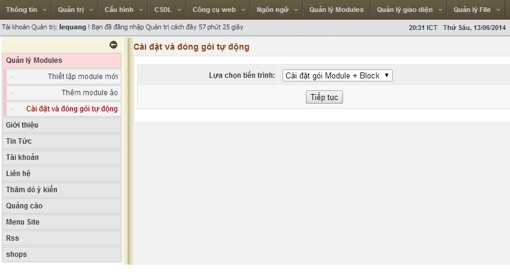  
\* Chọn tệp tin module Shop mà đã tải về trên mạng, chú ý tệp tin phải được nén dưới dạng file zip =\> tiếp tục.  
\* Sau đó hệ thống sẽ kiểm tra file tải lên =\> sau khi kiểm tra xong, chọn Thực hiện.  
\* Đợi cho quá trình cài đặt hoàn thành thì tự động chuyển về trang Quản lý Modules.(Hình 2)  
Hình 2: Thiết lập module mới. 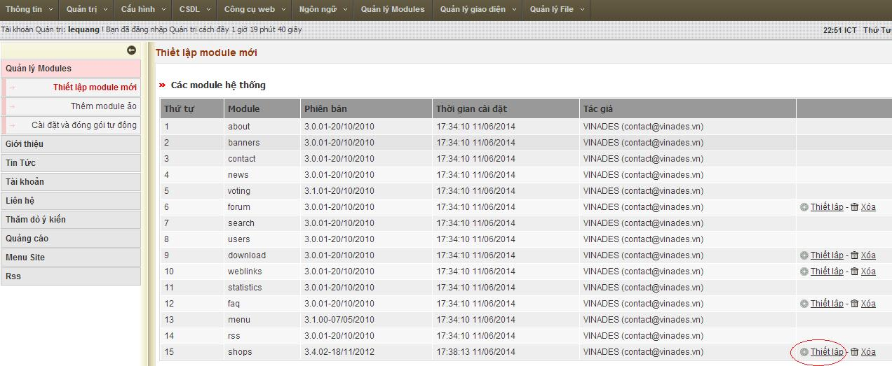  
\* Sau đó chọn thiết lập module Shop.  
\* Hệ thống sẽ ngay lập tức kích hoạt và chuyển bạn sang trang sửa thông tin module này.(Hình 3)  
Hình 3: Sửa thông tin của module "shops". 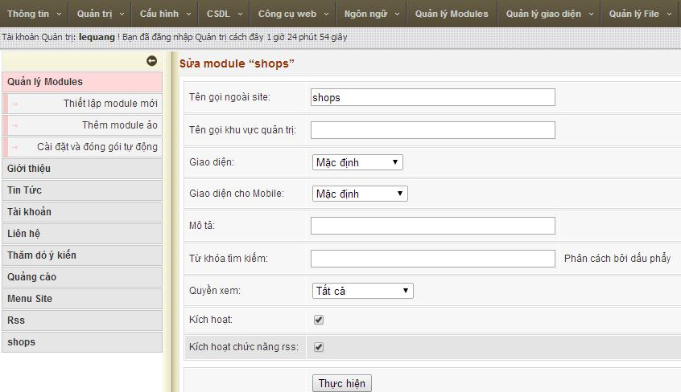  
\* Chọn Thực hiện.

#### Cách 2:

- Giải nén tập tin module Shop vừa mới tải về.  
  \* Copy toàn bô nội dung trong folder vừa giải nén được vào thư mục gốc của NukeViet.  
  \* Đăng nhập admin =\> Quản lý Modules =\> Thiết lập module mới =\> chọn Thiết lập module Shop.  
  \* Hệ thống sẽ ngay lập tức kích hoạt và chuyển bạn sang trang sửa thông tin module Shop.  
  \* Chọn Thực hiện.

## Hướng dẫn quản trị module Shop

### Danh sách sản phẩm

- Hiển thị danh sách sản phẩm được đăng lên.(Hình 4)  
  Hình 4: Danh sách sản phẩm.

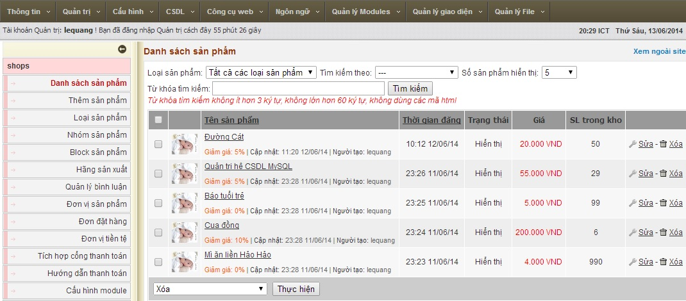

- Cho phép sửa, xóa thông tin của sản phẩm.  
  \* Tìm kiếm theo từ khóa, theo các thuộc tính của sản phẩm.  
  \* Cho phép lựa chọn số sản phẩm hiển thị trong một trang.

### Thêm sản phẩm

Để thêm sản phẩm trước tiên chúng ta cần phải tạo:  
\* Loại sản phẩm.  
\* Đơn vị sản phẩm.  
Cho phép thêm mới một sản phẩm.(Hình 5)  
Hình 5: Thêm mới sản phẩm. 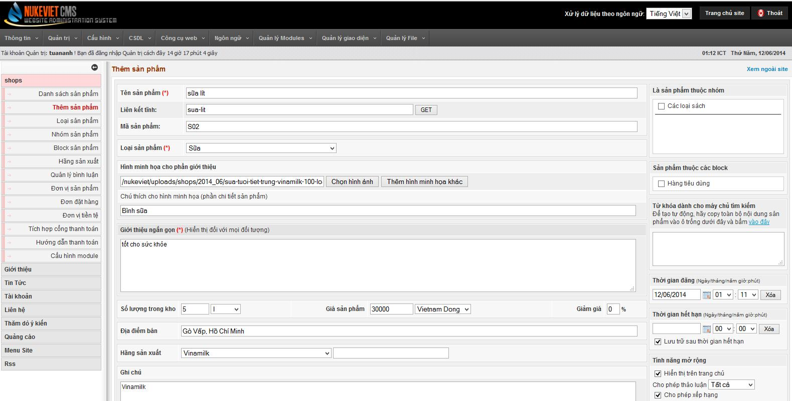  
Để thêm mới sản phẩm, nhập thông tin (Các phần đánh dấu \* là bắt buộc nhập, các phần còn lại có thể có hoặc không) :  
\* Tên sản phẩm cần thêm.  
\* Liên kết tĩnh: giúp tạo liên kết đến sản phẩm, tạo sự thân thiện cho các bộ máy tìm kiếm. Hệ thống sẽ tự tạo ra liên kết tĩnh dựa trên tên sản phẩm hoặc bạn có thể tự chỉnh sửa lại.  
\* Mã sản phẩm.  
\* Loại sản phẩm.  
\* Chọn hình cho sản phẩm: nhấn Browse để tìm kiếm và upload ảnh lên.(Hình 6)  
Hình 6: Chọn hình ảnh. 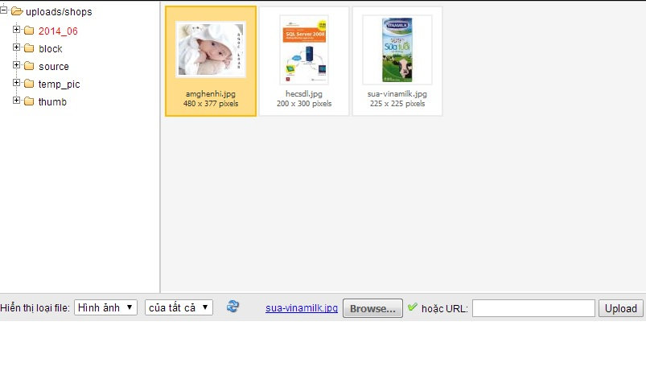  
\* Chú thích hình ảnh thêm vào.  
\* Giới thiệu ngắn gọn về sản phẩm.  
\* Số lượng trong kho, giá sản phẩm và giảm giá.  
\* Địa điểm bán sản phẩm.  
\* Chọn hãng sản xuất.  
\* Ghi chú.  
\* Bảo hành.  
\* Khuyến mãi.  
\* Nội dung chi tiết cho sản phẩm.  
Ta có thể chọn một trong hai nút: “Lưu sản phẩm nhưng không đăng” và “Đăng sản phẩm” tùy thuộc vào người nhập sản phẩm.  
Sau khi đăng bài, ta được danh sách các sản phẩm hiển thị bên ngoài site như sau:  
Hình 7: Sản phẩm sau khi đăng. 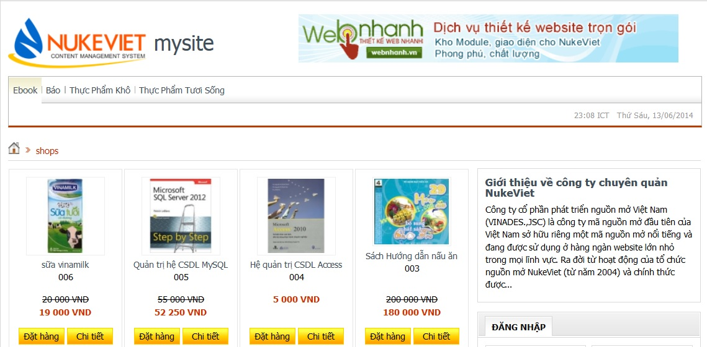  
==== Loại sản phẩm ====

- Hiển thị danh sách loại sản phẩm.(Hình 8)  
  Hình 8: Danh sách loại sản phẩm

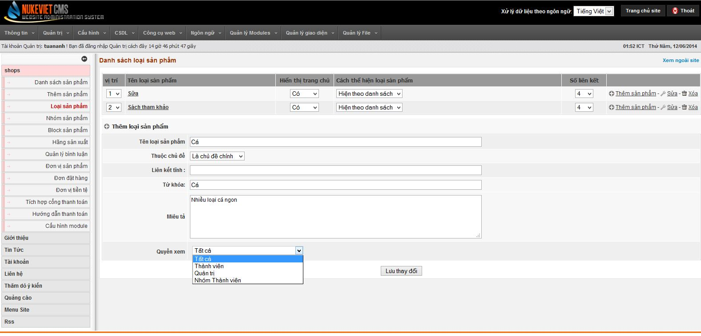

- Quản lý thêm, sửa, xóa loại sản phẩm.  
  \* Để thêm loại sản phẩm, nhập các thông tin sau :  
  \* Tên loại sản phẩm.  
  \* Chọn chủ đề: Khi mới tạo loại sản phẩm thì hệ thống chỉ cho phép tạo chủ đề chính, sau khi thêm loại sản phẩm sẽ cho phép chọn các chủ đề tương ứng.  
  \* Liên kết tĩnh : giúp tạo liên kết đến loại sản phẩm, tạo sự thân thiện cho các bộ máy tìm kiếm. Hệ thống sẽ tự tạo ra liên kết tĩnh dựa trên tên loại sản phẩm hoặc bạn có thể tự chỉnh sửa lại.  
  \* Từ khóa : chính là từ khóa để khi tìm kiếm được nhanh hơn.  
  \* Miêu tả : thông tin miêu tả về loại sản phẩm.  
  \* Quyền xem : cho phép đối tượng được xem loại sản phẩm này(Tất cả/Quản Trị/Thành viên/Nhóm thành viên).  
  \* Chọn “Lưu thay đổi” để lưu lại.

### Nhóm sản phẩm

- Hiện thị danh sách nhóm sản phẩm.(Hình 9)  
  Hình 9: Danh sách nhóm sản phẩm

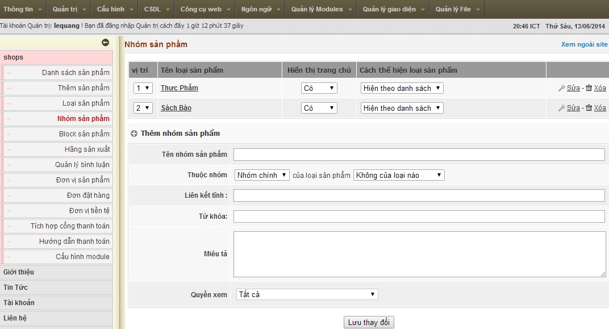

- Quản lý thêm, sửa, xóa nhóm sản phẩm.  
  \* Cho phép lựa chọn vị trí hiển thị của nhóm sản phẩm.  
  \* Cho phép lựa chọn có hoặc không có hiển thị nhóm sản phẩm lên trang chủ.  
  \* Cho phép lựa chọn cách thể hiện nhóm sản phẩm theo danh sách hay theo dang lưới.  
  \* Để thêm nhóm sản phẩm , nhập các thông tin:  
  \* Tên nhóm sản phẩm.  
  \* Chọn nhóm sản phẩm: nhóm chính hoặc các nhóm đã tạo.  
  \* Liên kết tĩnh : giúp tạo liên kết đến nhóm sản phẩm, tạo sự thân thiện cho các bộ máy tìm kiếm. Hệ thống sẽ tự tạo ra liên kết tĩnh dựa trên tên nhóm sản phẩm hoặc bạn có thể tự chỉnh sửa lại.  
  \* Từ khóa : chính là từ khóa để khi tìm kiếm được nhanh hơn.  
  \* Miêu tả : thông tin miêu tả về loại sản phẩm.  
  \* Quyền xem : cho phép đối tượng được xem loại sản phẩm này(Tất cả/Quản Trị/Thành viên/Nhóm thành viên).  
  \* Chọn “Lưu thay đổi” để lưu lại.

### Block sản phẩm

- Hiển thị danh sách các block sản phẩm.(Hình 10)  
  Hình 10: Danh sách Block sản phẩm.

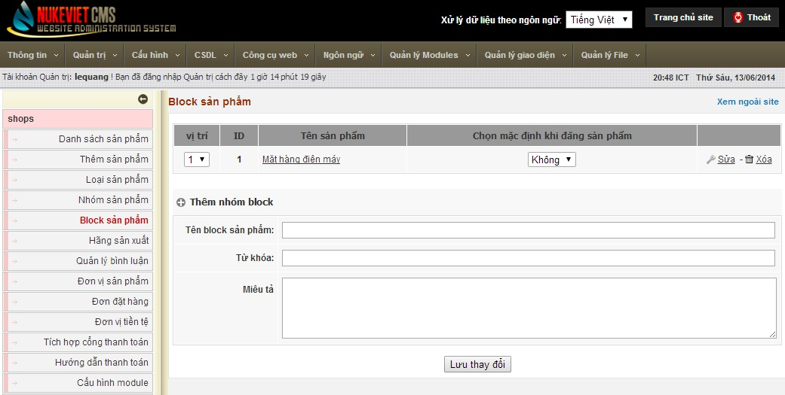  
\* Quản lý thêm, sửa, xóa block sản phẩm.  
\* Để thêm nhóm sản phẩm , nhập các thông tin:  
\* Tên block sản phẩm.  
\* Từ khóa: nhập từ khóa để khi tìm kiếm được nhanh hơn.  
\* Miêu tả: miêu tả block sản phẩm.  
\* Chọn “Lưu thay đổi” để lưu lại.

### Hãng sản xuất

- Hiển thị danh sách các hãng sản xuất.(Hình 11)  
  Hình 11: Danh sách hãng sản xuất.

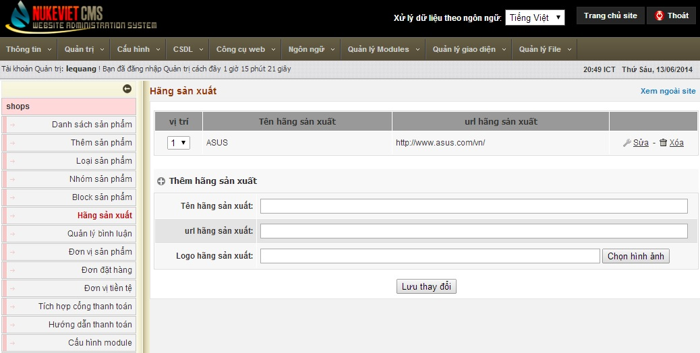  
\* Quản lý thêm, sửa, xóa hãng sản xuất.  
\* Để thêm hãng sản xuất, nhập các thông tin:  
\* Tên hãng sản xuất.  
\* url hãng sản xuất : để kết nối với website của hãng sản xuất(nếu có).  
\* Logo hãng sản xuất: logo làm đại diện cho hãng sản xuất.  
\* Chọn “Lưu thay đổi” để lưu lại.

### Quản lý bình luận

- Hiển thị danh sách các bình luận về sản phẩm.(Hình 12)  
  Hình 12: Danh sách các bình luận.

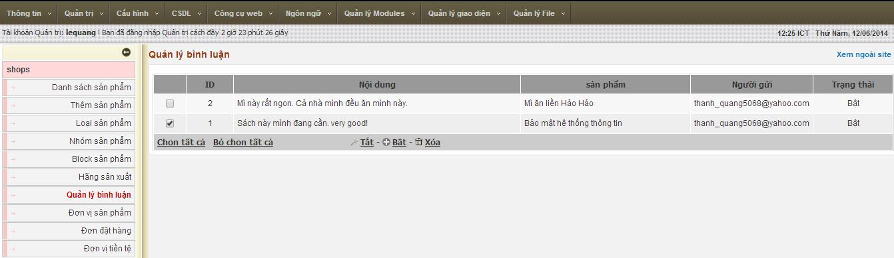  
\* Quản lý bật, tắt hoặc xóa các bình luận về sản phẩm.

### Đơn vị sản phẩm

- Hiển thị danh sách các đơn vị sản phẩm.(Hình 13)  
  Hình 13: Danh sách các đơn vị sản phẩm.

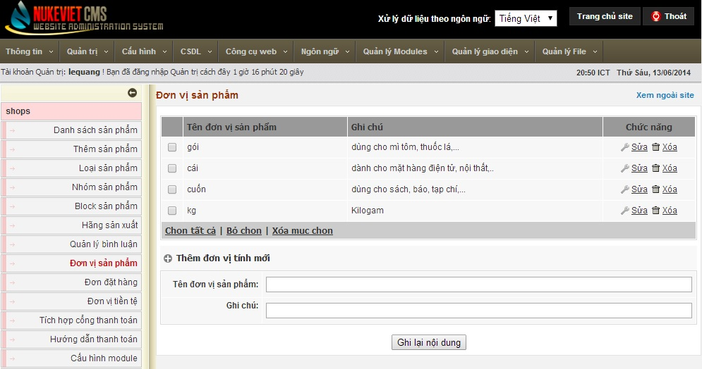  
\* Quản lý việc thêm mới, xóa, sửa thông tin của một đơn vị sản phẩm.  
\* Để thêm một đơn vị sản phẩm mới : điền thông tin vào Tên đơn vị sản phẩm và Ghi chú =\> chọn Ghi lại nội dung.

### Đơn đặt hàng

- Hiển thị danh sách các đơn đặt hàng.  
  \* Cho phép xem thông tin tất cả các đơn đặt hàng, xóa đơn đặt hàng  
  Hình 14: Danh sách các đơn đặt hàng.

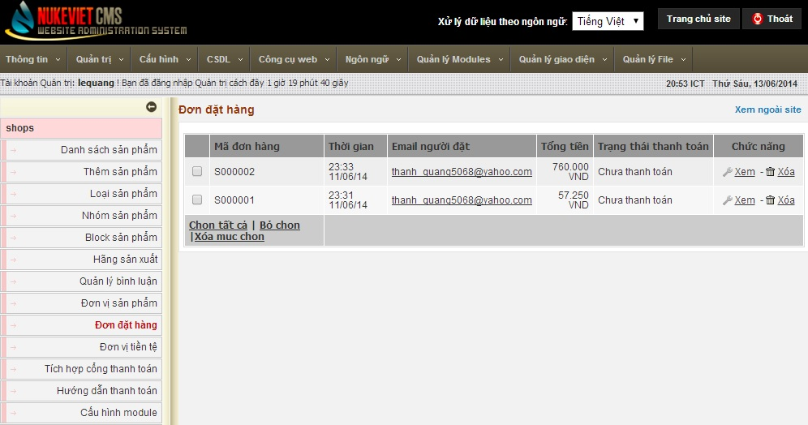  
\* Chọn xem đơn đặt hàng trong danh sách các đơn đặt hàng, ta có thể:  
\* Xem thông tin của người mua, các sản phẩm của đơn đặt hàng đó.  
\* Có thể in đơn đặt hàng.  
\* Có thể xác nhận người mua đã thanh toán đơn đặt hàng đó hay chưa.  
Hình 15: Thông tin đơn đặt hàng. 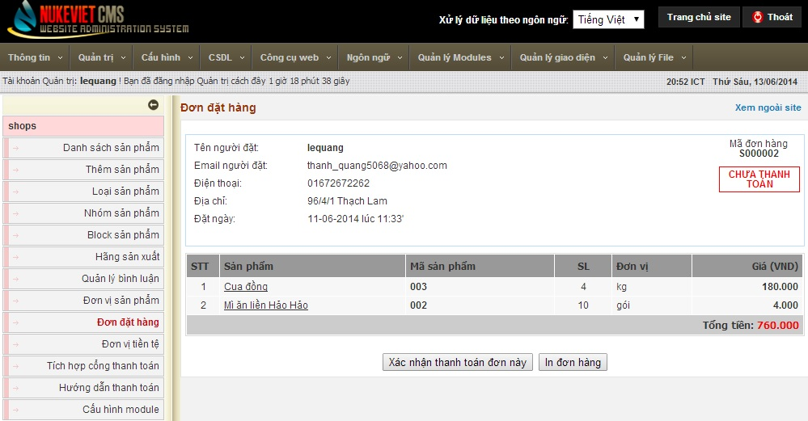  
==== Đơn vị tiền tệ ====

- Hiển thị danh sách các đơn vị tiền tệ.(Hình 16)  
  Hình 16: Danh sách các đơn vị tiền tệ.

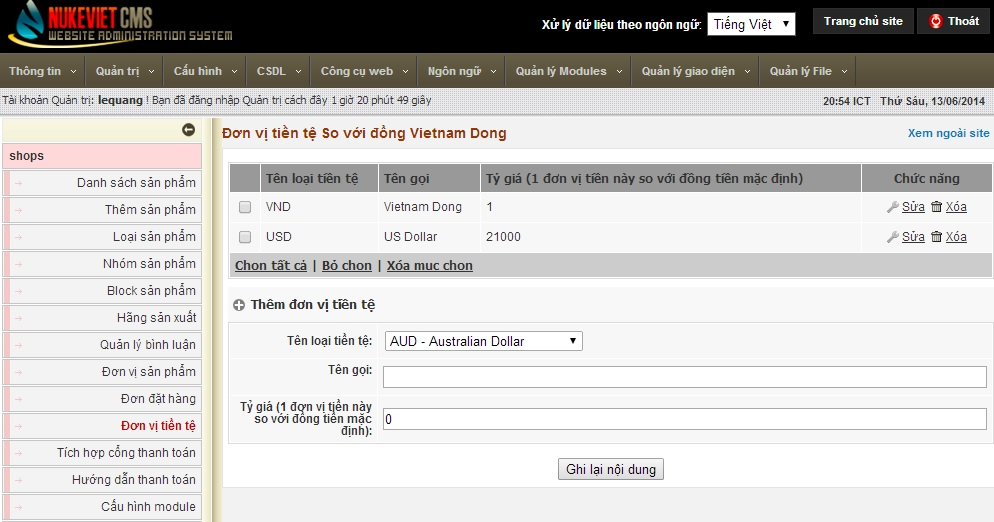  
\* Quản lý việc thêm, sửa, xóa đơn vị tiền tệ, mặc định khi cài NukeViet là Việt Nam đồng và USD.  
\* Để thêm 1 đơn vị tiền tệ cần nhập các thông tin :

``` text
  * Chọn loại tiền tệ. \\
  * Tên gọi ( để hiển thị cho loại tiền tệ).\\
  * Tỷ giá so với đơn vị tiền tệ trong nước.\\
* Nhấn Ghi lại nội dung để lưu lại.
```

### Tích hợp cổng thanh toán

Quản lý : thêm, sửa và kích hoạt/ ngừng kích hoạt cổng thanh toán.  
Hình 17: Tích hợp cổng thanh toán. 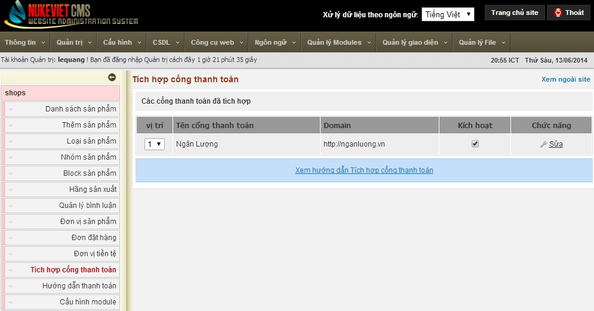  
Xem bài viết chi tiết tại đây: [Tích hợp cổng thanh toán](/nukeviet/admin/shops/payport)

### Hướng dẫn thanh toán

- Cung cấp thông tin cụ thể nhằm hướng dẫn khách hàng dễ dàng trong việc thanh toán.  
  \* Nội dung này hiển trong phần chi tiết mỗi sản phẩm hỗ trợ thanh toán.  
  Hình 18: Hướng dẫn thanh toán.

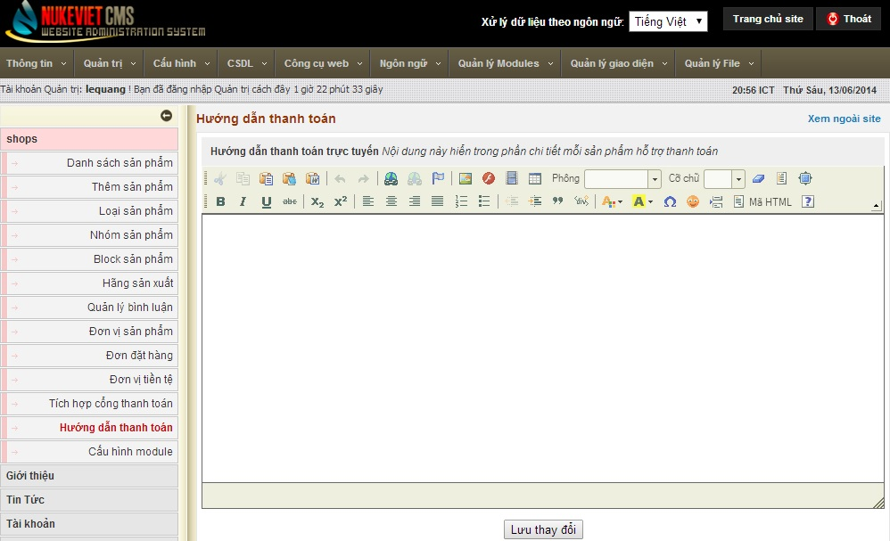  
\* Để hướng dẫn thanh toán, nhập nội dung hướng dẫn rồi chọn "Lưu thay đổi".

### Cấu hình module

Hình 19: Cấu hình module. 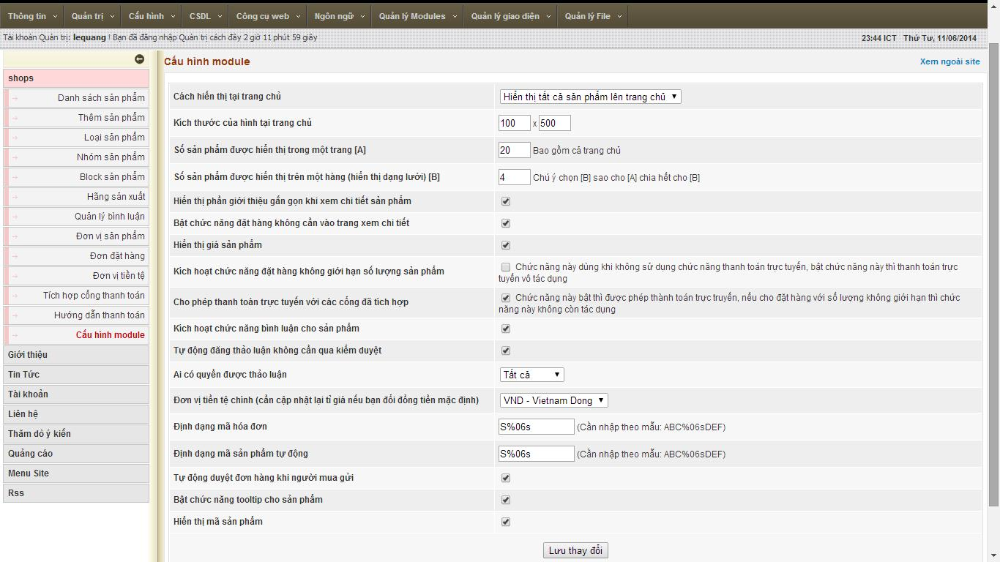  
=== Cho phép tùy chỉnh các thông tin về module shops như : ===

- Cách hiển thị tại trang chủ  
- Kích thước của hình tại trang chủ  
- Số sản phẩm được hiển thị trong một trang  
  \* Số sản phẩm được hiển thị trên một hàng  
  \* Hiển thị phần giới thiệu gắn gọn khi xem chi tiết sản phẩm  
- Bật chức năng đặt hàng không cần vào xem trang chi tiết  
- Hiển thị giá sản phẩm  
- Kích hoạt chức năng đặt hàng không giới hạn số lượng sản phẩm  
- Cho phép thanh toán trực tuyến với các cổng đã tích hợp  
- Kích hoạt chức năng bình luận cho sản phẩm  
- Tự động đăng thảo luận không cần qua kiểm duyệt  
- Ai có quyền được thảo luận  
- Đơn vị tiền tệ sử dụng  
  \* Định dạng mã hóa đơn  
  \* Định dạng mã sản phẩm tự động  
  \* Tự động duyệt đơn hàng khi người mua gửi  
  \* Bật chức năng tooltip cho sản phẩm  
  \* Hiển thị mã sản phẩm  
  ===== Tham khảo =====

- Xem giới thiệu chi tiết về module: [http://forum.nukeviet.vn/viewtopic.php?f=3&t=25317](http://forum.nukeviet.vn/viewtopic.php?f=3&t=25317).
- Hỗ trợ sử dụng: [http://forum.nukeviet.vn/viewforum.php?f=119](http://forum.nukeviet.vn/viewforum.php?f=119).
- Báo lỗi module: [http://forum.nukeviet.vn/viewtopic.php?f=119&t=25319](http://forum.nukeviet.vn/viewtopic.php?f=119&t=25319).
- Hướng dẫn nâng cấp: [http://forum.nukeviet.vn/viewtopic.php?f=119&t=25318](http://forum.nukeviet.vn/viewtopic.php?f=119&t=25318)
