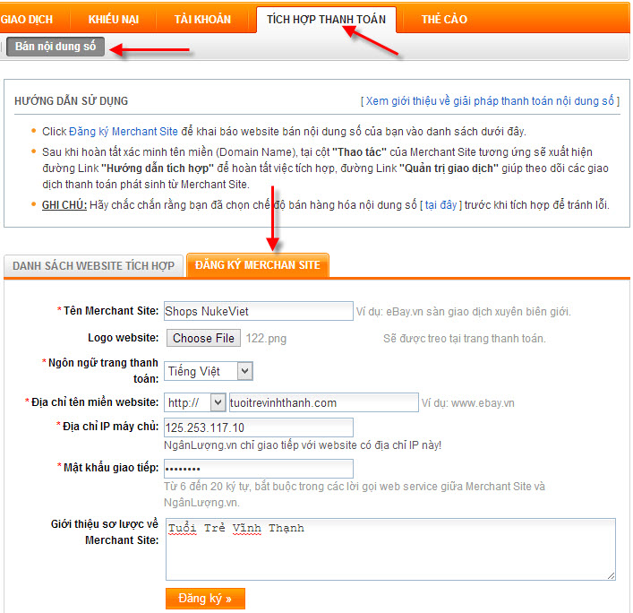
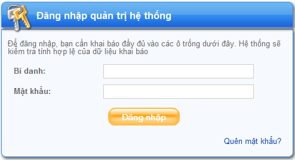
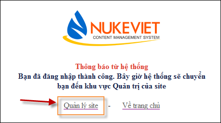
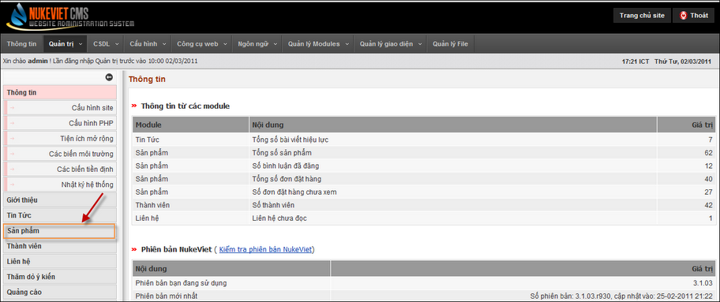
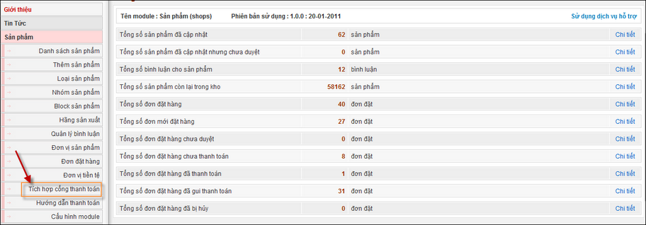
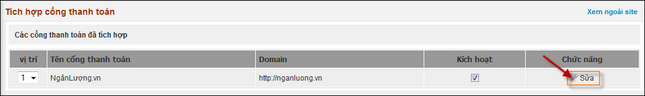
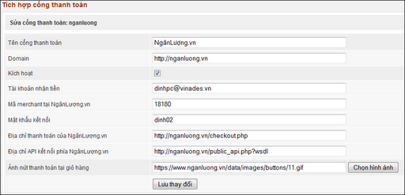
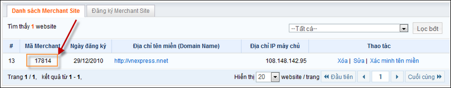
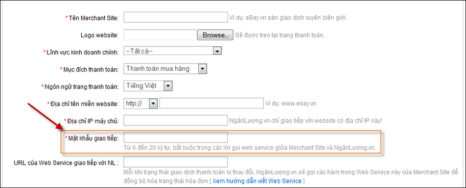

## Cài đặt

Hiện giờ module Shop phiên bản mới nhất là 3.4.02 được phát hành độc lập với NukeViet 3.4, để cài đặt module này bạn cần cài đặt NukeViet 3.4 trước, sau đó tiền hành cài đặt module Shop lên đó.

- Địa chỉ tải module Shop: [http://nukeviet.vn/vi/store/modules/shops/](http://nukeviet.vn/vi/store/modules/shops/)  
  (Lưu ý: Chỉ tải về tại địa chỉ chính thức, không sử dụng các module trôi nổi hoặc code share trên mạng để tránh bị chèn mã độc hoặc có thể chứa những lỗi không thể lường trước)

## Quản trị module Shop

Xem [Tạo gian hàng bằng NukeViet](/nukeviet/admin/shops)

## Tích hợp cổng thanh toán ngân lượng

### Đăng ký ví điện tử Ngân Lượng

Để có thể tích hợp cổng thanh toán ngân lượng vào website bán hàng bạn cần có một tài khoản nhận tiền, tài khoản nhận tiền chính là tải khoản ví điện tử của Ngân Lượng. Nếu bạn chưa có tài khoản, cần đăng kí trước tiên. Để thực hiện việc đăng kí tài khoản, tham khảo tài liệu [Hướng dẫn mở tài khoản ví điện tử](http://help.nganluong.vn/?portal=help&page=help_browse&category_id=56&category_name=Dang-ky-mo-tai-khoan&cat=2&page_no=1)

### Đăng ký Merchant Site

Để đăng kí Merchant Site trước tiên cần đăng nhập vào Ngân Lượng, sau khi đăng nhập thành công trên menu của thành viên chọn Tích hợp thanh toán =\> Bán nội dung số =\> Đăng kí Merchant Site, điền đầy đủ các thông tin vào form như ảnh

Sau khi đăng ký xong, bạn tiếp tục làm theo những hướng dẫn để xác minh website. Chú ý:

- Mục địa chỉ tên miền website cần điền đúng quy luật thì phần tích hợp mới hoạt động được. Nếu website của bạn chạy ngay từ tên miền chính ví dụ [http://nukeviet.vn](http://nukeviet.vn), [http://shops.nukeviet.vn](http://shops.nukeviet.vn) thì điền vào là nukeviet.vn, shops.nukeviet.vn. Nếu website của bạn được đặt vào thư mục con so với thư mục chính, đường dẫn tới website có dạng [http://nukeviet.vn/shops/](http://nukeviet.vn/shops/) hoặc [http://shops.nukeviet.vn/shops/](http://shops.nukeviet.vn/shops/) thì điền vào nukeviet.vn/shops, shops.nukeviet.vn/shops, không điền dấu / ở cuối đường dẫn ví dụ nukeviet.vn/.
- Mục Mật khẩu giao tiếp là mục bạn cần ghi nhớ để tích hợp vào shops.

### Tích hợp vào shops

Bước 1: Đăng nhập vào phần quản trị admin  Bước 2: Chọn phần quản lý site  Bước 3: Chọn phần Sản Phẩm  Bước 4: Chọn tích hợp cổng thanh toán  Bước 5: Chọn sửa để cấu hình thanh toán qua NgânLượng.vn  Bước 6: Tiến hành cấu hình thông tin.  Tại đây bạn cần chú ý điền các thông tin sau.

1\. Tên cổng thanh toán: Các bạn điền là NgânLượng.vn

2\. Domain: Các bạn điền là [https://nganluong.vn](https://nganluong.vn)

3\. Kích hoạt: Bạn check vào ô kích hoạt như hình phía trên.

4\. Tài khoản nhận tiền: Bạn điền Email tài khoản NgânLượng.vn mà bạn đã đăng ký tại [https://nganluong.vn](https://nganluong.vn).

5\. Mã Merchant tại NgânLượng.vn: Thông tin này bạn sẽ được bên NgânLượng.vn cấp khi tiến hành đăng ký Merchant.

6\. Mật khẩu kết nối: Mật khẩu này chính là mật khẩu giao tiếp khi bạn đăng ký Merchant site tại NgânLượng.vn.

7\. Địa chỉ thanh toán của NgânLượng.vn: bạn điền [https://nganluong.vn/checkout.php](https://nganluong.vn/checkout.php)

8\. Địa chỉ API kết nối phía NgânLượng.vn: Bạn điền [https://ngannluong.vn/public_api.php?wsdl](https://ngannluong.vn/public_api.php?wsdl).

9\. Ảnh nút thanh toán : bạn có thể truy cập vào [http://developer.nganluong.vn/?portal=integration&page=button_style&itemId=3](http://developer.nganluong.vn/?portal=integration&page=button_style&itemId=3) để chọn mẫu nút mà mình thích. Sau khi điền xong các thông tin bạn chọn lưu thay đổi.

Như vậy là bạn đã thực hiện xong việc tích hợp ngân lượng vào website.
