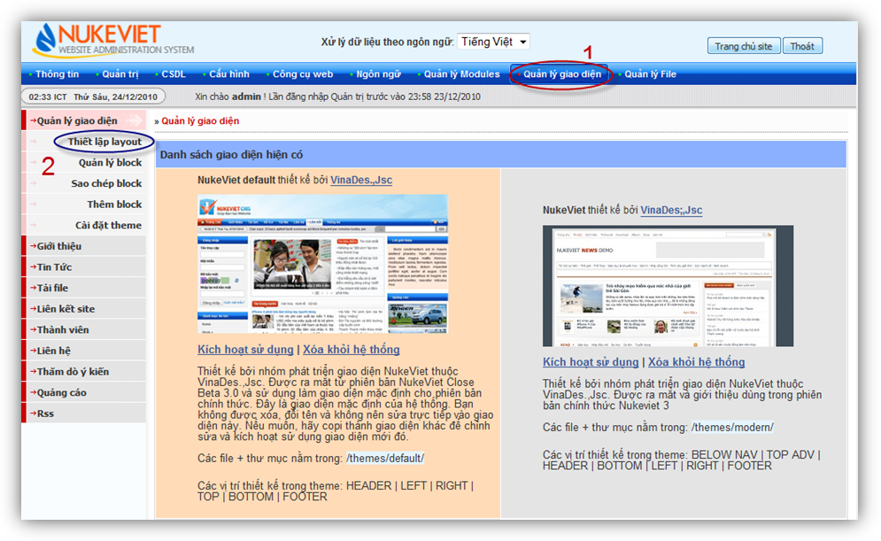

## Giới thiệu

Mặc định hệ thống Nukeviet3.0 có hai theme (giao diện) là default và modern

Để cấu hình giao diện cần đăng nhập khu vực quản trị với quyền điều hành tối cao hoặc điều hành chung, sau khi đăng nhập xong:

Nhấp chọn vào menu quản lý giao diện

Tại đây sẽ hiển thị đầy đủ các theme hiện có trên hệ thống

Bên trái sẽ là menu các chức năng mở rộng cho Quản lý giao diện (sẽ tìm hiểu ở phần sau)

- Thiết lập layout
- Quản lý block
- Sao chép Block
- Thêm block
- Cài đặt theme

## Kích hoạt giao diện mặc định cho hệ thống

Mỗi theme sẽ có các mô tả về theme như người thiết kế, các vị trí thiết kế…

Nhấp chọn vào kích hoạt sử dụng trên theme cần sử dung, Để xem giao diện mới được kích hoạtchọn trang chủ site
