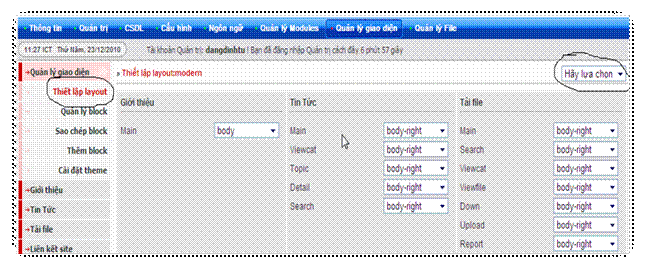

**Thông Báo** ~~bank níck~~

### Thêm mới giao diện

**Đăng nhập admin** =\> **quản lý giao diện** =\> **cài đặt theme** =\> **cài đặt theme lên hệ thống** =\> **tiếp tục** =\> sau đó chọn tệp tin theme mà đã tải về trên mạng chú ý tệp tin theme phải được nén dưới dạng file zip. Sau đó hệ thống sẽ kiểm tra file tải lên và cài đặt rồi chuyển đến trang quản lý giao diện

Chọn thiết lập layout và chọn theme vừa tải lên sau đó lưu cấu hình lại và chuyển đến trang quản lý giao diện và kích hoạt theme đó.

:-o8-O chào các bạn đến với forum**class 11a**
