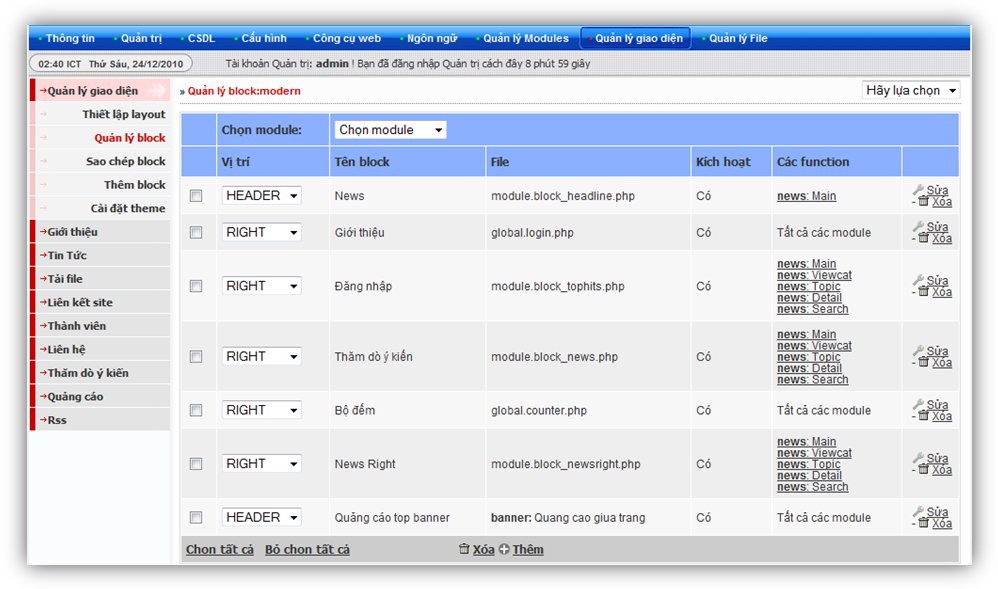
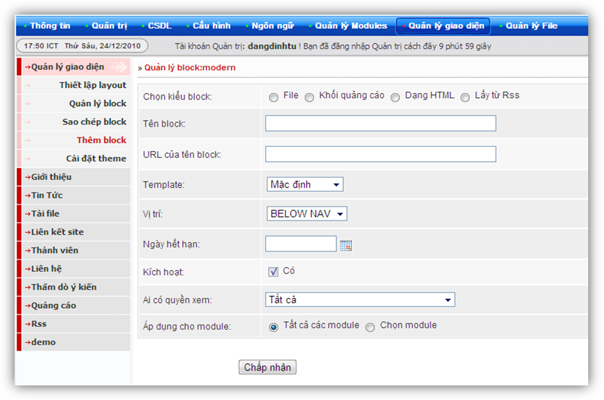
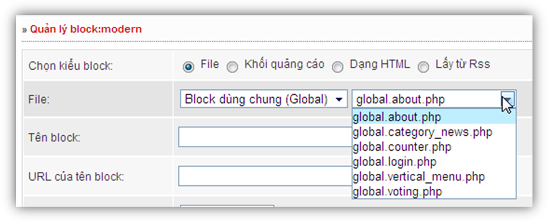
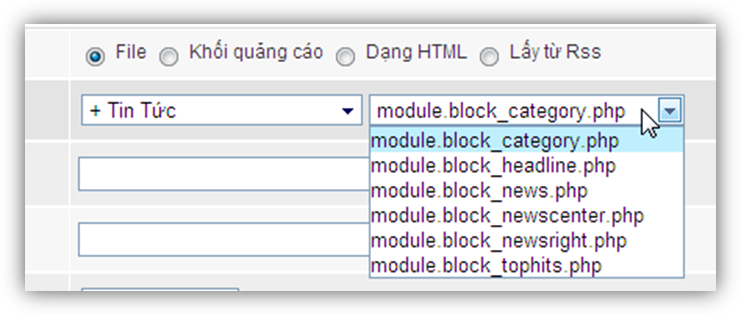
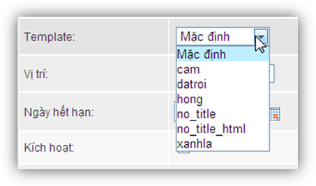
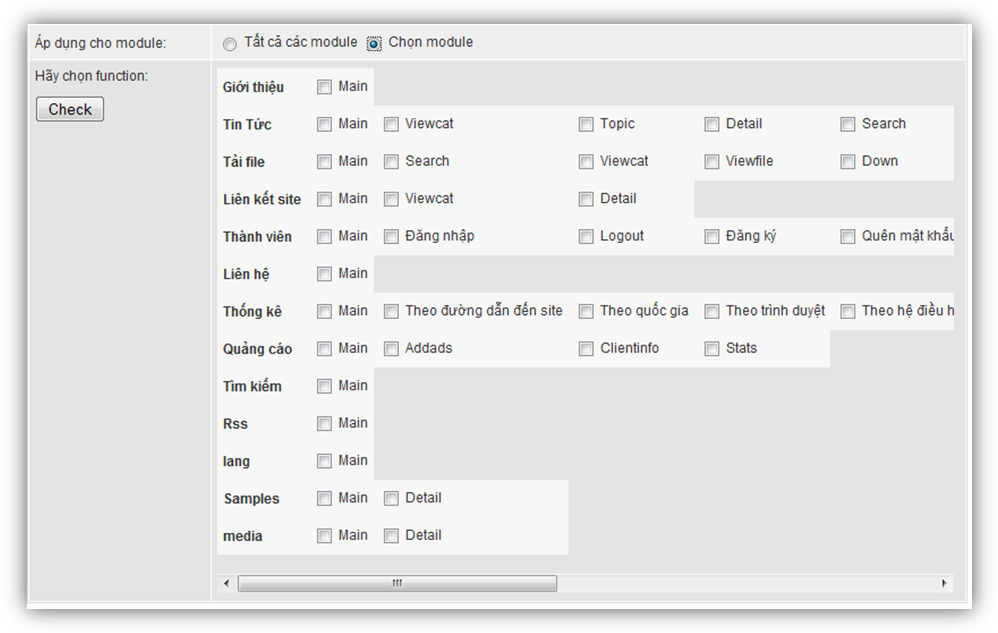
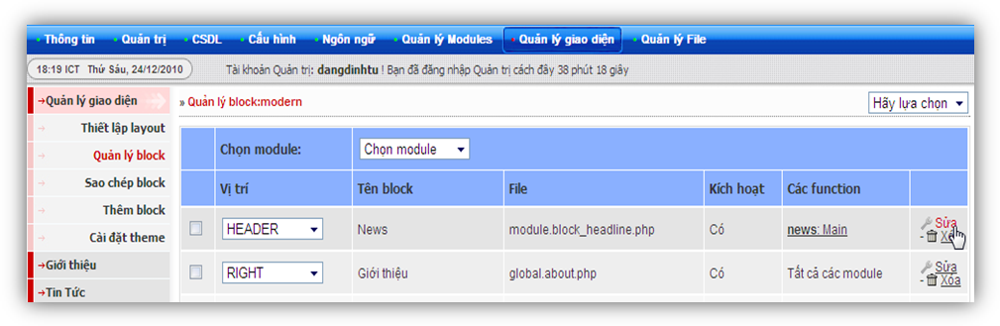
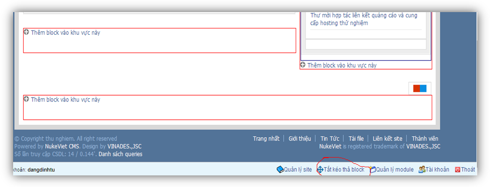
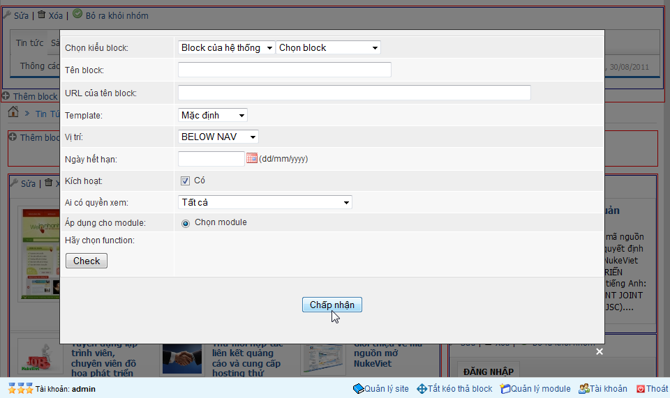

Tại chuyên mục quản lý block của giao diện sẽ được thể hiện như Hình 1



Ta sẽ tìm hiểu kỹ từng thành phần trong này:

- Quản lý block: modern : thể hiện việc quản lý block trên theme đang sử dụng

``` text
  lựa chọn: Giúp lựa chọn theme mà muốn quản lý block theo theme đó
```

- Chọn module: Giúp lựa chọn các module mà có chứa các block được thể hiện trên module đó

- Vị trí: đây chính là vị trí đặt các block

- Tên block: đặt tên cho block để dễ quản lý

- Các function: đây chính là giới hạn đặt block trên các module. Phần này sẽ được tìm hiểu kỹ hơn ở chuyên mục module
- Chức năng sửa xóa block

### Thêm block

Để thêm một block bạn có 2 cách thêm block

Thêm block tại trang quản lý admin Quản lý giao diện chọn thêm block 

Sau đó chọn File \> Hãy chọn dạng:

Có 2 loại block là block dùng chung cho tất cả các module hay còn gọi là block dùng chung (global)

- Dạng global gồm các block mặc định như hình 3



- Block theo module mình lấy ví dụ module tin tức(news) như hình 4



Sau khi đã chọn được block ta sẽ tiến hành đặt tên cho block và tạo giao diện cho nó như hình 5



Có 2 dạng template cho block đó là theo màu và không có tiêu đề (no_title)

Ngoài ra còn có các chức năng khác như vị trí thể hiện, ngày hết hạn, quyền xem, kích hoạt block, sau đó ta tiến hành áp dụng trên toàn site chú ý hình thức này chỉ áp dụng được cho các block dùng chung (global) còn blokc cho module thì chỉ thể hiện trên module đó mà thôi, hoặc áp dụng trên các function như hình



Để hiểu rõ hơn về các function này bạn cần nghiên cứu về cấu trúc module

Cuối cùng là chấp nhận để lưu cài đặt, sau đó ra trang chủ để xem kết quả

### Sửa, xóa một block

Đăng nhập admin quản lý giao diện =\> quản lý block =\>sửa hoặc xóa một block bất kỳ như hình 7 

### Quản lý block trên trang chủ

Đăn nhập admin sau đó ra trang chủ =\> di chuyển xuống dưới chọn chức năng bật, tắt kéo thả block để quản lý việc theme block hay di chuyển vị tri các block



Tiếp theo ta sẽ thực hiện việc thêm một block. Chọn chức năng thêm block vào khu vực này

Giao diện sẽ như sau



NukeViet cho phép sử dụng 4 kiểu block:

- Block dạng file : có các dạng global (dùng chung cho tất cả module, bắt đầu bằng chữ “Global”, trừ các block của hệ thống) và dạng block hiển thị theo module (Block module, bắt đầu bằng chữ “module”).

- Block dạng khối quảng cáo: Nạp các banner từ [module Quảng cáo](/nukeviet/admin/banners).

- Block HTML: Block Hệ thống, sử dụng để chèn các khối html (không dùng thẻ iframe, và các đoạn mã javascript...) lên site.
- Block Rss : để lấy tin tức rss từ trang bất kỳ có dạng [http://dantri.com.vn/the-thao.rss](http://dantri.com.vn/the-thao.rss)
