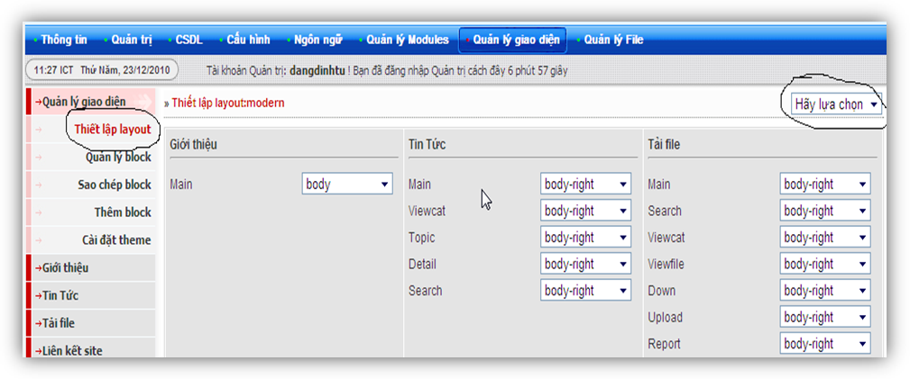
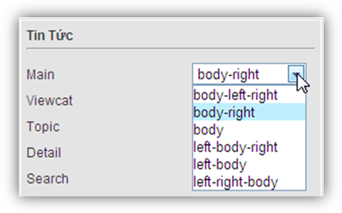
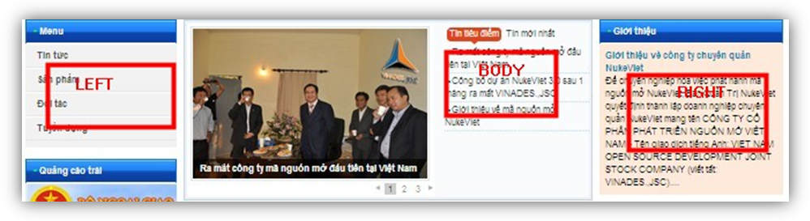

- Tại menu trái **Thiết lập layout** xuất hiện giao diện quản lý hình 1

Tại đây với mỗi function (main, viewcat, topic…) của từng module sẽ được thể hiện dưới nhiều giao diện như hình 7:

Theo theme mặc định sẽ có các giao diện như hình 2 

Ví dụ: body - left- right tức là giao diện 3 cột là: nội dung (body), cột left và cột right.

Sau đó lưu cấu hình ra trang chủ để xem kết quả.
