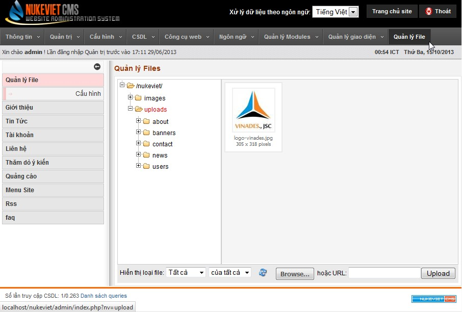
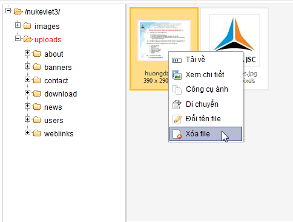
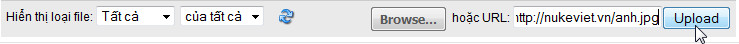

## Giới thiệu về hệ thống quản lý file

Hệ thống cho phép bạn quản lý toàn bộ các tiệp tin hình ảnh và các tệp tin được upload lên hệ thống tại thư mục uploads. Bạn có thể quản lý chúng bằng cách truy cập Admin Control Panel =\> Quản lý File. Giao diện trang quản lý như sau: 

Hệ thống quản lý file của NukeViet là hệ thống quản lý tập trung, ngoài chế độ quản lý độc lập như ở trên, hệ thống này còn được gọi ra từ các chế độ upload file, chèn hình... ở nhiều module, vị trí khác nhau.

## Thêm/Sửa/Xóa/Di chuyển file, folder

- Để sửa, xóa, di chuyển 1 file đã có, bạn click chuột phải lên file đó.

- Để Thêm, sửa, xóa một folder, bạn hãy click chuột phải lên folder đó.
- Để upload một file từ máy tính hoặc từ một địa chỉ trên mạng, bạn sử dụng nút upload cuối trang.

<u>Lưu ý:</u>

- Bạn muốn upload file lên thư mục nào trên hệ thống thì cần chọn thư mục đó, mặc định hệ thống sẽ chọn thư mục gốc của thư mục upload làm thư mục đầu tiên truy cập.
- Tùy vào quyền được phân mà bạn có thể có các quyền tạo, xóa tệp tin, xóa thư mục... ở các khu vực được phân quyền quản lý.
