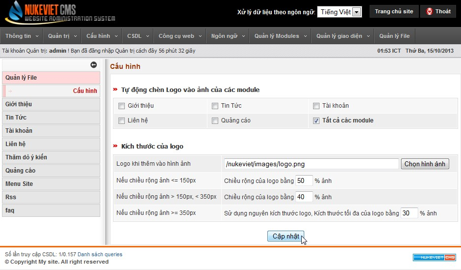

Từ phiên bản NukeViet 3.4 NukeViet đã bổ sung thêm chức năng "Cấu hình quản lý file". Tại đây bạn có thể thực hiện việc: - Bật tắt chức năng tự động chèn logo vào ảnh upload vào một trong các module nhất định hoặc toàn bộ website. - Cấu hình logo sẽ chèn, kích thước của logo khi chèn vào hình.

Để làm việc này, bạn truy cập: Admin Control Panel/ Quản lý file/ Cấu hình

Giao diện cấu hình quản lý file như dưới đây:

Quyền truy cập: Chỉ có Người điều hành tối cao và Người điều hành chung được cấp quyền để truy cập tính năng này.
