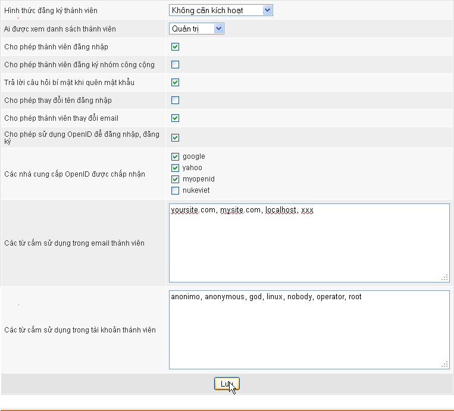
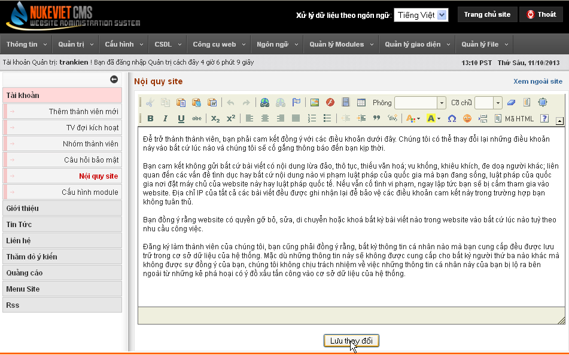
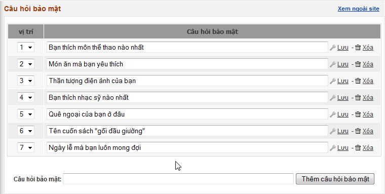
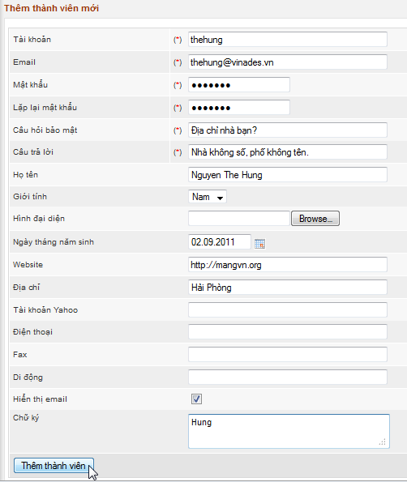
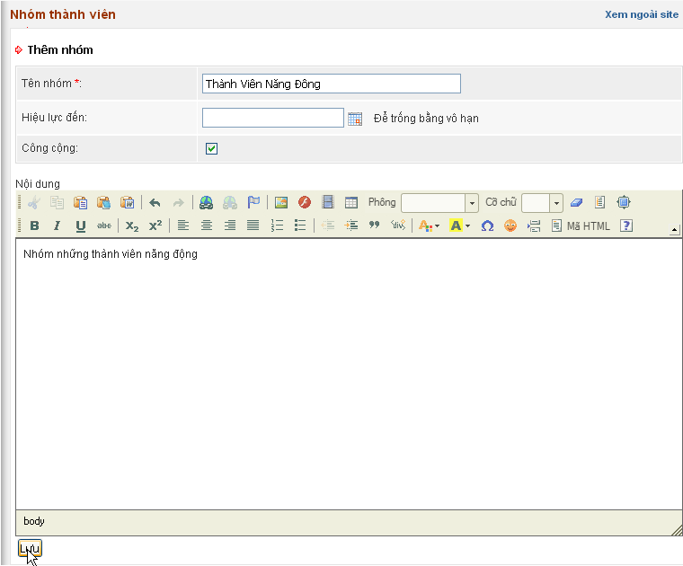

### Giới thiệu về hệ quản trị tài khoản

Module này cho phép quản lý tập trung toàn bộ hệ thống thành viên của site.

### Cấu hình module thành viên

### Nội quy website

### Câu hỏi bảo mật

 Câu hỏi bảo mật được sử dụng trong trường hợp thành viên quên mật khẩu, muốn hệ thống gửi lại mật khẩu qua email.

### Danh sách thành viên đợi kích hoạt

Cho phép bạn quản lý các thành viên chưa được kích hoạt.

### Thêm thành viên mới

### Quản lý nhóm thành viên

Nhóm thành viên là một chức năng cho phép hệ thống tổ chức và phân quyền theo nhóm. Chức năng này sẽ giúp các hệ thống lớn dễ dàng phân loại thành viên và áp dụng những quy tắc khác nhau cho từng nhóm khác nhau. 
