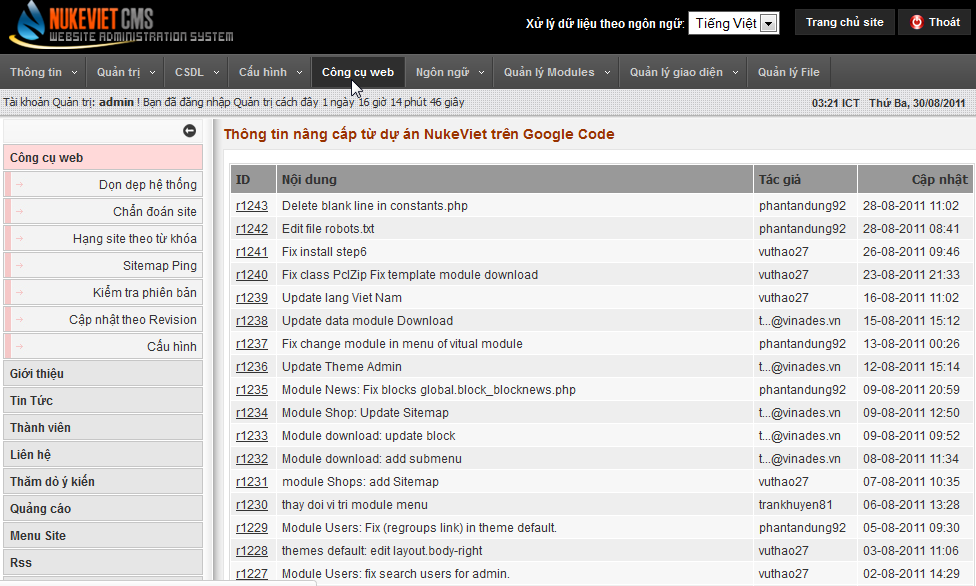
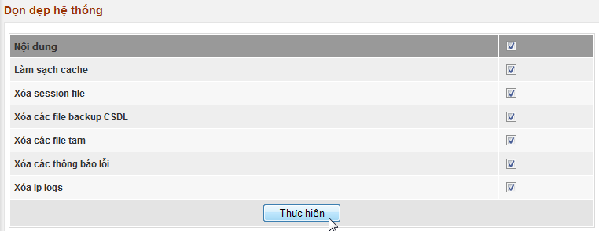
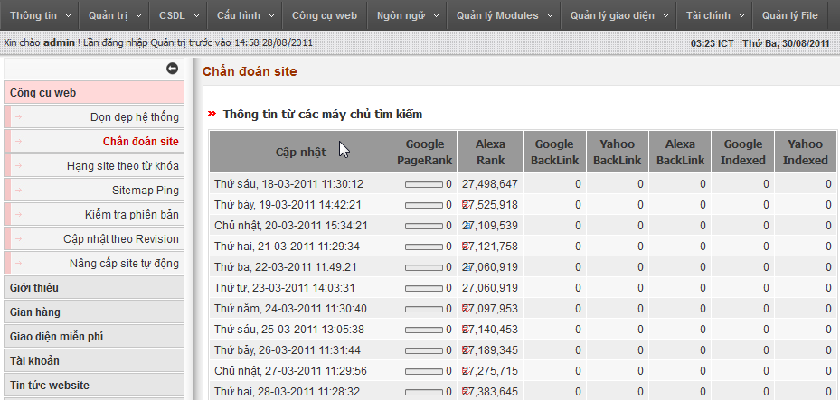
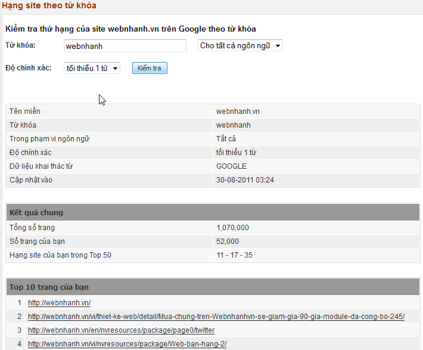
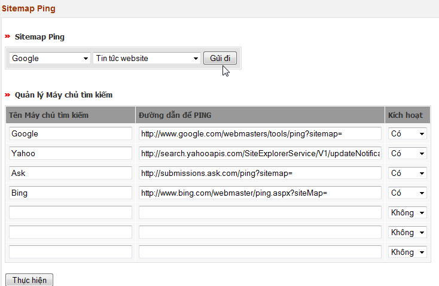
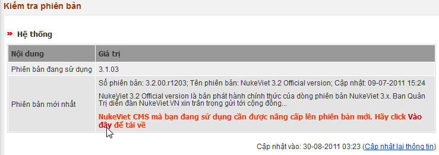
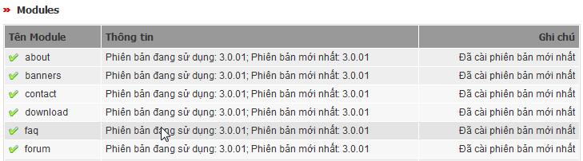
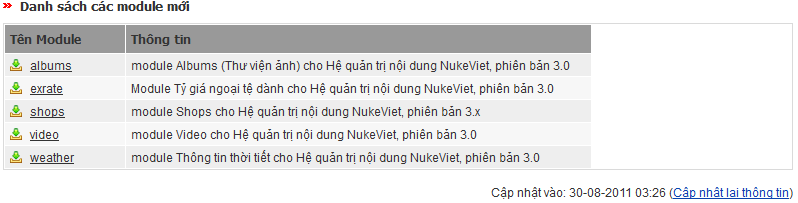
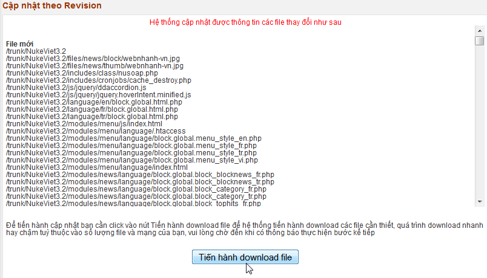
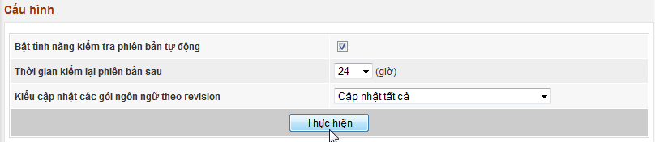

## Dọn dẹp hệ thống

## Chẩn đoán site

Chức năng này giúp bạn theo dõi các thông tin được cung cấp từ các máy chủ tìm kiếm về site của bạn. 

## Hạng site theo từ khóa

Chức năng này giúp người quản trị kiểm tra thứ hạng sủa site theo từ khóa trên các máy chủ tìm kiếm, đây là công cụ đắc lực phục vụ trong việc khảo sát kết quả quảng bá website hoặc kết quả SEO (Search Engine Optimization). 

## Sitemap Ping

Chức năng này giúp bạn gửi các thông tin lên máy chủ tìm kiếm, giúp nó nhận diện và tạo chỉ mục cho site bạn nhanh hơn. 

## Kiểm tra phiên bản

Chức năng này giúp bạn kiểm tra tình trạng hệ thống của bạn xem có phải là mới nhất không.   

## Cập nhật theo Revision

Chức năng này giúp cập nhật hệ thống của bạn theo các phiên bản đang được phát triển.

## Cấu hình

 Chức năng này giúp bạn tùy chỉnh tính năng kiểm tra phiên bản tự động (nếu bạn chạy trên mạng LAN thì bạn có thể tắt chức năng này đi, tránh việc hệ thống gọi ra ngoài internet không được sẽ gây chậm cho site)
