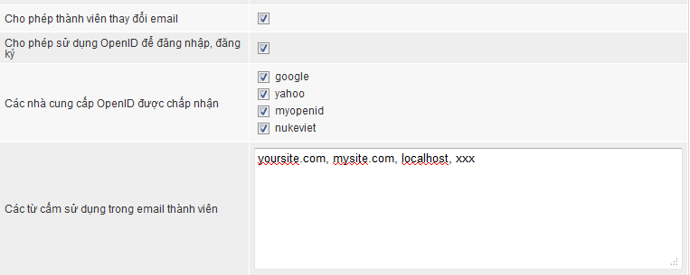

NukeViet mặc định cung cấp phương thức đăng nhập thành viên thông qua 4 nhà cung cấp OpenID, ngoài ra quản trị wesite cũng có thể thay đổi, thêm hoặc bớt nhà cung cấp OpenID.

# Bổ sung kết nối tới các nhà cung cấp OpenID ngoài danh sách có sẵn

Dữ liệu về các nhà cung cấp OpenID được lưu ở file `includes/openid.php`.

Để thêm một nhà cung cấp OpenID, thực hiện các thao tác sau:

- Thêm biến `$openid_servers` vào file `openid.php`, trong đó giá trị `identity` là đường dẫn đến website có cung cấp OpenID.
- Vào `Admin Control Panel/ Thành viên/ cấu hình module`, tại mục `Các nhà cung cấp OpenID được chấp nhận`, chọn nhà cung cấp vừa thêm sau đó lưu lại.
- Thêm một ảnh có tên ten-nha-cung-cap.gif vào theme hiện dùng theo đường dẫn `themes/ten-theme/images/users/`

# Tham khảo

- [Kết nối vào cổng OpenID do NukeViet.VN cung cấp](/programming/connect_nukeviet_openid)
