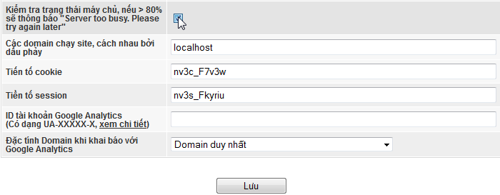
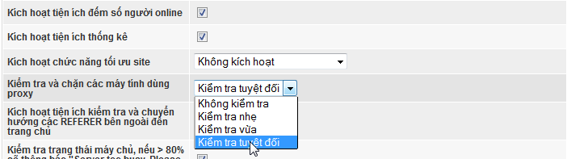
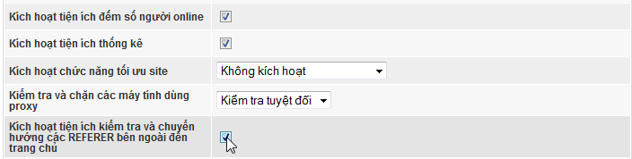
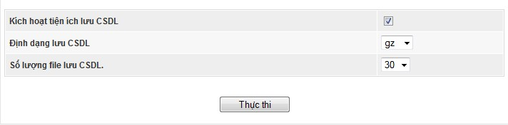
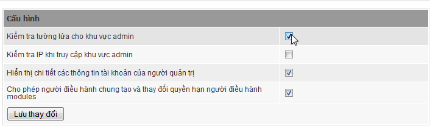
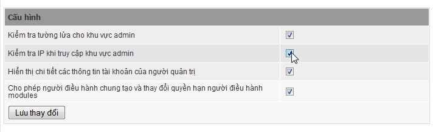

## Chống flood (chống lụt dữ liệu)

NukeViet mặc định đã kích hoạt sẵn chức năng chống flood cho website, tuy nhiên người quản trị có thể bật, tắt hoặc thay đổi cách thức chống flood riêng cho website của mình. Để bật hoặc tắt chức năng chống flood cần mở file `includes/constants.php` tìm đến dòng:

``` php
//Co bat tinh nang chong flood hay khong
define( 'NV_IS_FLOOD_BLOCKER', 1 );
```

Mặc định giá trị sẽ là 1 – chức năng đang bật, để tắt chức năng này, cần thay đổi giá trị thành 0. Để thay đổi cách chống flood, trong file constants.php, tìm đến dòng

``` php
//So requests toi da trong 1 phut
define( 'NV_MAX_REQUESTS_60', 40 );

//So requests toi da trong 5 phut
define( 'NV_MAX_REQUESTS_300', 150 );
```

Trong đó `NV_MAX_REQUESTS_60` xác định số truy vấn tối đa đến website cho phép trong một phút từ một địa chỉ IP, đến vượt quá giới hạn này, hệ thống sẽ chặn truy cập. `NV_MAX_REQUESTS_300` xác định số truy vấn tối đa đến website cho phép trong năm phút từ một địa chỉ IP, đến vượt quá giới hạn này, hệ thống sẽ chặn truy cập, có thể thay đổi hai giá trị này theo ý muốn của người quản trị website.

**Lưu ý:** Sau khi thay đổi cần vào khu vực quản trị phần cấu hình chung để lưu lại cấu hình.

## Chống quá tải máy chủ

NukeViet cung cấp công cụ bảo vệ máy chủ nếu trạng thái xử lý của CPU vượt quá 80%, hệ thống sẽ tạm ngưng hoạt động.

Chức năng này không được bật lên trong NukeViet mặc định, để kích hoạt chức năng này cần vào khu vực quản trị phần cấu hình chung, tìm và đánh dấu vào ô kiểm Kiểm tra trạng thái máy chủ, nếu \> 80% sẽ thông báo "Server too busy. Please try again later" sau đó lưu lại cấu hình. 

Bạn có thể tìm thấy vị trí cấu hình thủ công chức năng này tại tệp tin `\data\config_global.php`

``` text
$global_config['getloadavg'] = 0;
```

Với 0 là tắt, 1 là bật chức năng này.

## Kiểm tra và chặn các máy tính dùng proxy

NukeViet mặc định không kích hoạt chức năng kiểm tra các máy tính dùng proxy, để kích hoạt chức năng này, hãy đăng nhập quản trị web sau đó đến phần cấu hình chung, chọn chức năng kiểm tra và chặn các máy tính dùng proxy là nhẹ, vừa hoặc tuyệt đối. 

**Lưu ý:** Nếu không đăng nhập được khu vực quản trị sau khi kích hoạt chức năng này, mở file `data/config_global.php` tìm đến dòng `$global_config['proxy_blocker'] =` sau đó chỉnh lại thành

``` php
$global_config['proxy_blocker'] = 0;
```

Sau đó vào khu vực quản trị và thiết lập lại chức năng này.

## Kiểm tra và chuyển hướng các REFERER bên ngoài đến trang chủ

NukeViet mặc định không kích hoạt chức năng này, để kích hoạt, vào khu vực quản trị phần cấu hình chung, tại dòng Kích hoạt tiện ích kiểm tra và chuyển hướng các REFERER bên ngoài đến trang chủ đánh dấu vào ô kiểm sau đó lưu lại. 

## Sao lưu CSDL

Việc sao lưu CSDL thường xuyên sẽ giúp hạn chế việc mất mát dữ liệu nếu website xảy ra sự cố. Để kích hoạt chức năng này, đăng nhập admin sau đó vào phần CSDL =\> cấu hình sau đó đánh dấu vào ô Kích hoạt tiện ích lưu CSDL, chọn định dạng cho file lưu CSDL và số file tối đa lưu CSDL, ấn “Thực thi” để lưu lại cấu hình. 

Để tải về CSDL đã sao lưu, vào admin phần CSDL =\> Data backup sau đó chọn file cần tải và ấn “Tải về”. Lưu ý: Các file backup CSDL được lưu tại thư mục `logs/dump_backup`.

## Kiểm tra an ninh khu vực admin

Admin là khu vực cực kì quan trọng đối với website, do đó cần bảo vệ chặt chẽ khu vực này. NukeViet cung cấp hai công cụ giúp bảo vệ khu vực admin: Kiểm tra tường lửa truy cập admin và kiểm tra IP truy cập admin.

Để bật chức năng tường lửa cho khu vực admin hãy đăng nhập quản trị site, vào khu vực quản trị =\> cấu hình, đánh dấu chọn tại ô “Kiểm tra tường lửa cho khu vực admin” và ấn “Lưu thay đổi”. 

**Lưu ý:** Nếu sau khi bật chức năng này tài khoản quản trị tối cao bị chặn, hãy mở file `config_global.php` tìm đến dòng

``` php
$global_config['admfirewall'] = 1;
```

và sửa lại thành

``` php
$global_config['admfirewall'] = 0;
```

sau đó cấu hình lại chức năng này.

Để bật chức năng kiểm tra IP khi truy cập vào khu vực admin, hãy đăng nhập quản trị site, vào khu vực quản trị =\> cấu hình, đánh dấu chọn tại ô “Kiểm tra IP khi truy cập khu vực admin”, ấn “Lưu thay đổi”. 

Sau khi bật chức năng “Kiểm tra IP khi truy cập khu vực admin” hãy nhập những IP được phép truy cập vào khu vực admin để hoàn tất. 

`Lưu ý:` Nếu sau khi kích hoạt chức năng này, do vô tình đánh sai IP, tài khoản quản trị tối cao bị chặn truy cập có thể khắc phục bằng cách mở file `config_global.php` tìm đến dòng

``` php
$global_config['block_admin_ip'] = 1;
```

và sửa lại thành

``` php
$global_config['block_admin_ip'] = 0;
```

sau đó hãy đăng nhập quản trị và thiết lập lại chức năng này.

## Xem thêm

- [Hướng dẫn Bảo mật hệ thống NukeViet](/nukeviet/security)
- [Chống lại một cuộc tấn công từ chối dịch vụ](/nukeviet/anti_ddos)
