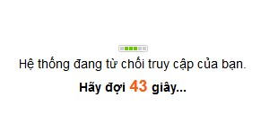

## Thế nào là DDoS?

Một cuộc tấn công từ chối dịch vụ (tấn công DoS - Viết tắt của Denial of Service) hay tấn công từ chối dịch vụ phân tán (tấn công DDoS - Viết tắt của Distributed Denial of Service) tới website của bạn là sự cố gắng làm cho tài nguyên của server chứa website của bạn không thể sử dụng được. [^1]

**Dấu hiệu của một vụ tấn cống từ chối dịch vụ**

- Mạng thực thi chậm khác thường khi mở tập tin hay truy cập Website;
- Không thể dùng một website cụ thể;
- Không thể truy cập bất kỳ website nào;
- Tăng lượng thư rác nhận được.

**Năm kiểu tấn công cơ bản:**

- Nhằm tiêu tốn tài nguyên tính toán như băng thông, dung lượng đĩa cứng hoặc thời gian xử lý
- Phá vỡ các thông tin cấu hình như thông tin định tuyến
- Phá vỡ các trạng thái thông tin như việc tự động reset lại các phiên TCP.
- Phá vỡ các thành phần vật lý của mạng máy tính
- Làm tắc nghẽn thông tin liên lạc có chủ đích giữa các người dùng và nạn nhân dẫn đến việc liên lạc giữa hai bên không được thông suốt.

## Chức năng chống DDoS của NukeViet

Trong nhóm các [chức năng an ninh của NukeViet](/nukeviet/security) có sẵn các chức năng giúp người quản trị hạn chế tác hại của một cuộc tấn công DDoS ở quy mô nhỏ.

### Cấu hình trong Admin Control Panel

Bạn có thể tăng khả năng kháng cự DDoS của NukeViet bằng cách: Vào: Admin Control Panel =\> Cấu hình =\> Cấu hình chung. Bạn tìm đến các mục sau:

``` text
Kiểm tra và chặn các máy tính dùng proxy

```

Chức năng này sẽ giúp bạn chặn các máy tính sử dụng proxy. Mặc định hệ thống sẽ không kiểm tra, bạn có thể tăng dần lên mức Kiểm tra nhẹ/ Kiểm tra vừa/ Kiểm tra tuyệt đối.

Chú ý: Mức "Kiểm tra tuyệt đối" có thể khiến bạn cũng không thể truy cập site.

``` text
Kích hoạt tiện ích kiểm tra và chuyển hướng các REFERER bên ngoài đến trang chủ   
```

Kích hoạt chức năng này sẽ khiến cho việc truy cập trực tiếp đến bất cứ trang nào thông qua một đường link nào đó cũng sẽ bị đẩy ra trang chủ. việc này giúp hạn chế việc truy cập trực tiếp đến một phần nào đó của site mà có thể phần đó tiêu tốn tài nguyên hệ thống nhiều nhất.

``` text
Kiểm tra trạng thái máy chủ, nếu > 80% sẽ thông báo "Server too busy. Please try again later"
```

Kích hoạt chức năng này sẽ giúp site tự đóng cửa trước khi server của bạn bị treo do quá tải.

### Sửa các thiết lập chống DDoS, chống lụt dữ liệu mặc định

Mặc định NukeViet đã bật chức năng chống lụt dữ liệu. NukeViet có cơ chế bảo vệ kép khi xuất hiện quá nhiều truy vấn (request) đến site. Giảm số lượng truy vấn trong 1 phút (mặc định là được tối đa 40 truy vấn) và trong 5 phút (mặc định là được tối đa 150 truy vấn). Giảm số truy vấn xuống sẽ chặn những người cố gắng truy vấn với tần suất quá cao đến site của bạn. Nếu họ cố gắng vượt giới hạn này (ví dụ như cố tấn công một site bằng phím F5 chẳng hạn(([vnexpress.net: Tấn công trường học với... phím F5](http://vnexpress.net/gl/vi-tinh/hacker-virus/2006/01/3b9e5dcc/) (nếu trường này sử dụng NukeViet chắc sẽ không bị đến nông nỗi này) )) ), hệ thống sẽ từ chối, nếu là người truy cập thông thường thì họ sẽ thấy thông báo sau: 

Bạn có thể sửa bằng cách tìm đến file: `/includes/constants.php`, sửa đoạn code sau:

``` php
//Co bat tinh nang chong flood hay khong
define( 'NV_IS_FLOOD_BLOCKER', 1 );

//So requests toi da trong 1 phut
define( 'NV_MAX_REQUESTS_60', 40 );

//So requests toi da trong 5 phut
define( 'NV_MAX_REQUESTS_300', 150 );
```

### Chống IFRAME

Không phải tự nhiên mà NukeViet chặn iframe, chính bởi vì iframe vẫn được coi là một trong những nguy cơ tiềm tàng về bảo mật (ví dụ chèn các trang web độc vào một website bình thường), thậm chí nó còn là một phương thức tấn công DDoS, đáng tiếc là các mạng xã hội vì mục tiêu tăng trưởng của mình mà lờ bỏ nguy cơ về bảo mật (đối với người dùng), thả phanh cho họ sử dụng iframe ở mọi nơi mọi chỗ, từ nút like cho tới các widget[^2] [^3]. Còn người dùng, vì sự tiện lợi của mình mà bất chấp nguy cơ trở thành nạn nhân của một vụ tấn công.

NukeViet từ trước đến nay luôn nổi tiếng là một hệ thống bảo mật cao và rất khắt khe trong việc kiểm soát vào ra dữ liệu, đặc biệt với iframe thì NukeViet được coi là khắc tinh trong việc chống sử dụng iframe trong các bài viết (mặc định chức năng này được bật và muốn tắt cũng phải làm thủ công). Bản thân NukeViet cũng có chức năng chống các site khách chèn iframe đến site của mình (mặc định chức năng này tắt). Bạn có thể bật bằng cách tìm đến file: `/includes/constants.php`, sửa đoạn code sau:

``` php
//Chong IFRAME
define( "NV_ANTI_IFRAME", 0 );
```

Khi được bật, một đoạn code JavaScript sau sẽ xuất hiện trên site:

``` javascript
<script language="JavaScript">
if (top.location != self.location)
{top.location = self.location}
</script>
```

Đoạn code này sẽ chống lại phương pháp tấn công DDoS được cho là thô sơ và cổ điển tới mức... chỉ kém phương pháp sử dụng phím F5 một chút. Trong phương pháp này kẻ tấn công sẽ mượn 1 website có lượt truy cập lớn nào đó chèn các iframe hướng về website cần tấn công rồi cho chạy lệnh refresh (tải lại) nhiều lần hoặc họ viết sẵn 1 tập tin flash với công dụng tương tự rồi đặt lên website kia và khi người dùng truy cập vào website đó thì họ vô tình bất đắc dĩ trở thành người tấn công website của ta. Đoạn code trên sẽ giúp site NukeViet thoát khỏi iframe (Đây cũng là phương pháp mà google hay sử dụng cho Gmail hay các ứng dụng khác của họ).

## Kết luận

Nói chung, cuộc chiến chống DDoS là một cuộc chiến dài kỳ, đòi hỏi nhiều công sức và khá tốn kém. Chống DDoS phải được xây dựng thành một giải pháp tổng thể từ phần cứng, máy chủ rồi mới tới phần mềm. Do đó chức năng chống DDoS của NukeViet chỉ giúp hạn chế tác hại của cuộc tấn công ở tầng ứng dụng, trong khi đó quan trọng nhất vẫn là phần cứng và máy chủ, cũng giống như việc bổ sung thêm một vài cái khóa chống trộm tốt cho nhà bạn, nó chỉ tốt khi căn nhà và cửa nẻo tốt. Nói như vậy đủ hiểu việc lựa chọn một nhà cung cấp hosting tốt sẽ quan trọng như thế nào.

## Xem thêm

- [Hướng dẫn Bảo mật hệ thống NukeViet](/nukeviet/security)
- [Thiết lập một số chức năng bảo mật](/nukeviet/advanced_setting/security)

## Chú thích

[^1]: [Wikipedia: Tấn công từ chối dịch vụ](http://vi.wikipedia.org/wiki/T%E1%BA%A5n_c%C3%B4ng_t%E1%BB%AB_ch%E1%BB%91i_d%E1%BB%8Bch_v%E1%BB%A5)

[^2]: [thongtincongnghe.com: Tìm hiểu cách lừa người dùng bấm nút Like trên Facebook](http://www.thongtincongnghe.com/article/30872)

[^3]: [quantrimang.com.vn: Các website dựa trên osCommerce bị tấn công](http://www.quantrimang.com.vn/baomat/hacker/81728_Cac-website-dua-tren-osCommerce-bi-tan-cong.aspx)
