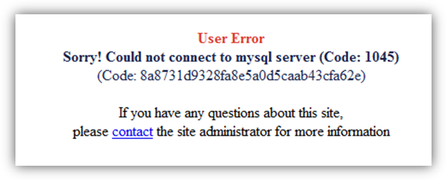
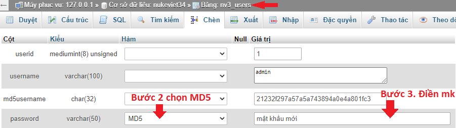

### Lỗi việc kết nối với MySQL

Lỗi này do hệ thống mất kết nối với cơ sở dữ liệu MySQL, thường xảy ra trong một số trường hợp sau:

- Hosting bị mất kết nối với cơ sở dữ liệu MySQL (do máy chủ MySQL bị treo hoặc bất cứ lý do nào khác).
- Bạn đưa NukeViet từ localhost lên host hoặc chuyển host hoặc cài NukeViet thủ công mà quá trình làm bạn đã khai báo sai một trong các thông số về DataBase (DB) host (Tên hosting là nơi chứa server MySQL, ví dụ: localhost ), DB name, DB username. Thường thì mọi người hay gặp lỗi do khai báo sai DB username và DB name.

DB username là tên người sử dụng cơ sở dữ liệu, nó luôn đi kèm với một mật khẩu (Password).

- Nếu bạn đang thử nghiệm trên máy cá nhân thì DB username chính là tên mà bạn khai báo khi cài appserv thì DB name là: root)
- Nếu bạn sử dụng Host trên mạng Internet thì nó chính là username của bạn tại host đó (hãy hỏi nhà cung cấp dịch vụ host hoặc xem thư mà họ gửi cho bạn).

DB name là tên cơ sở dữ liệu, ví dụ: abc_xdcd. Một người dùng (DB username) có thể có nhiều cơ sở dữ liệu (DB name). Có thể liên tưởng thế này: Nếu coi DB username là cái tủ thì các DB name là các ngăn kéo chứa tài liệu.

- Nếu bạn đang sử dụng Host trên Internet, thông thường theo quy định, DB username sẽ có tên theo kiểu "username_DB name" ví dụ nếu username sử dụng trên host của bạn có tên là abc và bạn tạo một CSDL mới có tên là xdcd thì DB username sẽ có tên là : abc_xdcd (chắc chắn đến 99.99% không thể khác được).

Việc tạo DB username trên Host sẽ yêu cầu bạn tạo một Password. Phải nhớ các thông số này để còn khai báo khi cài NukeViet.

### Lỗi không upload được file

Với các hosting linux bật safe mode, hoặc khi cài đặt hệ thống cần chmode cho các file và cấc thư mục thì bạn nên nhập các thông số FTP để khi hệ thống cần thiết tạo thư mục hoặc chmode có thể thực hiện được. chi tiết cấu hình này bạn tham khảo tại phần cấu hình FTP.

Nếu file vẫn không upload được bạn cần kiểm tra quyền của người quản trị có được upload các loại file:

- Truy cập vào menu Cấu hình/ Cấu hình upload để cấu hình Loại files cho phép: adobe, archives, audio, documents, flash, images, real, text, video, xml

- Vào menu Quản trị, chọn từng quản trị để sửa quyền hạn: Các kiểu file được phép tải lên

### Lỗi quên mật khẩu tài khoản quản trị

Việc người dùng thường xuyên quên mật khẩu tài khoản là điều không tránh khỏi. Với tài khoản thành viên bình thường có thể báo cho người quản trị khôi phục hộ. Nhưng với quản trị tối cao thì phải làm thế nào. Việc khôi phục tài khoản quản trị tối cao buộc người dùng phải quản lý hosting hoặc thông báo cho bộ phận quản lý hosting tiến hành khôi phục hộ

Việc khôi phục mật khẩu quản trị tối cao gồm:

- Mở bảng nv3_users
- Sửa lại trường dữ liệu muốn sửa mật khẩu
- Cột password chọn MD5. Nhập lại mật khẩu mới

- Thực hiện lưu lại các thay đổi
- Cuối cùng thử đăng nhập vào quản trị với mật khẩu mới
