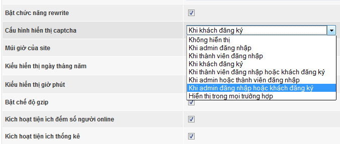
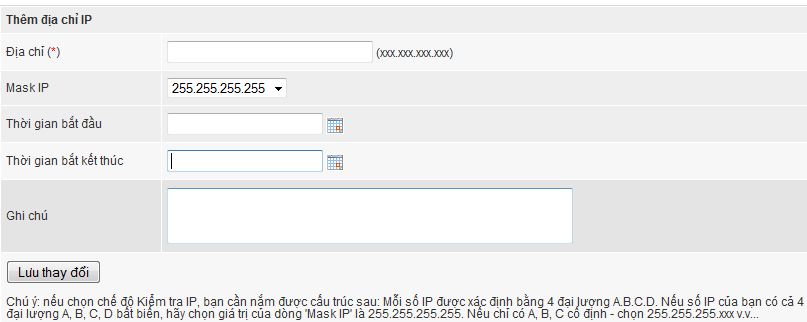
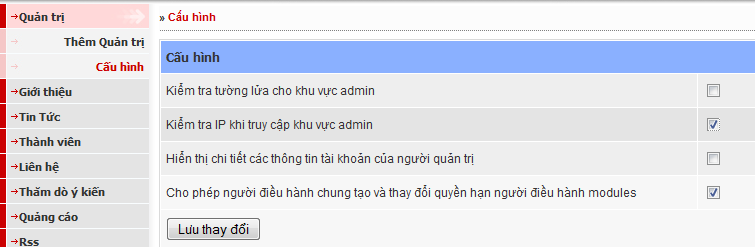

NukeViet 3 cung cấp nhiều công cụ và giải pháp bảo mật giúp người quản trị có những công cụ hữu hiệu nhằm tùy biến hệ thống, giúp hệ thống trở lên kín đáo và an toàn hơn trước sự soi mói của các hacker. Bài viết này tổng hợp và chia sẻ kinh nghiệm cũng như giải pháp bảo mật cho website sử dụng mã nguồn mở NukeViet 3.

## Hãy luôn cập nhật phiên bản mới nhất

Việc đầu tiên bạn cần làm đó là luôn cập nhật các phiên bản mới nhất của NukeViet việc này là hoàn toàn miễn phí và giúp chúng ta sửa chữa các lỗi ở phiên bản cũ, cập nhật thêm các tính năng mới cho hệ thống và các module.

Ngoài cách cập nhật các phiên bản phát hành, bạn có thể cập nhật các bản cập nhật hàng ngày theo chức năng cập nhật phiên bản.

Một chú ý trong việc phát triển thêm tính năng của site, bạn không nên hiển thị các thông tin của phiên bản NukeViet bạn đang sử dụng (chỉ hiển thị cho người điều hành tối cao của site xem).

## Phân quyền người dùng một cách hợp lý

Hệ thống NukeViet là hệ thống rất mạnh về việc phân quyền quản trị site, nếu một cách hợp lý bạn có thể ngăn ngừa các nguy cơ "tấn công nội bộ" hoặc "tấn công vào các tài khoản quản trị". Sau đây là một số lưu ý:

- Không tạo thêm tài khoản quản trị tối cao. Bạn không nên tạo nhiều tài khoản này bằng cách sửa cơ sở dữ liệu. Không phải tự dưng mà NukeViet chỉ cho phép có 1 Người quản trị tối cao ([God admin](/nukeviet/concepts/god_admin))[^1].
- Không nên sử dụng tài khoản quản trị tối cao cho những hoạt động thông thường (Ví dụ đăng tin, post bài...) Thay vào đó bạn nên tạo thêm tài khoản khác để sử dụng riêng cho nhu cầu này. Ví dụ việc tạo thêm cho mình một tài khoản Điều hành chung hoặc với quyền thấp hơn là Người điều hành module (tất cả module) để xử lý các công việc này, đây là một ý tưởng không tồi (đừng quên là sử dụng các mật khẩu đủ mạnh và khác nhau).
- Không nên trao quá nhiều quyền không cần thiết cho một tài khoản nào đó. Chỉ cấp quyền truy cập cho họ vào những khu vực phù hợp.

## Hạn chế sử dụng các module và block

Hãy sử dụng các module và block một cách hạn chế, có nghĩa là chỉ cài những module và block nào thật cần thiết, sẽ trách được các lỗi (bug) tiềm ẩn trong bản thân module và block.

Nếu module nào không sử dụng, bạn cần tiến hành xóa trong công cụ quản trị của NukeViet.

## Chặn truy cập thư mục không được phép

Cách này nhằm tránh những người có chủ tâm không tốt khai thác thông tin về site của bạn, rồi dùng thông tin đó để dò lỗi và khai thác. Rất nhiều nhà cung câp dịch vụ Hosting hay Webmaster để ngầm định chế độ cho phép xem danh sách các file của thư mục. Tuy nhiên, bạn nên loại bỏ khả năng xem nội dung thư mục bằng cách tạo file file index.html trong tất cả các thư mục. Ngoài ra bạn cần thêm file .htaccess có nội dung: “deny from all” cho tất cả các thư mục không cho phép truy cập trực tiếp (chú ý khi dùng file .htaccess này tất cả các file trong thư mục này sẽ không truy cập trực tiếp được). Nếu là người phát triển module bạn nên lưu ý không cho truy cập trực tiếp các thư mục sau của mỗi module:

``` text
modules/about/admin
modules/about/blocks
modules/about/funcs
modules/about/language
```

(Chú ý cách bảo vệ thư mục bằng file **.htaccess** chỉ áp dụng được cho hosting dùng máy chủ web Apache, các máy chủ dùng IIS sẽ không được bảo vệ, vì vậy nếu có thể, bạn nên chuyển sang dùng hệ điều hành linux dùng máy chủ web Apache).

Ngoài ra bạn nên chặn các loại bots dò tới các thư mục nhạy cảm của bạn bằng cách chèn code sau vào file robots.txt trên thư mục root:

``` text
Disallow: /dir_name/
Disallow: /file_name.ext
```

## Vấn đề Chmod

[Chmod](/support/hosting/chmod) thư mục `public_html` thành 710 và các thư mục còn lại thành 701, việc này sẽ giúp bạn bảo vệ được cấu trúc website của mình. Các thư mục `cache, data , files, logs, sess, tmp, uploads` (và tất cả các thư mục con của chúng) cần chmod 755 (một số host cần chmod 777) để hệ thống có thể ghi file.

Chmod tập tin `config.php` thành 400, điều này chống hacker local và view source của tập tin này.

## Thông tin Admin

Thường thì chúng ta vẫn đặt tên tài khoản quản trị là admin hoặc administrator. Như vậy thay vì phải dò cả tên đăng nhập và mật khẩu thì giờ đây hacker chỉ cần đoán được mật khẩu là có thể vào được site của bạn. Do đó bạn nên đổi tên tài khoản admin thành 1 tên riêng nào đó chỉ có site bạn sử dụng.

Ngoài ra bạn có thể bảo vệ khu vực admin bằng các cách sau:

### Đổi tên thư mục admin

Bạn hãy đổi tên thư mục admin thành 1 cái tên nào đó mà chỉ bạn và các thành viên ban quản trị site được biết ví dụ adm2457 Khi đó bạn cần sửa file `includes/constants.php`, tìm đến dòng

``` php
//Ten thu muc admin
define( "NV_ADMINDIR", "admin" );
 
//Ten thu muc editors
define( "NV_EDITORSDIR", "admin/editors" );
```

Sửa thành:

``` php
//Ten thu muc admin
define( "NV_ADMINDIR", "adm2457" );
 
//Ten thu muc editors
define( "NV_EDITORSDIR", "adm2457/editors" );
```

### Bật chế độ captcha trong khi đăng nhập

Bạn có thể chọn chế độ đăng nhập có yêu cầu captcha tùy theo nhu cầu bảo vệ site bằng cách cấu hình hiển thị captcha trong phần Cấu hình -\> Cấu hình chung. 

### Bật chế độ Kiểm tra IP khi truy cập khu vực admin

Nếu Bạn có IP tĩnh, hoặc chỉ truy cập site trong giải IP có định, Bạn có thể cấu hình chức năng này trong phần: Quản trị -\> Cấu hình site.

Để thực hiện việc này bạn cần thêm địa chỉ IP hoặc dải IP truy cập vào admin vào phần dưới 

Sau đó Sửa phần cấu hình Kiểm tra IP khi truy cập khu vực admin và lưu lại. 

### Bảo vệ thư mục admin bằng chức năng bảo vệ thư mục của hosting

Nếu hosting của bạn có hỗ trợ chức năng bảo vệ thư mục bằng tài khoản và mật khẩu, bạn nên dùng chức năng này để bảo vệ thư mục admin. Nếu hosting của bạn không hỗ trợ bạn có thể dùng chức năng Kiểm tra tường lửa cho khu vực admin trong phần cấu hình của menu quản trị.

## Giấu file config.php

File config.php là file chứa tất cả những gì quan trọng nhất, vì vậy việc không view được source của file này rất quan trọng. đó đó bạn nên đổi tên file di chuyển đến 1 vị trí người khác khó đoán ra. Sau khi đổi tên và đổi đường dẫn file `config.php`, các bạn tìm file `includes/constants.php` Tìm đến dòng:

``` php
//Ten file config
define( "NV_CONFIG_FILENAME", "config.php" );
```

Edit lại cho phù hợp với đường dẫn và tên file `config.php` Ví dụ: trên hosting các file được đặt trong thư mục `/public_html/` , bạn có thể đổi tên file `config.php` thành `cfg.nkv` và di chuyển nó ra ngoài thư mục `/public_htm/` (khi đó file `cfg.nkv` nằm ngang hàng với thư mục `/public_html/`) và dòng lệnh:

``` php
define( "NV_CONFIG_FILENAME", "config.php" );
```

sẽ được sửa thành:

``` php
define( "NV_CONFIG_FILENAME", "../cfg.nkv" );
```

## Thay đổi đường dẫn tới các thư mục hệ thống

Các thư mục sau bạn nên đổi tên: cache, data , files, logs, sess, tmp sau khi đổi tên các thư mục này bạn cần khai báo lại các thông số này vào file `includes/constants.php`

## Mã hoá file cấu hình hệ thống

Để hóa các file php bạn có thể chọn IonCube và ZendGuard 5. Việc mã hóa file làm cho hacker khó khăn hơn khi muốn đọc nội dung các file này. Các file bạn cần thiết mã hoá là `config.php` và `includes/constants.php`. Nếu có điều kiện bạn có thể mã hóa tất cả các file \*.php của site.

## Thường xuyên sao lưu website

Bạn hãy lên lịch định kỳ hàng tuần thậm chí là hàng ngày thực hiện việc sao lưu website (bao gồm cơ sở dữ liệu site và dữ liệu dạng file có trên hệ thống).

Hàng tháng hãy thực hiện một bản sao lưu đầy đủ, toàn diện site (backup full).

Hãy giữ các bản sao lưu ở đâu đó an toàn (tất nhiên không phải trên server chạy web của bạn rồi).

### Sao lưu cơ sở dữ liệu

NukeViet đã có sẵn chức năng sao lưu cơ sở dữ liệu (database) và chức năng này mặc định được kích hoạt hàng ngày hệ thống sẽ tự động sao lưu và lưu trữ trên site, bạn hãy tải nó về. Cơ sở dữ liệu sao lưu sẽ được lưu trữ trên site tối đa 30 ngày (tương đương 30 file sao lưu) trước khi nó tự động bị xóa đi.

NukeViet cũng có chức năng giúp bạn sao lưu cơ sở dữ liệu thủ công (sao lưu tức thời) để bạn sử dụng bất cứ lúc nào.

### Sao lưu các dữ liệu dạng file có trên site

Ngoài cơ sở dữ liệu, NukeViet còn lưu trên website các dữ liệu dạng file khác, bao gồm tập tin được upload lên, tập tin cấu hình, các dữ liệu mà hệ thống bóc tách được và lưu trực dạng file thay cho dạng cơ sở dữ liệu MySQL... bạn cần tải các dữ liệu này về thông qua trình FTP.

### Sao lưu đầy đủ

Tải toàn bộ dữ liệu trên server về, bao gồm cả code và các dữ liệu tạm trên site, bạn sẽ có một bản sao lưu đầy đủ nhất. Bản sau lưu đầy đủ này đặc biệt hữu ích khi site bạn bị hack, có thể nó chứa thông tin giúp dò ra dấu vết của hacker.

## Cập nhật thông tin từ diễn đàn nukeviet.vn

Hãy cập nhật những thông tin mới nhất từ diễn đàn [http://nukeviet.vn](http://nukeviet.vn), việc này sẽ giúp bạn nắm bắt được thông tin về việc cập nhật phiên bản, tình trạng báo lỗi cũng như phát hành phiên bản của NukeViet.

# Hướng dẫn xử lý website sau khi bị hack

Xem chi tiết [Hướng dẫn xử lý website sau khi bị hack](/nukeviet/anti_hack).

# Xem thêm

- [Hướng dẫn Bảo mật hệ thống NukeViet 4.1](/nukeviet4/setup/security)
- [Chống lại một cuộc tấn công từ chối dịch vụ](/nukeviet/anti_ddos)
- [Thiết lập một số chức năng bảo mật](/nukeviet/advanced_setting/security)
- [Thay thế code của trang NukeViet đang chạy (nhằm làm sạch code hoặc sau khi bị hack)](/nukeviet/setup/replace_code)

[^1]: Tài khoản cài đặt site là tài khoản quản trị tối cao (God admin). Tài khoản này rất nhiều đặc quyền, ngoài việc được phép toàn quyền hệ thống (sửa, xóa site...không thể khôi phục) tài khoản này còn được phép cài đặt module, block, theme lên site (mà rất có thể trong các bộ cài này có chứa mã độc có thể sử dụng để theo dõi, tấn công hoặc gây hại hệ thống), do đó bạn cần tuyệt đối giữ gìn bảo mật tài khoản này. Ngoài việc thực hiện các quy tắc bảo mật thông thường, bạn cần lưu ý thêm khi phân quyền quản trị.
