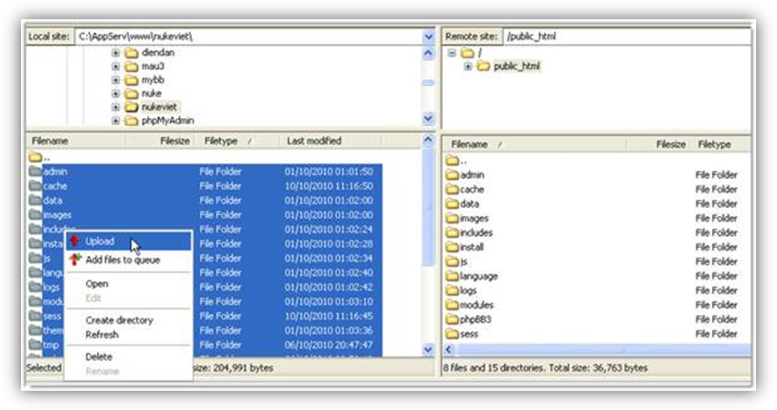
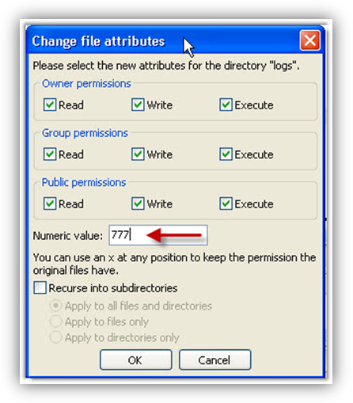
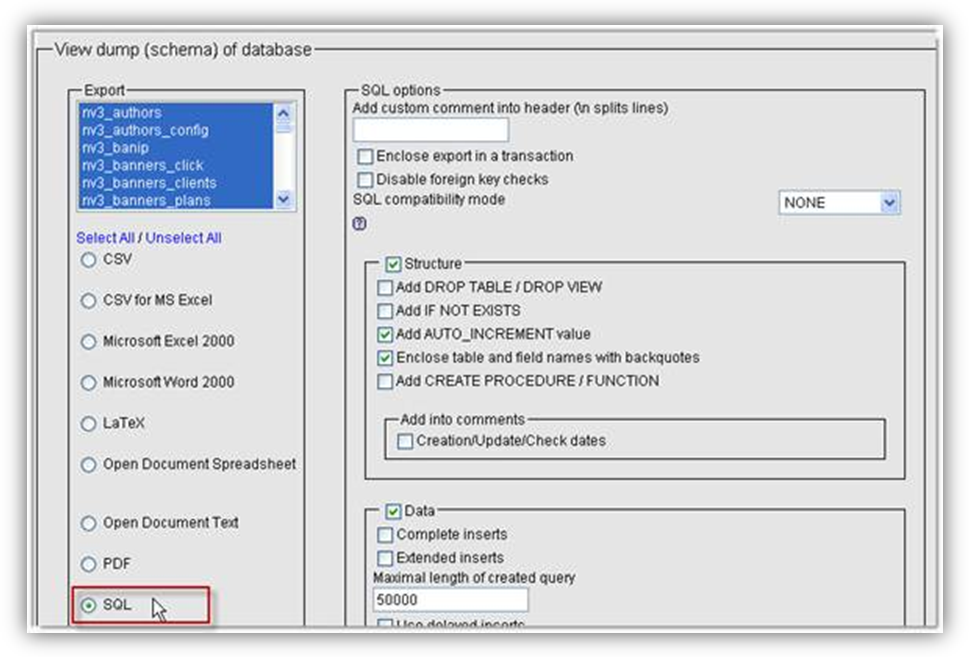
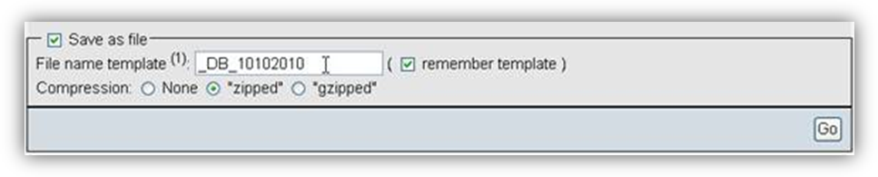
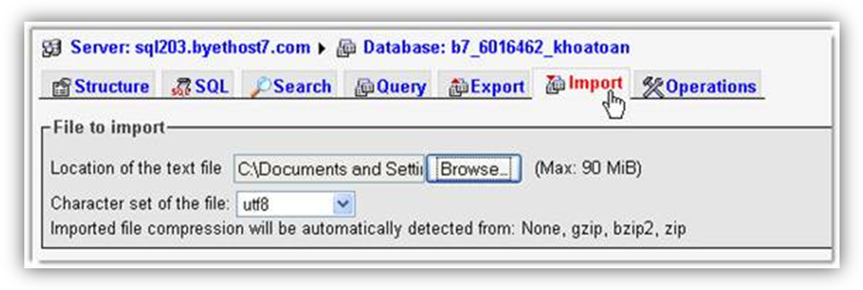

## Đăng kí hosting và tên miền

Để vận hành Website, cần chuẩn bị 1 domain[^1] [^2] và hosting. Domain cần trỏ về hosting và được cấu hình để sẵn sàng sử dụng. Hosting cần có dung lượng, lưu lượng và băng thông phù hợp nhu cầu sử dụng, có cấu hình phù hợp để vận hành phần mềm.

Thông số máy chủ (hosting) yêu cầu để vận hành tốt nhất phần mềm:

\<table>
\<thead>
\<tr>
\<th style="text-align: left;">Nội dung\</th>
\<th style="text-align: left;">Thông số yêu cầu của máy chủ\</th>
\</tr>
\</thead>
\<tbody>
\<tr>
\<td style="text-align: left;">Máy chủ web\</td>
\<td style="text-align: left;">Linux cài sẵn Apache 2.2 hoặc Window cài IIS7\</td>
\</tr>
\<tr>
\<td style="text-align: left;">PHP\</td>
\<td style="text-align: left;">PHP 5.2 hoặc phiên bản mới nhất\</td>
\</tr>
\<tr>
\<td style="text-align: left;">Các thư viện php cần có\</td>
\<td style="text-align: left;">file_uploads, session, mbstring, curl, gd2, zlib, soap, sockets, tidy.\</td>
\</tr>
\<tr>
\<td style="text-align: left;">MySQL\</td>
\<td style="text-align: left;">MySQL 5.02 hoặc phiên bản mới nhất\</td>
\</tr>
\<tr>
\<td style="text-align: left;">Tính năng rewite\</td>
\<td style="text-align: left;">Máy chủ apache cần hỗ trợ mod_rewrite<br />
Máy chỉ windows cần càuURL Rewrite 2.0\</td>
\</tr>
\</tbody>
\</table>

Nếu đang trong giai đoạn thử nghiệm, tập làm Website thì bạn có thể sử dụng các dịch vụ hosting miễn phí như Byethost, 000webhost, tên miền miễn phí như co.cc, cz.cc, dot.tk.

## Cấu hình domain và Dọn dẹp hệ thống.

Để có thể thêm domain mới: `Admin Control Panel/Cấu hình/Cấu hình chung`. Thêm domain mới vào phần: "Các domain chạy site, cách nhau bởi dấu phảy".

Ví dụ giá trị này là `locahost`, cần sửa thành: `locahost, my_domain.com` Dọn dẹp các file không cần thiết đưa lên site: `Admin Control Panel/Công cụ web/Dọn dẹp hệ thống`. Chọn các thành phần cần dọn dẹp để hệ thống xóa các file này (Chức năng này có từ bản 3.0.13).

## Tải toàn bộ mã nguồn lên hosting



Khởi động phần mềm FTP như FileZilla FTP Client rồi nhập các thông số đã được cung cấp từ lúc đăng kí hosting:

- Host (địa chỉ của máy chủ, chẳng hạn `ftp.byethost24.com`),
- Usename (tên đăng nhập, dạng `b24_6129815`),
- Password (mật khẩu),
- Port (mặc định cổng 21),

Sau đó bấm **Quickconnect**.

Ở khung Local site, bạn duyệt đến thư mục gốc NukeViet, bên cạnh đó cũng phải duyệt đến thư mục ~~htdocs~~ của tên miền (hoặc `public_html` ở một số hosting khác), chọn tất cả thư mục con và tập tin của NukeViet và bấm chuột phải chọn **Upload**.

## CHMOD 777 một số thư mục

 [Chmod](/support/hosting/chmod) là chữ viết tắt của từ Change mod, một lệnh đặc biệt được dùng trên máy chủ Unix và nó được sử dụng để thay đổi quyền lực của một người bất kỳ đối với tập tin và thư mục trên Website. Tức là, bạn sử dụng lệnh này để cấp quyền đọc (Read), viết (Write) và thực thi (Execute) cho người sử dụng Website.

Giá trị Chmod luôn được biểu thị bằng một cụm gồm ba chữ số, đại diện cho ba nhóm sử dụng Owner (chủ sở hữu Website), Group (nhóm cộng tác), Public (tất cả mọi người). Giá trị 777 thể hiện quyền lực tuyệt đối đối với tập tin, thư mục, áp dụng cho cả ba nhóm người dùng.

Ở Website động thì người dùng thường xuyên phải làm với một số tập tin và thư mục trên máy chủ, bao gồm cả thành viên, người truy cập thông thường. Do đó, với trang web được tạo bằng mã nguồn NukeViet, bạn cần thiết lập Chmod 777 cho các tập tin và thư mục sau:

``` text
cache
data (tất cả các file, thư mục con của nó)
files (tất cả các file, thư mục con của nó)
logs(tất cả các file, thư mục con của nó)
sess
tmp
uploads(tất cả các file, thư mục con của nó)
.htaccess
```

Để thực hiện Chmod, bạn bấm chuột phải vào thư mục hay tập tin trong khung **Remote site** của FileZilla FTP Client, chọn **File permissions**. Trong hộp thoại **Change file attributes**, bạn đánh dấu kiểm vào các ô cần chọn hoặc có thể nhập ngay số 777 vào ô **Numeric value**.

## Xuất ra cơ sở dữ liệu

Đầu tiên, bạn đăng nhập vào phpMyAdmin của localhost ([http://localhost/phpMyAdmin](http://localhost/phpMyAdmin)). Trong trường Database ở bên trái, bạn chọn tên cơ sở dữ liệu lúc cài đặt NukeViet. Một danh sách gồm nhiều bảng cơ sở dữ liệu hiện ra.

Bấm nút **Export** rồi kiểm tra trong khung **View dump (schema) of database** mục **SQL** đã được đánh dấu chọn hay chưa, các mục còn lại giữ mặc định.

 Riêng đối với khung **Save as type**, bạn đặt tên cho tập tin cơ sở dữ liệu vào ô **File name template**, rồi đánh dấu chọn vào ô **zipped** ở mục **Compression**, bấm nút **Go**. Theo kinh nghiệm của người viết, việc đặt tên cơ sở dữ liệu cần gắn liền với ngày tháng sao lưu để tiện phục hồi đúng thời điểm khi cần thiết. Ý nghĩa của việc làm này là xuất bản cơ sở dữ liệu trên localhost ra một tập tin và dùng nó nhập vào cơ sở dữ liệu trên hosting. 

## Nhập vào cơ sở dữ liệu

Tạo cơ sở dữ liệu rỗng trên hosting.

Truy cập vào trang phpMyAdmin của hosting, bấm nút **Import**, rồi duyệt đến tập tin trên máy bằng nút **Browse** ở khung **File to import**, bấm **Go**.

Khi xong bấm vào nút **Structure** để kiểm tra danh sách các bảng cơ sở dữ liệu được nhập vào. 

## Sửa thông số cơ sở dữ liệu

Để kết nối gói mã nguồn đã tải lên hosting và cơ sở dữ liệu thì bạn cần can thiệp vào những dòng lệnh của hai tập tin `config.php` (thư mục gốc của hosting) Bạn cần chuẩn bị các thông số để khai báo vào hai tập tin này: tên miền (không cần phải nhập http:), MySQL Hostname (tên máy chủ MySQL), MySQL Username (tên đăng nhập cơ sở dữ liệu), Database name (tên cơ sở dữ liệu) và MySQL Password (mật khẩu đăng nhập cơ sở dữ liệu).

Nếu sử dụng phần mềm FileZile FTP Client thì cần phải tải hai tập tin trên về máy để chỉnh sửa bằng Notepad, rồi tải lên và ghi đè tập tin cũ.

\+ Đối với tập tin config.php, tìm đến dòng lệnh:

``` php
$db_config['dbhost'] = "localhost";
$db_config['dbport'] = "";
$db_config['dbname'] = "home";
$db_config['dbuname'] = "root";
$db_config['dbpass'] = "123";
$db_config['prefix'] = "nv3";
```

Thay thế `localhost` bằng địa chỉ MySQL Hostname (nếu máy chủ mysql khác máy chủ web), `home` bằng thông số Database name, `root` bằng thông số MySQL Username, `123` bằng thông số MySQL Password.

Đến đây, Website đã vận hành được bình thường trên Internet.

[^1]: Bạn có thể tra cứu tên miền tại [http://webnhanh.vn/vi/nvresources/domain/](http://webnhanh.vn/vi/nvresources/domain/)

[^2]: Các kiến thức về domain có thể xem thêm tại đây: [http://webnhanh.vn/vi/faq/Hoi-dap-ten-mien/](http://webnhanh.vn/vi/faq/Hoi-dap-ten-mien/)
