Điều kiện và môi trường được hướng dẫn ở đây:

- Phiên bản hướng dẫn: NukeViet 3.0 Official version
- Hosting Sử dụng: Cpanel 11
- Domain sử dụng: [http://demo.vinades.net](http://demo.vinades.net) (đã trỏ domain tới hosting)
- Hosting hướng dẫn là host linux, thư mục chứa file có thể khác nhau tùy vào nhà cung cấp hosting.

Với các môi trường khác, hình ảnh và trình tự có sẽ sẽ có đôi chút khác biệt.

## Upload file cài đặt lên hosting

Truy cập website [http://nukeviet.vn/](http://nukeviet.vn/) để download phiên bản NukeViet mới nhất. Khi đó được file NukeViet3.0-Official.rar, giải nén file này được các file 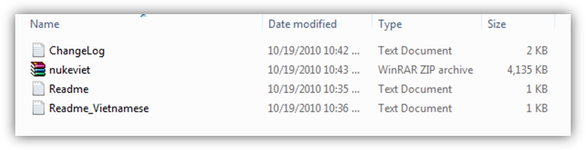 Đăng nhập vào "cPanel", vào mục "File Manager" 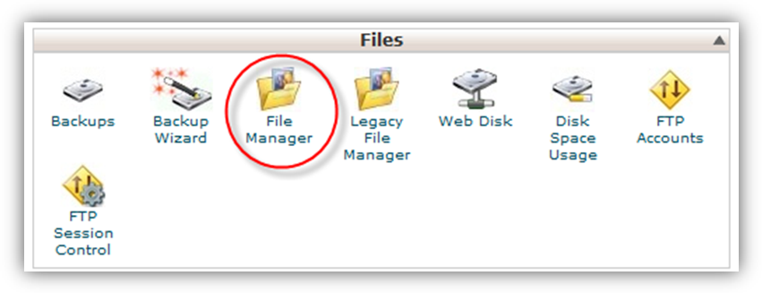

Popup hiện lên hỏi bạn thư mục muốn quản lý, bạn chọn thư mục "public_html". Trình duyệt sẽ chuyển bạn tới trang quản lý

Bạn di chuyển tới thư mục "public_html", click nút upload để mở công cụ upload file 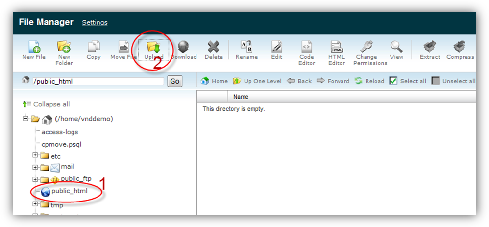

Tại trang upload file, bạn nhấp nút "Browse..." để tìm đến tệp tin cần upload.

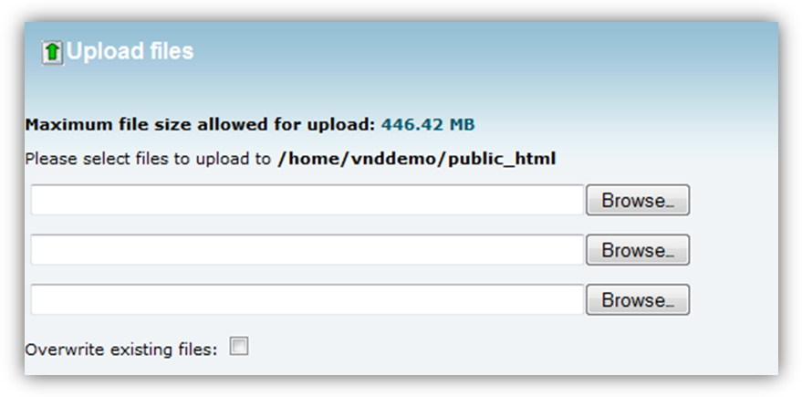

Bạn chọn file nukeviet.zip , ấn "Open" 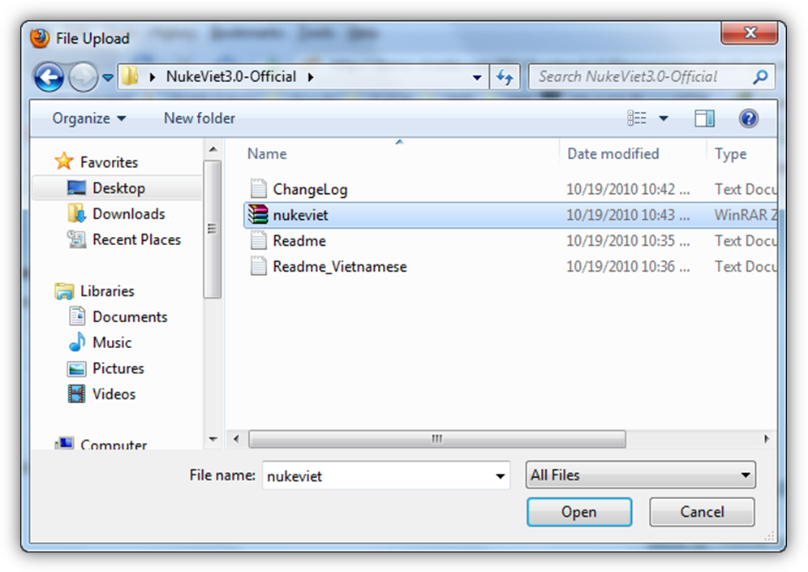

Đợi vài phút để trình duyệt upload file lên server.

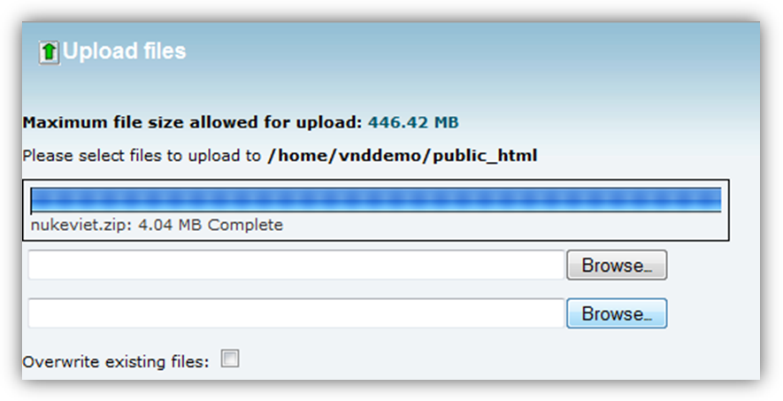

Khi quá trình upload hoàn tất (100%). bạn trở lại trang quản lý file, ấn nút Reload để nạp lại dữ liệu.

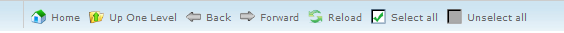

Bạn sẽ thấy file nukeviet.zip đã được tải lên server. Click chuột phải lên file, chọn "Extract" để giải nén file này.

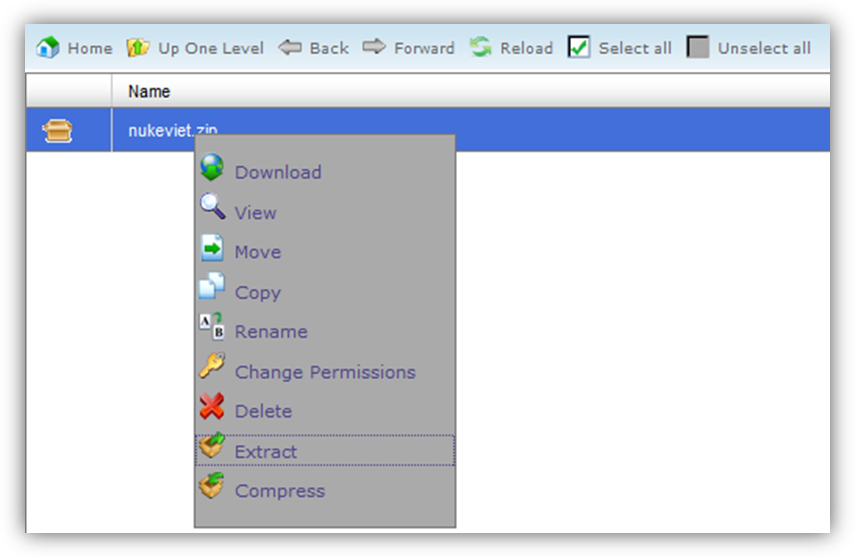

Cửa sổ Extract hiện ra, bạn chọn thư mục giải nén là "/public_html" để giải nén các file cài đặt của NukeViet. 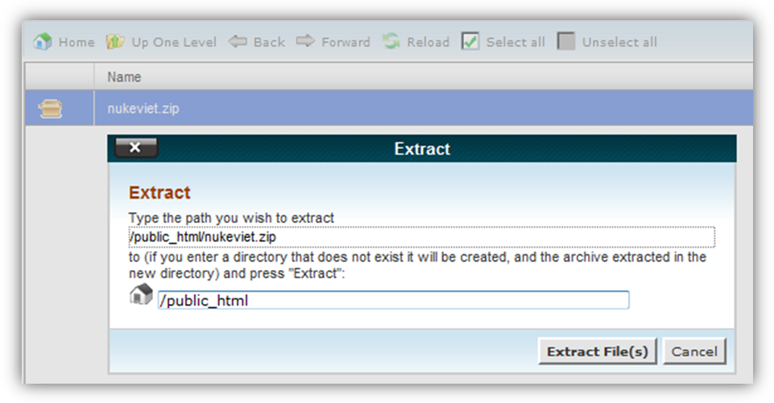

Trong giây lát, các file sẽ được giải nén, bạn nhấp nút close để đóng của sổ thông báo kết quả. 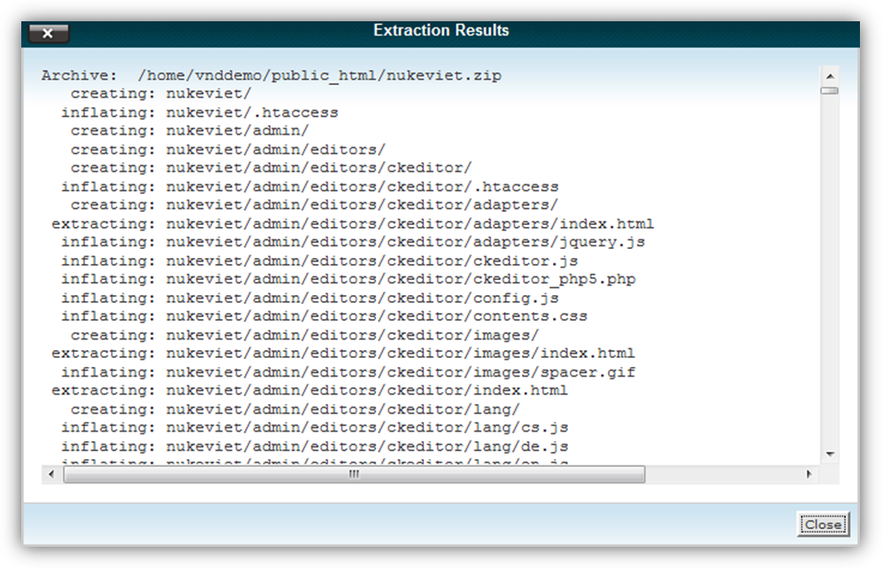

Khi đó thư mục NukeViet được gọi là thư mục gốc của NukeViet và địa chỉ truy cập tới site là [http://demo.vinades.net/nukeviet/](http://demo.vinades.net/nukeviet/))

## Tạo cơ sở dữ liệu rỗng.

Bước 1: Vào "cPanel", mục "MySQL® Database Wizard".

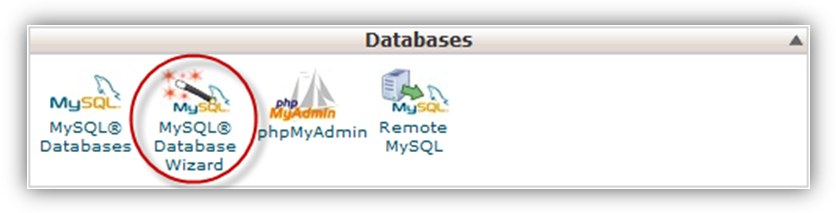

Bước 2: Tạo cơ sở dữ liệu mới. Nhập tên cơ sở dữ liệu, ví dụ "nukeviet" 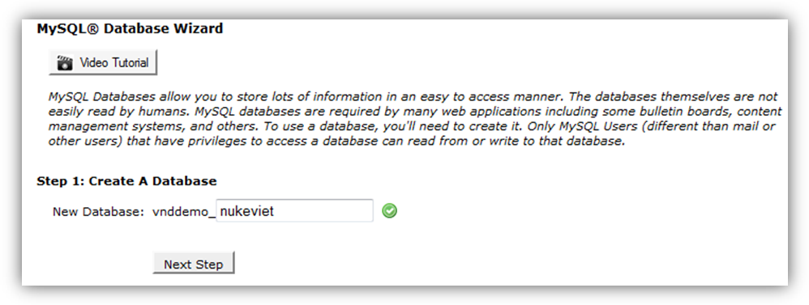

Click Next Step để chuyển sang bước tiếp theo 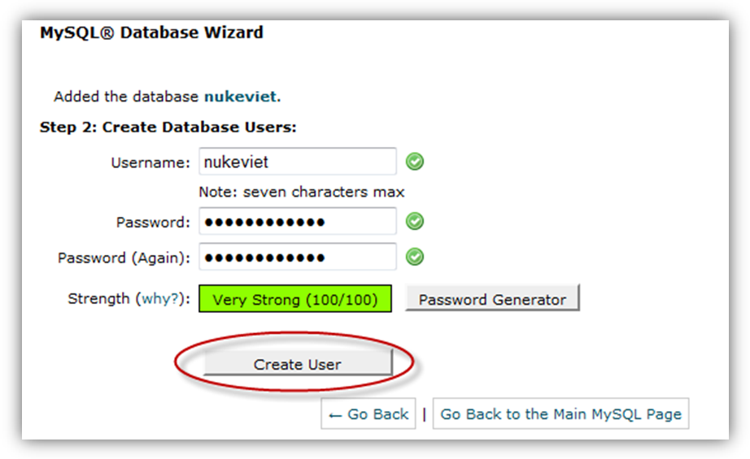 Cần điềm đầy đủ các thông số Username, Password và nhập lại password vào Password (Again) sau đó click vào Create User để chuyển sang bước kế tiếp.

Khi đó cơ sở dữ liệu được tạo với tài khoản:

Database name: vnddemo_nukeviet

Database Username: vnddemo_nukeviet

Mật khẩu: 2Cg5hoWNVRJH (Mật khẩu bạn đặt tương tự như trên)

Hãy ghi nhớ tên này để nhập trong quá trình cài đặt nukeviet. (Chú ý: Tên tiền tố của bảng CSDL các host khác nhau thì có phần tiền tố khác nhau, tên cơ sở dữ liệu và tên người sử dụng có thể giống và khác nhau, tránh nhầm lẫn).

Sau đó cần thêm User vào Database (Thực hiện theo bước 1 và 2 trên hình) 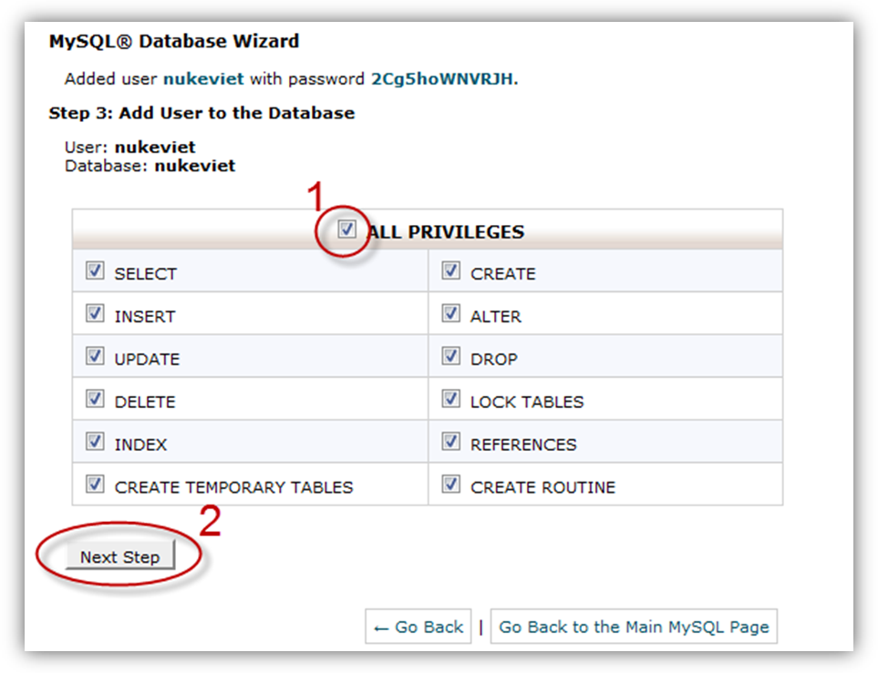 Như vậy bạn đã xong việc tạo CSDL rỗng và người dùng. 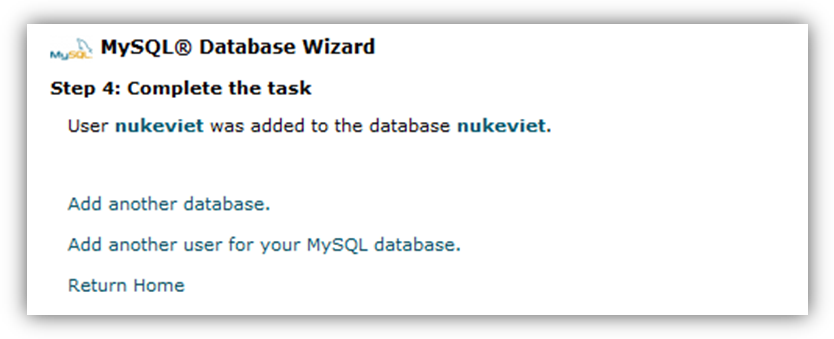

## Cài đặt NukeViet 3

Từ cửa sổ trình duyệt của bạn, truy cập thư mục gốc chứa bộ cài NukeViet tại địa chỉ [http://demo.vinades.net/nukeviet/](http://demo.vinades.net/nukeviet/) Khi đó chương trình sẽ tự động chuyển sang bước cài đặt trên địa chỉ: [http://demo.vinades.net/nukeviet/install/index.php](http://demo.vinades.net/nukeviet/install/index.php)

Khi đó quá trình cài đặt NukeViet 3 trên hosting tương tự như quá trình cài đặt trên localhost. Xem [Hướng dẫn cài đặt NukeViet 3 trên localhost](/nukeviet/setup/localhost)

Chú ý: Trong quá trình cài đặt NukeViet 3, tại bước (4) Kiểm tra việc CHMOD, Nếu hệ thống có file hoặc thư mục cần chmode Hệ thống sẽ hiển thị thêm khu vực nhập các thông số FTP Bạn nên nhập các thông số FTP để NukeViet 3 chmodecác file và thư mục.
