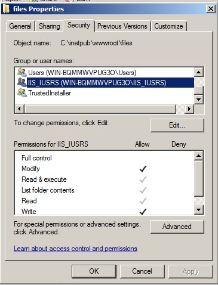
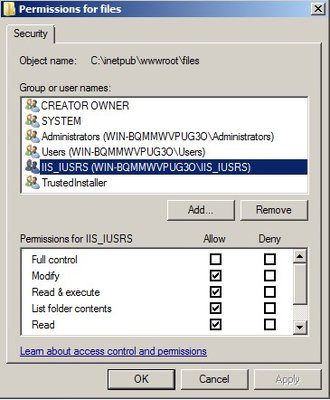

## Chuẩn bị

- PHP 5.2.16 tải về tại địa chỉ: [http://windows.php.net/downloads/releases/archives/php-5.2.16-nts-Win32-VC6-x86.zip](http://windows.php.net/downloads/releases/archives/php-5.2.16-nts-Win32-VC6-x86.zip)
- MySQL 5.1.42 tải về tại địa chỉ: [http://downloads.mysql.com/archives.php?p=mysql-5.1&o=other](http://downloads.mysql.com/archives.php?p=mysql-5.1&o=other)
- phpMyAdmin 2.11.11.3 tải về tại địa chỉ: [http://sourceforge.net/projects/phpmyadmin/files/phpMyAdmin/2.11.11.3/](http://sourceforge.net/projects/phpmyadmin/files/phpMyAdmin/2.11.11.3/)
- Bộ cài NukeViet 3 mới nhất tại [http://code.google.com/p/nuke-viet/downloads/](http://code.google.com/p/nuke-viet/downloads/)

## Cài Đặt

### Cài đặt IIS 7.0 trên Windows Server 2008

### Cài đặt PHP5.2 lên IIS7

#### Cài đặt URL Rewrite Module 2.0

#### Cài đặt và cấu hình php.ini và sql

#### Cài đặt phpMyAdmin

#### Cài đặt NukeViet 3.x

|   Tên thư mục hoặc file   | Chế độ Chmod trong Linux |
|:-------------------------:|:-------------------------|
|           data            | Chmod 777                |
|  data/config_global.php   | Chmod 777                |
|           sess            | Chmod 777                |
|           logs            | Chmod 777                |
|           cache           | Chmod 777                |
|          uploads          | Chmod 777                |
|            tmp            | Chmod 777                |
|      logs/data_logs       | Chmod 777                |
|     logs/dump_backup      | Chmod 777                |
|      logs/error_logs      | Chmod 777                |
| logs/error_logs/errors256 | Chmod 777                |
|    logs/error_logs/old    | Chmod 777                |
|    logs/error_logs/tmp    | Chmod 777                |
|       logs/ip_logs        | Chmod 777                |
|       logs/ref_logs       | Chmod 777                |
|     logs/voting_logs      | Chmod 777                |
|         files/css         | Chmod 777                |
|         files/js          | Chmod 777                |

Hoặc chạy các lênh sau để set quyền, ví dụ site đặt ở thu mục D:\nukeviet.vn

``` text
icacls D:\nukeviet.vn\cache /grant IUSR:(OI)(CI)(M)
icacls D:\nukeviet.vn\data /grant IUSR:(OI)(CI)(M)
icacls D:\nukeviet.vn\files /grant IUSR:(OI)(CI)(M)
icacls D:\nukeviet.vn\logs /grant IUSR:(OI)(CI)(M)
icacls D:\nukeviet.vn\sess /grant IUSR:(OI)(CI)(M)
icacls D:\nukeviet.vn\tmp /grant IUSR:(OI)(CI)(M)
icacls D:\nukeviet.vn\uploads /grant IUSR:(OI)(CI)(M)
icacls D:\nukeviet.vn\web.config  /grant IUSR:(M)
icacls D:\nukeviet.vn\web.config  /grant IIS_IUSRS:(M)
#icacls D:\nukeviet.vn\web.config  /reset
```

| Các giá trị Chmod 777 tương đương với việc phân quyền của full control trong Windows |  |
|----|----|
|  |  |
| Hình 1 | Hình 2 |

Bây giờ bạn có thể cài đặt NukeViet3x sau khi cài xong nhớ đọc hướng dẫn ở bước cuối cùng là di chuyển file config.php trong thư mục temp ra bên ngoài ngang hàng với file index.php
