- Phiên bản mới nhất ổn định của MAMP Pro là 3.0.5, Bạn có thể tải bản này về từ website: [http://www.mamp.info/en/downloads/](http://www.mamp.info/en/downloads/)
- Trong gói tải vể này bao gồm có : MAMP và MAMP PRO. MAMP Pro miễn phí dùng thử 14 ngày
- Trong bài viết này chúng ta sẽ sử dụng MAMP và hướng dẫn qua với MAMP Pro.
- Hệ điều hành được sử dụng ở đây là MAC OS, nếu bạn sử dụng Windows hay Linux, xin xem [Cài phần mềm web server để tạo localhost](/nukeviet/concepts/localhost)

**Tối Thiểu:**

- MAMP Pro yêu cầu các bạn chạy trên Mac OS X 10.6.6 trở lên

- Hiện Tại MAMP mới hỗ trợ các ngôn ngữ sau : English, French, German, Italian, Japanese, Russian, Spanish

- Sau khi tiến hành tất cả các bước chuẩn bị đã nêu ở trên, bạn tiến hành cài đặt chương trình.

## Cài đặt MAMP

Bước 1: Sau khi các bạn tải về hãy chạy file **MAMP_MAMP_PRO_3.0.5.PKG** để tiến hành cài đặt. Cửa sổ Welcome của màn hình Setup hiện ra. Nhấp Continue để tiếp tục (xem hình 1)

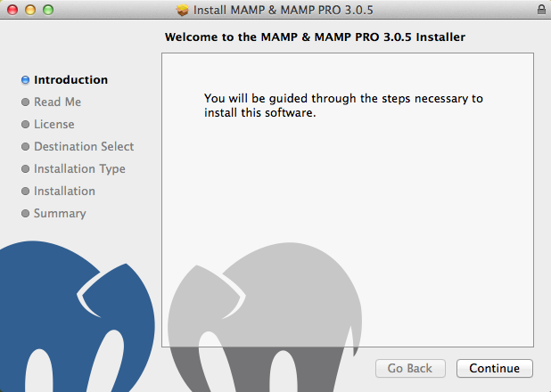

Bước 2: Thông tin quan trọng : MAMP sẽ cài đặt với hai thư mục là: **MAMP** và **MAMP PRO** . Lưu ý không di chuyển 2 thư mục này ra khỏi thư mục Application của hệ thống hoặc đổi tên nó.Bấm Print để in ra , Save để lưu ra tệp tin văn bản, Go Back để quay trở lại bước trước, Continue để tiếp tục

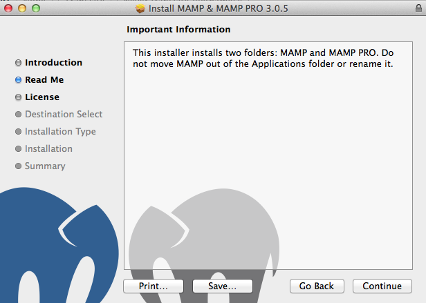

Bước 3: Thông tin bản quyền: MAMP xuất bản theo giấy phép GNU/GPL License. Bạn ấn Continues để tiếp tục .Bấm Agree để tiếp tục , nếu không hay chọn Disagree để hủy .

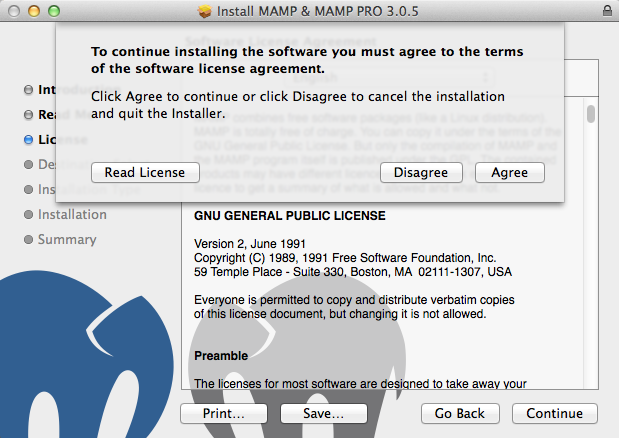

Bước 4 : Bấm Install để phầm mêm tự cài đặt lên hệ thống của bạn (Điền mật khẩu tài khoản của bạn nếu có). 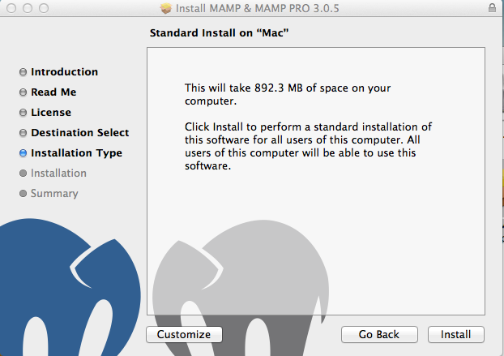

Bước 5: Kết thúc cài đặt và khởi động chương trình

Nhấp Close để kết thúc quá trình cài đặt .

Apache & MySQL sẽ được không được tự động khởi động ngay sau khi kết thúc cài đặt. Vậy nên bạn cần khởi động nó sau mỗi lần bạn khởi động lại máy

Các bạn vào Laundpad của Mac OS và Nhấp vào biểu tượng Con voi màu xám (MAMP) để khởi động chương trình

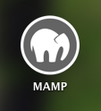

Bước 6 : Thiết lập chương trình

Các bạn nhấp chuột vào Preferences bảng cài đặt sẽ hiện ra

Version PHP : 5.5.10

Chuyển sang tab Ports : Các bạn nên set Apache & Mysql port to 80 & 3306 để chạy ổn định, Nếu trên máy tính bạn đã 1 Webserver khác thì bạn có thể thay đổi ở ô nhập

Còn lại các bạn để mặc định rồi bấm **Ok**

Các bạn bấm Start Server đẻ MAMP hoàn tất.

Bước 8: Kiểm tra kết quả.

Mở Safari hoặc trình duyệt có trên hệ thống của bạn, gõ địa chỉ [http://localhost/](http://localhost/) nếu thấy trang web tương tự như hình dưới tức là bạn đã cài thành công MAMP.

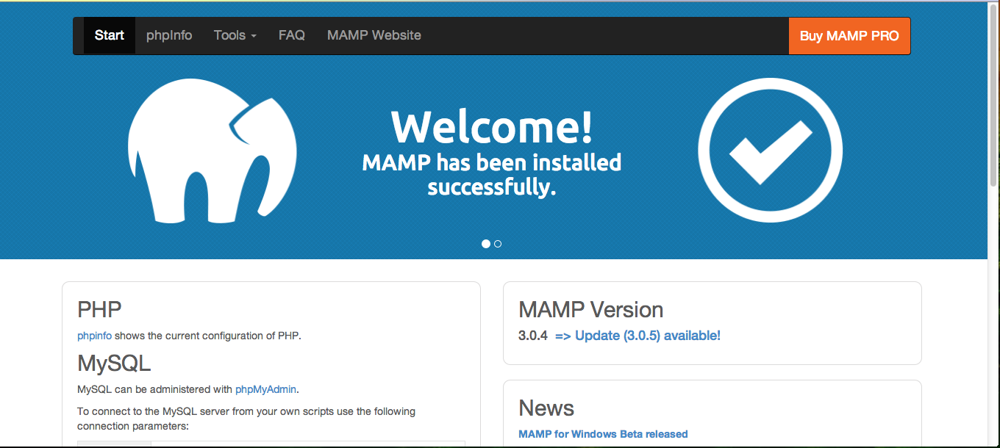

======Giới thiệu MAMP Pro 3.0.5======

MAMP Pro là phiển bản chuyên nghiệp của phần mềm MAMP nó có nhiều thiết lập hơn cho bạn tùy chọn.Sau đây chúng ta sẽ tìm hiểu qua về nó:

\* Các thiết lâp trung

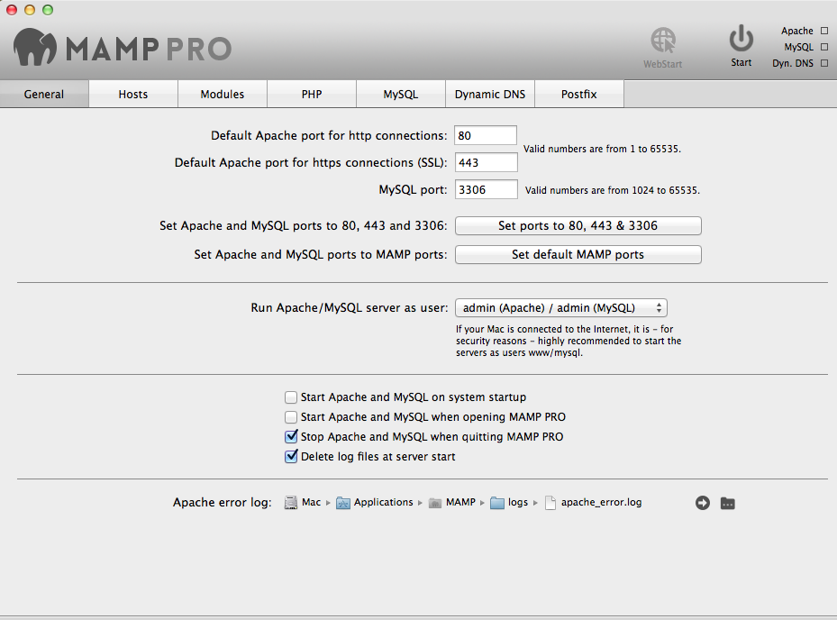

\* Thiết lập Hosts

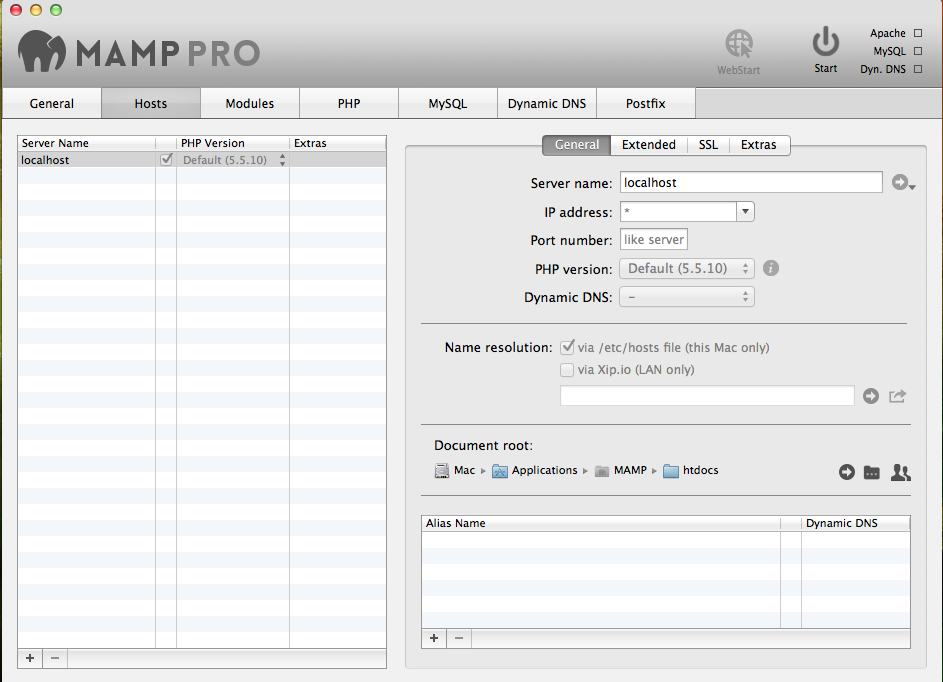

\* Thiết lập Modules

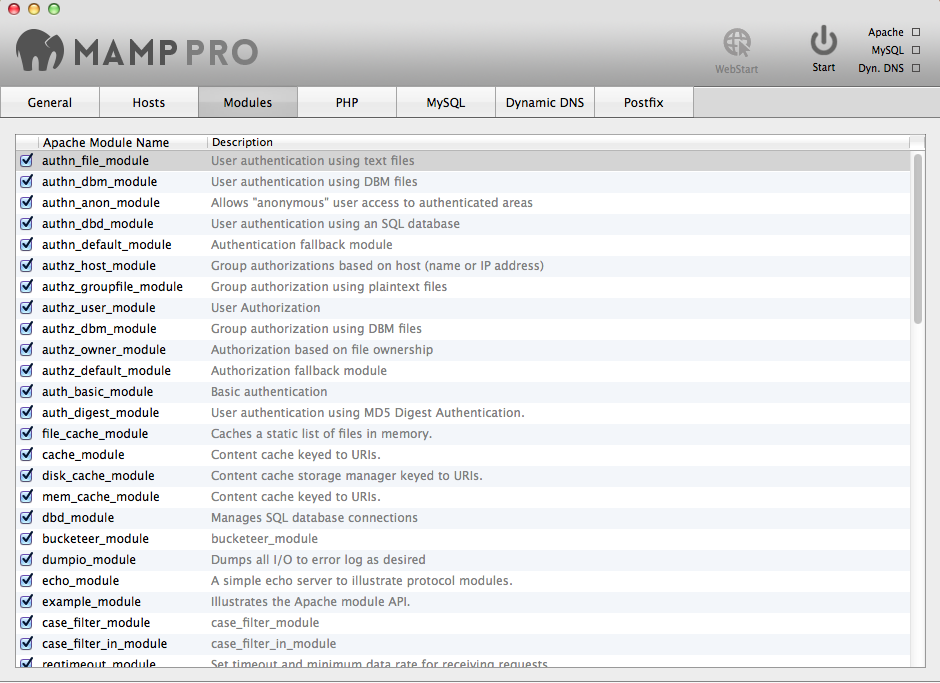

\* Thiết lập PHP

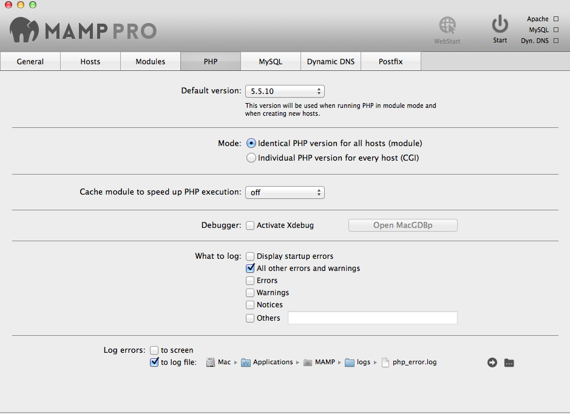

\* Thiết lập MySQL

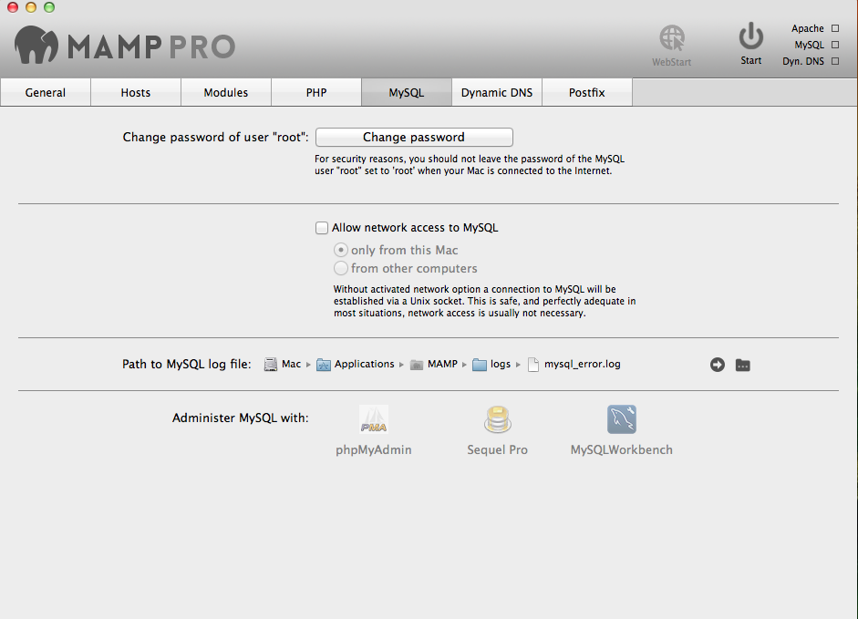

\* Thiết lập Dynamic DNS

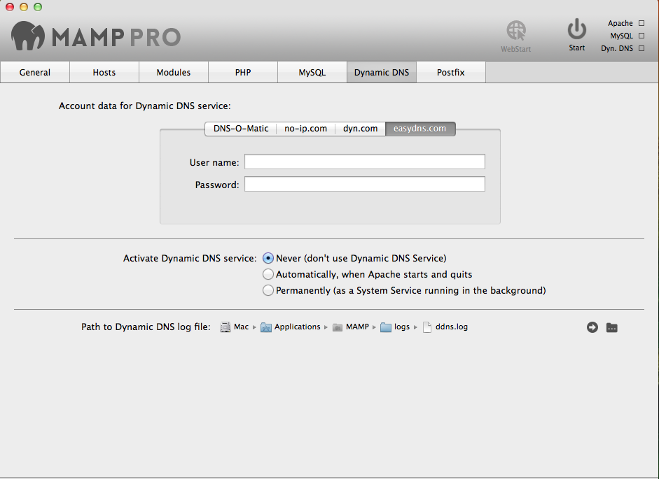

\* Thiết lập Postfix

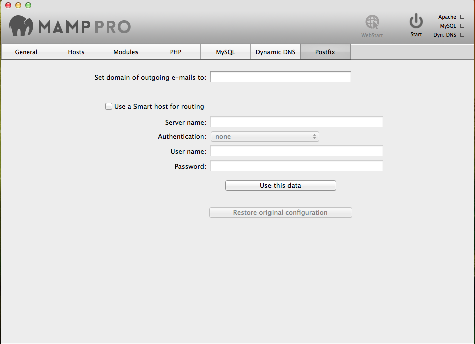

======MAMP Cài những gì lên hệ thống của bạn====== Sau khi cài xong MAMP máy tính của bạn sẽ có các chương trình sau:

- Apache Web Server

- PHP Script Language Version 5.5.10

- MySQL Database

- phpMyAdmin Database Manager

Thư mục htdos được nằm ở địa chỉ : **/Applications/MAMP/htdocs/**

Thư mục Data của mysql (MAMP) : **/Applications/MAMP/db/mysql/**

Thư mục Data của mysql (MAMP) : **/Library/Application Support/appsolute/MAMP PRO/db/mysql**

======Lưu ý====== \* Trên hệ thống Mac OS toàn bộ các tệp tin hệ thống như .htacess được ẩn đi. Vì vậy nếu trong quá trình copy bạn không copy được nó sẽ dẫn đền khống thể cài đặt được nukeviet. Để làm được điều này các bạn mở Terminal Chạy lệnh sau:

**defaults write com.apple.finder AppleShowAllFiles TRUE** Và

**killall Finder**

Để khôi phục về ẩn tệp tin

**defaults write com.apple.finder AppleShowAllFiles FALSE** Và

**killall Finder**

Tiếp theo bạn làm theo [Hướng dẫn cài NukeViet trên localhost](/nukeviet/setup/localhost) .Chúc các bạn thành công !
